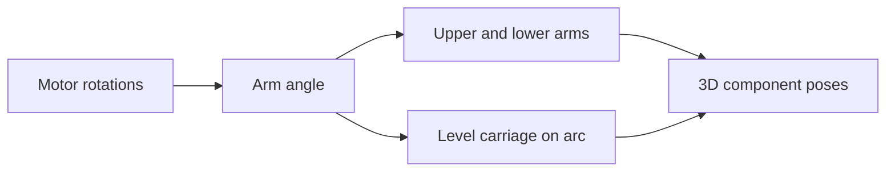

# Offseason bot CAD and deploy motion

The 2026-10-01 Onshape STEP exports replace the old placeholder geometry.
Source filenames and SHA-256 hashes are recorded in `cad-manifest.json`.
The original files remain in the supplied `offseason STEP` folder outside Git.
Swerve modules are fixed geometry in the base; their steering and wheels are not animated.

## Installed assets

| File | Geometry |
| --- | --- |
| `model.glb` | Fixed base, including chassis and static swerve modules |
| `model_0.glb` | Hood, green during SCORE/FEED |
| `model_1.glb` | Turret, green during SCORE/FEED |
| `model_2.glb` | Intake carriage and attached hardware, 52 instances |
| `model_3.glb` | Hood, yellow in other states |
| `model_4.glb` | Turret, blue in other states |
| `model_5.glb` | Upper deploy arms and attached washers, 6 instances |
| `model_6.glb` | Lower deploy arms and attached washers, 6 instances |

The seven indexed models match the pose array published at
`SuperstructureVisualization/Components`. The fixed base contains none of those
moving groups. Both hood/turret color variants share the same geometry; only one
variant of each is visible at a time when component poses are selected.

All assembled models are expressed in robot coordinates, in meters: X forward,
Y left, Z up. Onshape's assembly is rotated +90 degrees about Z. Its wheel contact
plane is already Z = 0, so `doglog.jsonc` doesn't need a `mount` transform.
Each part's `origin` is its pivot in the assembled CAD. Studio moves the part
so that the pivot follows the logged pose.

The turret axis is **4.750 inches back, 8.025 inches left**, and its CAD reference
height is 14.750 inches. The hood hinge is recovered from the two pivot bearings,
approximately 4.160 inches forward and 3.272 inches above that turret reference.
The hood export is treated as the existing retracted-angle reference of 11 degrees.

## Rotary deploy implementation

The two intake exports have identical instance topology. Their assembly placements
separate into a level carriage, upper links, and lower links. Both link groups
rotate **88.4 degrees** about robot +Y. The carriage follows a circular arc while
remaining level; its full endpoint displacement is approximately **13.454 inches
forward and 8.016 inches down**.

`DeployKinematics` models these groups together, preserving their attachment
points throughout the motion. `MechanismVisualizer` publishes all three poses.



The deploy controller now uses arm degrees above fully down (0°), with
CTRE feedback and requests in mechanism rotations using the documented **36.57:1**
motor-to-arm ratio. The fully inward reference starts at 88.4 degrees for bringup; the
outward reference is zero. Tune `DeployConfig.COLLAPSED_ANGLE_DEGREES` on the robot. `DeployKinematics` consumes the arm
angle directly and subtracts the arm angle from the CAD sweep to rotate the exported meshes.
Simulation bounds cover both homing endpoints.

Intermediate targets are explicit degree values for bringup. All deploy PID and
feedforward gains start at zero, including the differential and desync slots.
`STOW` remains an intermediate pose rather than the fully inward
CAD pose. Gravity compensation is configured as arm/cosine, with zero `kG` until
measured. See `docs/offseason_bot/subsystems.md` for coast/recovery behavior and
its hardware validation requirements.

## Regenerate

From the repository root, run:

```sh
uv run --package cad python tools/cad/import_offseason.py '/path/to/offseason STEP'
```

The source folder needs `offseason-base.step`, `offseason-turret.step`,
`offseason-hood.step`, `offseason-intake-in.step`, `offseason-intake-out.step`,
and `offseason-full-reference.step`. Keep all exports in the TLA coordinate
system. The script preserves CAD colors for the base/intake, makes the state
color variants, separates the intake by endpoint motion, and records its derived
geometry. STEP conversion uses OCCT with 0.5 mm linear and 0.35 radian angular
tessellation deflection. Repeated geometry stays instanced in the final GLBs.

If regenerated CAD changes the pivots or linkage geometry, update the Java
constants to match the manifest and rerun the tests; regeneration does not
automatically change robot code. The importer updates only the Offseason Bot
entry in the root `doglog.jsonc`. Keep that file valid JSON (no comments or
trailing commas) so the importer can read it.

## View and verify

In DogLog Studio, open **Widget options** in a **Robot** widget. In the
**Robot** dropdown (default: **Swerve drivebase**), choose **Add project…** and
select the repository root. This registers all three robots from `doglog.jsonc`.
Choose **581 Offseason Bot**, then add `SuperstructureVisualization/Components`
to the widget to animate the parts.
Color variants overlap without component poses because they use the same
assembled position.

Validation covers the two exported endpoints, linkage attachment points at
intermediate positions, travel clamping, hood motion, component colors, and turret
placement. The final intake assets' outward transforms were also checked against
all 64 STEP-exported instance placements, with maximum matrix error below 1e-9.

Reference: [DogLog Studio robot config schema](https://doglog.studio/doglog.schema.json).
