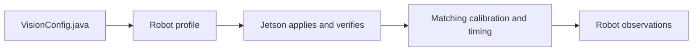

# Configure cameras in Java

## Quick hardware reference

- **SWYFT USB AprilTag Camera:** 1280 × 800 = **1,024,000 pixels (1.024 MP)**; monochrome global shutter; USB 2.0; **MJPEG only**. Advertised MJPEG maxima: 210 FPS at 160×120, 320×240, 352×288, 640×400; 120 FPS at 640×480, 800×600, 1024×768, 1280×720, 1280×800. See the [SWYFT specifications](https://shop.swyftrobotics.com/products/swyft-usb-camera).
- **Arducam UC-844 Rev.B / B0332:** OV9281 monochrome global shutter; 1280 × 800 = **1,024,000 pixels (1.024 MP)**; 3 µm sensor pixels; USB 2.0. Its [manufacturer datasheet](https://uctronics.com/download/Amazon/B0332_OV9281_Global_Shutter_UVC_Camera_Datasheet.pdf) lists MJPEG at 100 FPS for 1280×800, 800×600, 640×480, 320×240; YUY2 at 10 FPS for 1280×800 and 1280×720. Older documentation lists different MJPEG rates: inspect your firmware's actual descriptors.
- **Recorded team results:** the camera called Swift/Generic USB Camera in older notes used MJPEG 640×480 at requested 120 FPS; higher advertised resolutions timed out. Attached Arducams were recorded as UC762, with MJPEG 1280×720 at requested 120 FPS. Those identities/rates are historical records, not proof of UC-844 Rev.B capabilities. Confirm the board label and enumerated device before copying settings.

Advertised/requested FPS is not measured delivered FPS or detection FPS. Test all cameras simultaneously on their actual USB topology. YUYV is uncompressed USB traffic; MJPEG is compressed USB traffic. Spot can convert decoded MJPEG into YUYV in Jetson memory without sending YUYV over USB. A monochrome sensor can still expose color controls that have little or no image effect.

This reference was checked on October 18, 2026. The Jetson was unreachable during this documentation update, so current per-device firmware ranges and menu subsets have not been re-enumerated. Product specifications, historical observations, and generic control meanings below are deliberately distinguished.

## Define a camera in VisionConfig.java

Edit `offseason-bot/src/main/java/frc/robot/vision/VisionConfig.java` in offseason-2026, or `src/main/java/frc/robot/vision/VisionConfig.java` in basic-robot-tester. Settings compile with robot code and are sent to Spot automatically. USB-to-name bindings and intrinsic calibration remain on the Jetson.

The example below is a template: replace the mount and verify the capture request and control names against the real device. Exposure and gain values are starting examples, not a calibrated preset. Import `SpotCameraConfig.Control` and `java.util.List` when using the short names below.

```java
public static final SpotCameraConfig FRONT = new SpotCameraConfig(
    "front",
    true, // required for all-required-cameras health
    mount(.10, 0, .30, 0, 0, 0), // x/y/z metres; roll/pitch/yaw degrees
    0, // image rotation: 0 or 180 degrees
    new CaptureSettings(640, 480, 30, PixelFormat.MJPEG),
    List.of(
        Control.pinned("auto_exposure", 1),
        Control.pinned("exposure_time_absolute", 5000), // 5000 µs = 5 ms
        Control.tunable("gain", 20)));

public static final List<SpotCameraConfig> CAMERAS = List.of(FRONT);
```

Use the exact exposure-mode name your camera reports: `auto_exposure` and `exposure_auto` are alternative spellings, not two controls to add indiscriminately. Verify that menu value `1` is Manual Mode. Keep the actual robot's roles `left`, `right`, `front`, `back` chassis-fixed and required, in that order. Add each named constant to `CAMERAS`; a constant alone does not register a camera. Defaults remain empty until measurements are available.



## Every SpotCameraConfig option

- **`name` — String:** logical role, for example `front`. Must be unique in the profile and match `[A-Za-z0-9][A-Za-z0-9_.-]{0,63}`. Bind the physical USB device to this name in Spot. Changing the string is not a USB-device selector.
- **`required` — boolean:** `true` makes a missing/unusable camera fail the all-required-cameras health check. Other valid cameras can continue contributing; this does not turn a partial outage into a global fusion switch. `false` marks an optional camera. The actual offseason commissioning configuration calls for all four required.
- **`robotToCamera` — Transform3d:** measured camera origin/orientation in the robot frame. All six values must be finite. `mount(xM, yM, zM, rollDeg, pitchDeg, yawDeg)` converts degrees to WPILib radians. +X is forward, +Y left, +Z up. Positive rotations follow the right-hand rule; rotations compose as yaw × pitch × roll. There are no moving-mount/joint-history settings in this fixed-camera helper.
- **`imageRotationDeg` — int:** exactly `0` or `180`. Rotates the delivered image; it is separate from the physical mount rotation. Changing it requires matching calibration and changes image orientation for detection and previews.
- **`capture` — CaptureSettings:** exactly one explicit camera capture request; cannot be null. See the next section. Students do not enter a protocol mode ID, mode list, or optical-signature string.
- **`controls` — List of Control:** zero to 64 policies; `List.of()` declares no control policies. Names must be unique. Omitted controls are not pinned to a robot-code value, so a device's existing/default behavior may remain active. Explicitly declare automatic/manual settings when you need repeatable behavior.

## Every CaptureSettings option

The constructor is `new CaptureSettings(width, height, fps, pixelFormat)`.

- **`width` — int pixels:** greater than zero, at most 4096, and even. The actual camera must advertise that width together with the selected height/format/FPS.
- **`height` — int pixels:** greater than zero and at most 4096; must be part of an advertised combination.
- **`fps` — int frames/second:** 1–240. This is requested acquisition cadence, not detector throughput. Do not assume that every lower integer FPS is supported: a device advertising 120 FPS may reject a 30 FPS request at the same resolution.
- **`PixelFormat.MJPEG`:** compressed camera-to-Jetson USB stream. Use for the SWYFT camera and verified compressed Arducam configurations. The service normalizes the UVC spelling to MJPG internally.
- **`PixelFormat.YUYV`:** uncompressed, two bytes/pixel over USB; also called YUY2 by some camera documentation. Requires a supported mode and enough shared USB bandwidth. It is not a way to obtain SWYFT raw output, and it is not selected merely because the detector uses YUYV internally.

Those are the two enum values currently supported by the Java helper. RGB, GRAY8 and H.264 are not options in this helper. Dimension/FPS validation expresses software bounds, not a claim that a camera can deliver every combination. Pixel count is width × height: 640×480 is 307,200 pixels; 1280×720 is 921,600; 1280×800 is 1,024,000.

The implementation generates stable mode IDs and signatures from capture settings. Changing any capture field changes that identity. Saved mode selections from the previous hand-named mode API may need updating, and calibration/timing evidence must match the resulting mode. Changing physical optics/focus still requires recalibration even when capture values stay the same.

## Every Control policy option

The full constructor is `new Control(name, value, required, allowOverride)`.

- **`name` — String:** exact V4L2 control name reported by the device; same bounded identifier syntax as camera names. Labels such as Exposure or Auto exposure are not necessarily the driver key. No `CAP_PROP_` prefix is used.
- **`value` — double:** robot-code default. Must be finite. Exposure-time values use **microseconds**; other controls use driver units/menu indices. A Java double does not permit fractional hardware steps: Spot converts units and rejects values outside the driver range, step or menu.
- **`required` — boolean:** `true` blocks that camera's ready configuration when the control is absent. `false` allows an absent control to be skipped. Optional does not mean an invalid value is accepted when the control exists.
- **`allowOverride` — boolean:** `false` enforces the robot default; `true` allows a saved Spot GUI override while edits are eligible. A saved override can remain effective across restart; changing a Java default does not necessarily replace it. Use Reset to code defaults when you want that default restored.
- **`Control.pinned(name, value)`:** shorthand for `required=true, allowOverride=false`.
- **`Control.tunable(name, value)`:** shorthand for `required=true, allowOverride=true`.

For an optional tunable control use, for example, `new Control("sharpness", 0, false, true)`. This is useful only if zero is in the actual device's advertised range. Configuration changes/tuning require the current disabled robot or explicitly authorized disconnected standalone setup. Writes are checked by readback; unsupported, clipped or rejected settings do not count as applied.

## Exposure and automatic-control values

The standard V4L2 exposure-mode menu has the meanings below. A camera may expose only some entries; select only values printed by its own menu. See the [Linux camera-control reference](https://docs.kernel.org/userspace-api/media/v4l/ext-ctrls-camera.html).

- **`auto_exposure` or `exposure_auto`:** `0` = automatic exposure and iris; `1` = manual exposure and iris; `2` = manual exposure with automatic iris; `3` = automatic exposure with manual iris. Fixed-lens USB cameras commonly expose only `1` (manual) and `3` (automatic). Do not use OpenCV's unrelated fractional auto-exposure values such as 0.25/0.75 here.
- **`exposure_time_absolute` or `exposure_absolute`:** integration duration. In Java/Spot use µs: `1000` = 1 ms; `5000` = 5 ms. Raw V4L2 uses 100 µs ticks, so those become native `10` and `50`. Set manual exposure mode first; Spot orders automatic-control writes ahead of dependent manual writes.
- **`autogain`:** `0` = manual gain; `1` = automatic gain. If supported, disable it before pinning `gain`.
- **`white_balance_automatic` or `white_balance_temperature_auto`:** `0` = manual white balance; `1` = automatic. Disable it before writing a temperature. A monochrome camera may advertise these controls without useful color effects.
- **`power_line_frequency`:** `0` = disabled; `1` = 50 Hz; `2` = 60 Hz; `3` = automatic. Only advertised entries are legal. This is an anti-flicker lighting setting, not capture FPS. See the [Linux user-control reference](https://docs.kernel.org/userspace-api/media/v4l/control.html).

Exposure must fit the capture interval and the device's own range/step. At 100 µs steps the interval limits are 33,300 µs at 30 FPS, 16,600 µs at 60 FPS, and 8,300 µs at 120 FPS. Shorter exposure generally reduces motion blur and collects less light; longer exposure collects more light but can smear tags. Historical team readings found a 5,000 µs minimum for the SWYFT/Generic camera and used 1,000 µs on the attached Arducams. These are firmware observations, not universal minimums for every camera sold under those names.

## Every image control Spot labels explicitly

The following list covers every name/alias in Spot's current image-control descriptions. It explains meaning; it does not claim every control exists on either camera. For each integer, use the actual `min`, `max`, `step` and menu, not an assumed 0–100 scale. Standard semantics are described by the [Linux user-control reference](https://docs.kernel.org/userspace-api/media/v4l/control.html); units and availability come from the device.

- **`auto_exposure`, `exposure_auto`:** exposure mode menu; values above.
- **`exposure_time_absolute`, `exposure_absolute`:** exposure duration in µs in robot code; values above.
- **`autogain`:** automatic/manual gain switch; values above.
- **`gain`:** image amplification. Higher generally brightens the image and increases noise. It is not exposure duration and has no universal dB conversion or range.
- **`brightness`:** black-level/luminance offset. Raising it can lift dark pixels without collecting more light. Zero is not necessarily the default or midpoint.
- **`black_level`:** a separately named black-level control on devices exposing it. It is not an interchangeable spelling to invent when only brightness is advertised.
- **`contrast`:** separation of bright and dark intensities. Excess can clip tag edges/highlights; device scale is arbitrary.
- **`gamma`:** midtone response. The number may use a firmware-specific scale; do not assume the value 1 means linear gamma.
- **`sharpness`:** edge enhancement. The advertised minimum disables the standard sharpness filter; larger values strengthen it and can create halos. Use the actual minimum rather than assuming zero is allowed.
- **`backlight_compensation`:** processing to brighten subjects against a bright background. The standard minimum disables it; larger values increase the device's compensation. Not a substitute for exposure tuning.
- **`power_line_frequency`:** anti-flicker menu; values above.
- **`white_balance_automatic`, `white_balance_temperature_auto`:** automatic/manual white balance switch; values above.
- **`white_balance_temperature`:** manual color temperature in kelvin, within device limits. Lower values represent warmer illumination; higher values represent cooler illumination. Automatic white balance must be off. May have no meaningful effect on a monochrome image.
- **`saturation`:** color intensity. The standard zero setting removes chroma when zero is available; higher values increase color strength. Usually unhelpful for a monochrome AprilTag camera.
- **`hue`:** color-balance adjustment on the advertised scale. It does not rotate the image or change camera heading; usually unhelpful on monochrome sensors.

## Other controls, limits and unsupported options

The Java policy accepts other valid control names, and beta discovery reads advertised scalar `int`, `bool`, `menu`, and `intmenu` controls. There is no fixed universal list across all UVC cameras. A boolean normally uses 0/1; a menu uses the exact listed integer, which can have gaps. Device flags such as inactive, read-only, disabled and grabbed can prevent changes. Button, string, array and write-only action controls are not supported by this policy path.

Examples you might see on other devices include `exposure_dynamic_framerate`/`exposure_auto_priority` (0 keeps auto exposure from varying FPS; 1 permits it), `focus_automatic_continuous`/`focus_auto` (0 manual, 1 autofocus), `focus_absolute` (driver-specific position), `zoom_absolute` (driver-specific zoom), and pan/tilt/iris controls. Treat those spellings as examples: use your device's actual enumeration. Do not infer unsupported motorized focus, zoom or iris from the presence of an M12 lens. SWYFT's manufacturer lists focus/zoom/pan/tilt/iris as unsupported. Focus/zoom/crop/flip changes can invalidate calibration; change them only with a matching optical configuration and fresh validation.

`convert_rgb`/`CAP_PROP_CONVERT_RGB` is a host OpenCV property, not a portable UVC camera policy. It is not an extra `PixelFormat` or a control to add unless the device actually advertises an applicable scalar control. Detector backend, decimation, camera preview encoding and detector FPS are also not `Control` entries.

## Get the exact options for your physical camera

The complete current per-device list is in the camera's Spot Config/Advanced panel: names, labels, menus, units, min/max/step, requested values, actual readback and policy locks. Exposure values there are already in µs. Use the discovered list to decide what is supported; manufacturer lists and this reference explain it but cannot supply universal firmware ranges.

For raw capability inspection on the Jetson, these commands only read descriptors/controls and do not start another capture stream. Select the image-capture node, not a metadata node. `/dev/video0` is an example for inspection only; save physical bindings using stable identity/USB paths.

```sh
v4l2-ctl --list-devices
v4l2-ctl --device=/dev/video0 --list-formats-ext
v4l2-ctl --device=/dev/video0 --list-ctrls-menus
```

A hypothetical line `min=50 max=10000 step=1 default=166 value=50` for `exposure_time_absolute` means native ticks: 5,000–1,000,000 µs, 100 µs increments, 16,600 µs device default, 5,000 µs current. The capture interval can impose a lower usable maximum. For non-exposure integer controls use the listed units directly. Legal values satisfy min ≤ value ≤ max and `(value - min) % step == 0`; menu values must also appear in the menu. Raw `default` is the device default, not necessarily the robot-code default or saved GUI override.

## Profile settings and commissioning

- **`ROBOT_ID`:** bounded identifier for the robot profile; offseason uses `offseason-2026`, the tester uses `basic-robot-tester`. Keep bench and robot identities distinct.
- **`CAMERAS`:** registered camera constants; at most 32 is the protocol/software bound, not a Jetson capacity claim. An empty list intentionally gives no camera-based localization.
- **`CAMERA_NAMES`:** offseason's planned role names/order (`left`, `right`, `front`, `back`); this list does not register cameras by itself.
- **`FIELD_LAYOUT`:** WPILib AprilTag layout, defaulting to the team's 2026 welded layout. For home prints, supply surveyed tag poses in a consistent blue-wall-right field frame instead of assuming the official positions. A layout asset may be JSON; camera settings remain Java.
- **`TAG_SIZE_M`:** finite, greater than zero and at most one metre; default 0.1651 m. Measure the printed tag's black square, excluding surrounding white margin.
- **`FUSION_ENABLED`:** defaults false. True allows eligible measurements to reach the estimator, still subject to validation and DS suppression. In the tester this is only its stationary bench estimator. Production robot fusion requires qualification; heading fusion remains disabled by the current builder.
- **Bench-only `BenchConfig.STATIONARY_POSE`:** initial/reset pose for a stationary test rig. The actual robot instead supplies drivetrain pose/IMU history.

Bind devices, confirm actual capture/readback, calibrate with independent validation, and qualify measured timing before enabling robot fusion. Mode/orientation/optical-control changes can invalidate calibration; timing also depends on control readback. Rebuild/redeploy robot code after configuration edits. The docs and examples do not commission or deploy any camera.

## Offline camera preview

See the [Spot VS Code preview guide](https://github.com/team581/spot-2026/blob/main/docs/operator/13-vscode-camera-preview.md). Normal `:offseason-bot:build` installs or updates the private extension after the approved release is pinned. Open VisionConfig.java for a split preview; saved changes refresh geometry.
