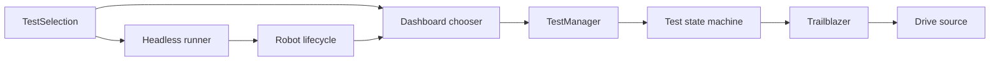

# Integration testing

Integration tests check how robot code works together. The offseason bot currently supports
headless simulation checks and a straight-line diagnostic in full simulation or on the robot.
Comp and new member bots do not currently include this testing setup.

Use Java 21 and run commands from the repository's root folder.
On Windows, use `gradlew.bat` instead of `./gradlew`.

## Headless sim

Run the regular robot application without a simulator window or physical robot. The headless
runner uses the normal robot lifecycle, scheduler, controller bindings, and subsystem simulations
to run the same registered tests used with the `TestMode` DS option. Test manager behavior and controlled
straight-line failure checks also run with the normal unit tests.

```sh
./gradlew headlessTest
```

To run only the straight-line tests:

```sh
./gradlew :offseason-bot:straightLineTest
```

Straight-line distances, constraints, and tolerances are constants at the top of
`StraightLineTest.java`. The robot and headless simulation use those same values.
To change the simulation environment:

```sh
./gradlew :offseason-bot:straightLineTest -Psim.batteryVoltage=10 -Psim.startHeading=90
```

After `headlessTest`, open these files:

- `offseason-bot/build/reports/tests/headlessTest/index.html` — test results and failure details.
- `offseason-bot/build/reports/headlessTest/logs/FRC_*.wpilog` — the normal robot log, including
  test configuration, motion samples, and results recorded by DogLog in the test itself.
  Open it in AdvantageScope or generate a summary and plots:

```sh
uv run tools/analyze_straight_line.py offseason-bot/build/reports/headlessTest/logs
```

The optional analysis script writes `acceleration-summary.md`, `acceleration-metrics.json`, and a PNG per
straight-line test run beside each log. It accepts a normal robot WPILOG or a directory of logs.
`Tests/StraightLine/RunId` separates repeated tests within the same log. All test telemetry uses
regular `DogLog.log` calls under `Tests/`; there is no separate test log writer.

For `straightLineTest`, replace `headlessTest` with `straightLineTest` in those paths.
The HTML report is overwritten on each run; robot logs use the normal timestamped filenames.

CI runs the suite on every push in the **Headless tests** job. Download its **headless-results**
artifact for reports and logs. Normal `test`, `build`, and deployment commands do not run this suite.

## Full sim

Start the offseason robot application with the simulator window:

```sh
./gradlew :offseason-bot:simulateJava
```

To run the straight-line diagnostic:

1. While disabled, select `STRAIGHT_LINE` in the connected dashboard's `Tests/SelectedTest` chooser.
2. Enable **Teleop** in the simulator, then set `/DSOptions/TestMode` to `true`.
   The option defaults to `false`; the selected test starts when enabled teleop and `TestMode` are both active.
3. Watch `Tests/Regression/Status` and `Tests/Reason` in the dashboard or logs for the result.
   Disable to select another test or run the same test again. Disabling or turning off `TestMode` during a run aborts it.

Like `AutoChooser`, the test chooser uses WPILib’s `SendableChooser`, published through
`SmartDashboard.putData`. Auto selection is at `Autos/SelectedAuto`; test selection is at
`Tests/SelectedTest`. Selection is read while disabled, matching `Autos.getNextState()`. Each activation creates a fresh test. Toggle `TestMode` off and on to rerun while enabled.
Completed results remain visible until the next run. Selecting `NONE` leaves normal teleop operation active.
Tests command the shared Trailblazer; Swerve uses its normal field-centric drive source.
Normal controller bindings remain active.
The interactive diagnostic reports through dashboard/log values rather than the headless HTML report.

## On robot

Deploy the offseason application to the intended robot:

```sh
./gradlew :offseason-bot:deploy
```

1. With the robot disabled, allow room for the test’s driving distance and keep the path clear.
2. In the connected dashboard, select `STRAIGHT_LINE` as described under **Full sim**.
3. Enable **Teleop** in Driver Station, then set `/DSOptions/TestMode` to `true`.
   Watch the robot and disable or turn off `TestMode` to abort if needed.
4. Read `Tests/Regression/Status` and `Tests/Reason`, save the robot log, and measure the final
   position independently. Disable before another attempt; select `NONE` when finished.

The diagnostic writes to the normal robot WPILOG through DogLog, including its configuration,
motion samples, and result. The same analysis command accepts a downloaded robot log:

```sh
uv run tools/analyze_straight_line.py /path/to/FRC_robot_log.wpilog
```

A passing straight-line diagnostic checks reaching the goal and settling. It does not verify
acceleration limits or replace checking the robot's physical motion.

## Check test results

- **CI:** Open the branch's latest **CI** run in GitHub Actions. Check **Run tests** for unit tests
  and **Headless tests** for simulation tests. Open a failed job to read its test failures.
  Under **Artifacts**, download and unzip **headless-results**, then open
  `index.html` under `reports/tests/headlessTest/` for the test report.
- **Local headless tests:** Check the terminal for failed test names, then open
  `offseason-bot/build/reports/tests/headlessTest/index.html` in a browser for details.
  Run the analysis command above and read
  `offseason-bot/build/reports/headlessTest/logs/acceleration-summary.md` for measurements.
  For `straightLineTest`, replace `headlessTest` with `straightLineTest` in these paths.
- **Local unit tests:** After `./gradlew test`, open `<project>/build/reports/tests/test/index.html`
  for each project you want to check.
- **Full sim or on robot:** Check `Tests/Regression/Status` for `PASSED`, `FAILED`, or `ABORTED`,
  and `Tests/Reason` for an explanation. These values are in the dashboard and robot logs;
  interactive runs do not produce the headless HTML report.

## Add a robot test

Implement a state machine extending `RobotTest` in the `frc.robot.testing` package. Like the existing
autos, its public constructor takes `RobotManager` and `Trailblazer`. The test owns its mechanism
requests, sensor reads, DogLog telemetry, outcome checks, and abort cleanup. Return a `TestResult`
with `RUNNING`, `PASSED`, `FAILED`, or `ABORTED` and a reason. Checks belong in the test so the
robot and headless simulation evaluate the same outcome; the optional analysis script only reports
measurements and plots.

Add the test's selection and construction case in `TestSelection`. That enum is the only registration list: the dashboard
chooser and parameterized headless runner both enumerate it. No separate simulation test is needed.
The runner constructs `Robot`, selects through the dashboard chooser, enables teleop and `TestMode`, and
checks the result returned by the test. Swerve uses its existing simulation thread and normal
drive requests. Add any new subsystem simulation support to the regular robot simulation so
interactive and headless runs share it.



The normal `test` task runs `TestManagerTest` for lifecycle behavior and `StraightLineTestTest`
for controlled sensor and outcome checks. `headlessTest` uses the same test source set,
selecting the parameterized runner with a JUnit tag. `straightLineTest` filters that runner to
`STRAIGHT_LINE`.
