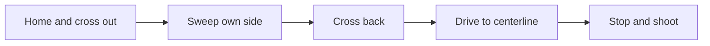
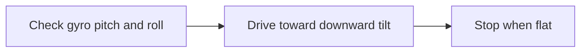

# Autos

## Wait-behind-hub bump autos

- `LEFT_BUMP_CROSS_WAIT` and `RIGHT_BUMP_CROSS_WAIT` retain their original routes: cross outward,
  drive behind the hub, wait one second for teammates, sweep across the neutral zone,
  return over the same bump, and stop at their existing tower-side shooting positions.

## No-depot bump sweep autos

- Select `LEFT_BUMP_NO_DEPOT` or `RIGHT_BUMP_NO_DEPOT`. Neither route visits the depot.
- Start intake facing the neutral zone, front bumper touching the starting line and side bumper
  aligned with the adjacent hub corner. Placement uses the 35-inch bumper envelope and 47-inch hub.
- Home deploy and hood, cross outward, then immediately sweep from the lane toward the centerline.
  The entire bumper envelope stays on its own side during collection. The right route mirrors the left.
- Return over the same bump, aiming and spinning up with the live shooting solution while keeping
  the hopper idle. Once the bump tracker reports flat, drive to red `(14.8, field width / 2)` meters
  at `0°`, centered between the hub and climb tower and just forward of the tower preset.
  Alliance mirroring handles blue.
- Approach at up to `2.0 m/s` and `3.0 m/s²`. Once within `0.08 m` and `3°` and below
  `0.1 m/s` and `0.1 rad/s`, stop and shoot until autonomous ends. There is no depot pickup
  or timed departure from the shot. Validate the tuned approach and shot on the robot.

## 2 cycle auto

- Sweeps the neutral zone twice
- Starts under the trench with the intake facing out, directly forward
- The four-link deploy latches onto the trench
- Ideally, the scoring section includes a simple shoot-on-the-move (SOTM) segment

## Unbeaching

- Check the tilt of the gyro - the side of the robot that is beached will be tilting upward
  - Tilt is a combination of pitch and roll
- Drive in the direction that is tilting down until we are flat again

## Bump-auto simulation regression

Run the complete robot lifecycle with `./gradlew :offseason-bot:headlessTest --tests '*BumpAutoSimulationTest'`.
The default is `LEFT_BUMP_NO_DEPOT`. Use `-Psim.auto=RIGHT_BUMP_NO_DEPOT` to select the right lane and `-Psim.red=true` for red alliance.
Use `-Psim.auto=LEFT_BUMP_CROSS_WAIT` or `RIGHT_BUMP_CROSS_WAIT` to check the preserved waiting routes.
The sweep test checks lane clearance, uphill and downhill detection on both crossings, no depot states,
and travel to the centerline followed by standstill shooting. Simulated pitch/roll come from bump
geometry and robot heading rather than timed pulses. This models sensor tilt, not chassis traction
or suspension.
