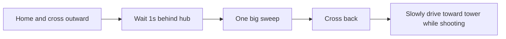
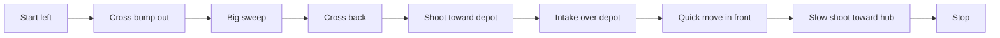
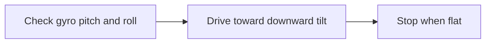

# Autos

## Bump-start normal autos

- Select `LEFT_BUMP_CROSS` or `RIGHT_BUMP_CROSS`.
- Start intake facing the neutral zone, front bumper touching the starting line and side bumper
  aligned with the adjacent hub corner. Placement uses the repository’s 35-inch bumper envelope
  and 47-inch hub width, mirrored automatically for blue. The first segment aligns with the bump
  before arming crossing detection.
- Preserve normal-auto deploy and hood homing, intake, and power management for a single neutral-zone
  sweep and scoring cycle.
- After crossing the bump outward, drive around to the opposite (neutral-zone) side of the hub
  (`x = 10.7 m`, tucked close to the hub and slightly across the field centerline) and wait 1.0 second
  so two alliance robots running the trench autos can clear the neutral zone and bumps.
- Start the sweep across the field centerline (`y = RED_HUB_CENTER.getY()`) to get a larger single
  sweep across the neutral zone and return over the same bump.
- Cross outward first using the opposite tracking direction from the return crossing.
  The outbound landing reference is red x = 10.6 m. The return crossing retains its existing tracking.
- During the shooting segment, slowly drive toward the climb tower (`0.4 m/s`, turning within
  turret travel limits with five degrees of clearance) to clear space in front of the bump.

## Left bump and depot auto

- Select `LEFT_BUMP_DEPOT`. This is a separate left-side route; the existing bump autos remain
  available. Alliance mirroring handles blue, without creating a right-side version.
- Use the same hub-corner starting placement and outbound bump crossing as `LEFT_BUMP_CROSS`.
  Immediately begin its neutral-zone sweep near the left wall, then arc toward the field centerline
  without crossing it (including the bumper envelope), without driving behind the hub or waiting.
- Aim and spin up with the live shooting solution during the return crossing, keeping the hopper idle.
  Request scoring as soon as the bump tracker reports flat at red x = 13.25 m, without waiting to
  reach x = 13.9 m. Shoot while approaching the depot at red `(15.2, 3.0)` meters.
  Spread the drive and turn over roughly five seconds: `0.4 m/s`, `0.4 m/s²`,
  `0.3 rad/s` (about 17°/s), and `0.4 rad/s²`, with a five-second minimum before proceeding.
- Stop shooting and intake across the depot via `(15.827, 3.0)` to `(15.977, 1.0)`, holding a
  red heading of `-75°`. Both pickup waypoints are shifted five inches toward the driver station.
  Limit pickup speed to `1.0 m/s`.
- After pickup, keep the hopper idle and drive quickly to red `(15.15, 1.3)` in front of the
  depot (`2.0 m/s`, `3.0 m/s²`). Aim and warm up during this move, and only resume shooting after
  reaching the front waypoint.
- Resume shooting while slowly returning toward the hub to `(14.9, 1.8)`, at `0.2 m/s` and
  `0.3 m/s²`, with a minimum three-second shooting phase. Stop driving and shooting there.
- Coordinates are route tuning points; validate depot pickup and wall clearance on the robot.
  The [official field layout](https://firstfrc.blob.core.windows.net/frc2026/Manual/2026GameManual.pdf)
  places the depot against the alliance wall (Figures 5-2 and 5-11).

Run `./gradlew :offseason-bot:headlessTest --tests '*BumpAutoSimulationTest' -Psim.auto=LEFT_BUMP_DEPOT`.
Add `-Psim.red=true` for red alliance. The depot checks cover state order, shooting durations,
left-side bumper clearance at the field centerline, actual scoring near the bump landing,
intake-only depot traversal, crossing angle, final position, and holding at the end.

## 2 cycle auto

- Sweeps the neutral zone twice
- Starts under the trench with the intake facing out, directly forward
- The four-link deploy latches onto the trench
- Ideally, the scoring section includes a simple shoot-on-the-move (SOTM) segment

## Unbeaching

- Check the tilt of the gyro - the side of the robot that is beached will be tilting upward
  - Tilt is a combination of pitch and roll
- Drive in the direction that is tilting down until we are flat again

## Bump-auto simulation regression

Run the complete robot lifecycle with `./gradlew :offseason-bot:headlessTest --tests '*BumpAutoSimulationTest'`.
Use `-Psim.auto=RIGHT_BUMP_CROSS` to select the right lane and `-Psim.red=true` for red alliance.
The test checks waiting behind the hub, uphill and downhill detection on both crossings, and slow
translation toward the tower while shooting. Simulated pitch/roll come from bump geometry and
robot heading rather than timed pulses. This models sensor tilt, not chassis traction or suspension.
