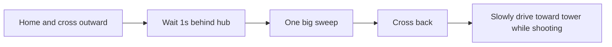
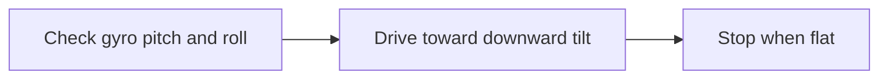

# Autos

## Bump-start normal autos

- Select `LEFT_BUMP_CROSS` or `RIGHT_BUMP_CROSS`.
- Start intake facing the neutral zone, front bumper touching the starting line and side bumper
  aligned with the adjacent hub corner. Placement uses the repository’s 35-inch bumper envelope
  and 47-inch hub width, mirrored automatically for blue. The first segment aligns with the bump
  before arming crossing detection.
- Preserve normal-auto deploy and hood homing, intake, and power management for a single neutral-zone
  sweep and scoring cycle.
- After crossing the bump outward, drive around to the opposite (neutral-zone) side of the hub
  (`x = 10.7 m`, tucked close to the hub and slightly across the field centerline) and wait 1.0 second
  so two alliance robots running the trench autos can clear the neutral zone and bumps.
- Start the sweep across the field centerline (`y = RED_HUB_CENTER.getY()`) to get a larger single
  sweep across the neutral zone and return over the same bump.
- Cross outward first using the opposite tracking direction from the return crossing.
  The outbound landing reference is red x = 10.6 m. The return crossing retains its existing tracking.
- During the shooting segment, slowly drive toward the climb tower (`0.4 m/s`, turning within
  turret travel limits with five degrees of clearance) to clear space in front of the bump.

## 2 cycle auto

- Sweeps the neutral zone twice
- Starts under the trench with the intake facing out, directly forward
- The four-link deploy latches onto the trench
- Ideally, the scoring section includes a simple shoot-on-the-move (SOTM) segment

## Unbeaching

- Check the tilt of the gyro - the side of the robot that is beached will be tilting upward
  - Tilt is a combination of pitch and roll
- Drive in the direction that is tilting down until we are flat again

## Bump-auto simulation regression

Run the complete robot lifecycle with `./gradlew :offseason-bot:headlessTest --tests '*BumpAutoSimulationTest'`.
Use `-Psim.auto=RIGHT_BUMP_CROSS` to select the right lane and `-Psim.red=true` for red alliance.
The test checks waiting behind the hub, uphill and downhill detection on both crossings, and slow
translation toward the tower while shooting. Simulated pitch/roll come from bump geometry and
robot heading rather than timed pulses. This models sensor tilt, not chassis traction or suspension.
