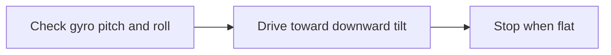

# Autos

## Unbeaching

- Check the tilt of the gyro - the side of the robot that is beached will be tilting upward
  - Tilt is a combination of pitch and roll
- Drive in the direction that is tilting down until we are flat again

