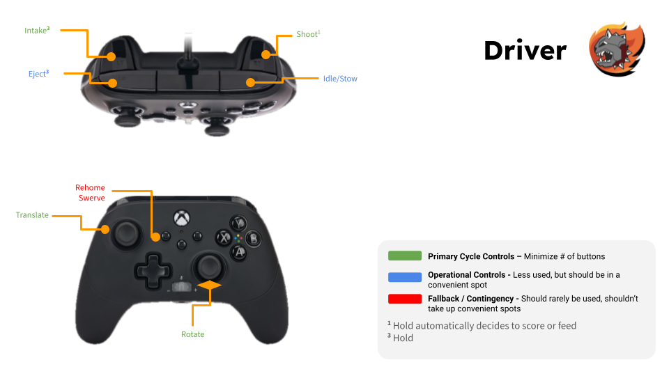
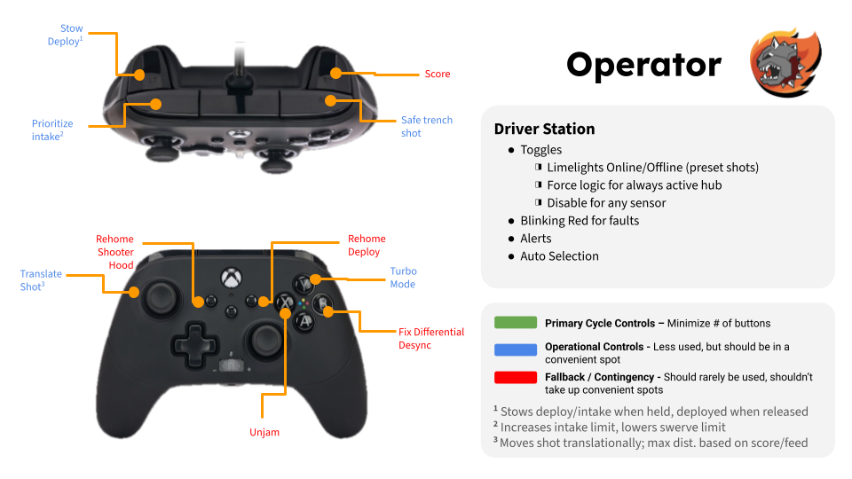

# Controls

## Control priorities

- **Primary cycle controls:** Minimize number of buttons.
- **Operational controls:** Less used, but should be in a convenient spot.
- **Fallback / contingency:** Should rarely be used, shouldn't take up convenient spots.

## Driver

| Control       | Action        | Priority               |
| ------------- | ------------- | ---------------------- |
| Left stick    | Translate     | Primary cycle          |
| Right stick   | Rotate        | Primary cycle          |
| Left trigger  | Intake³       | Primary cycle          |
| Right trigger | Shoot¹        | Primary cycle          |
| Left bumper   | Eject³        | Operational            |
| Right bumper  | Idle/Stow     | Operational            |
| View (Back)   | Rehome Swerve | Fallback / contingency |

¹ Hold automatically decides to score or feed. 
³ Hold.

## Operator

| Control       | Action                  | Priority               |
| ------------- | ----------------------- | ---------------------- |
| Left trigger  | Stow Deploy¹            | Operational            |
| Right trigger | Score                   | Fallback / contingency |
| Left bumper   | Prioritize intake²      | Operational            |
| Right bumper  | Safe trench shot        | Operational            |
| Left stick    | Translate Shot³         | Operational            |
| View (Back)   | Rehome Shooter Hood     | Fallback / contingency |
| Menu (Start)  | Rehome Deploy           | Fallback / contingency |
| Y             | Turbo Mode              | Operational            |
| B             | Fix Differential Desync | Fallback / contingency |
| X             | Unjam                   | Fallback / contingency |

¹ Stows deploy/intake when held, deployed when released. 
² Increases intake limit, lowers swerve limit. 
³ Moves shot translationally; max distance based on score/feed.

## Driver Station

- Toggles:
  - Limelights Online/Offline (preset shots)
  - Force logic for always active hub
  - Disable for any sensor
- Blinking red for faults
- Alerts
- Auto selection
