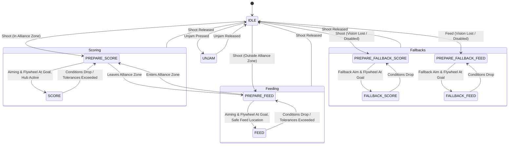
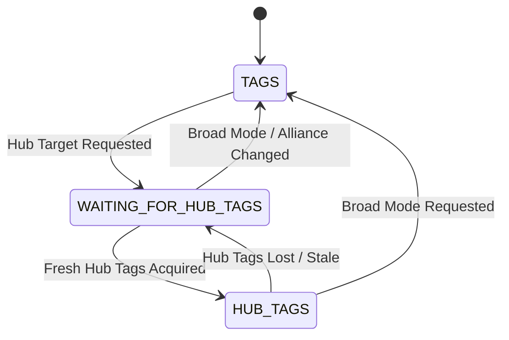

# Subsystems

## Intake Deploy

- 2 Kraken X44 motors on CANivore (`581CANivore`) using differential mechanism (Leader 15, Follower 30)
- Gear Ratio: `36.57:1`
- Control loops:
  - Extension: Motion Magic Torque Current FOC
  - Differential sync: Position Torque Current FOC
  - Desync fix: High differential kP to resync sides
- Parallel-linkage motion (calibrated travel 5.0" to 11.8", ~88.4° arc)
- States:
  - `UNHOMED`
  - `HOME_INWARD`: Current-based inward homing (auto)
  - `HOME_OUTWARD`: Current-based outward homing (teleop)
  - `STOW`
  - `INTAKE`
  - `SAFE_KICKER_STOW`
  - `SCORE_COMPACTION_WAITING`
  - `SCORE_COMPACTION`
  - `FEED_COMPACTION`
  - `BEAST_MODE_COMPACTION`
  - `FIX_DIFFERENTIAL_DESYNC`

## Swerve

- CANivore Bus (`581CANivore`)
- Kraken X60 drive motors, Kraken X44 steer motors
- Pigeon 2 IMU (ID 2)
- Swerve X2c X1 ratio with 10T pinion ([ratio cheatsheet](https://docs.wcproducts.com/welcome/frc-build-system/gearboxes/swerve#drive-ratios))
- Closed-loop voltage control on drive and steer
- Motion Magic Expo for slow steer movement when locking X-swerve

## Intake

- Rio CAN Bus
- 2 Kraken X60 motors (Left 16, Right 17)
- Gear Ratio: `12:20` (0.6)
- Rollers: 2" diameter + cat tongue tape
- Open-loop voltage control with FOC
- States:
  - `IDLE`: 0V
  - `INTAKE`: 12V
  - `SCORE`: 5V (lower voltage while shooting)
  - `FEED`: 5V (lower voltage while feeding)
  - `EJECT`: -12V

## Conveyor/Floor

- CANivore Bus (`581CANivore`), IDs 18 & 19
- Open-loop voltage control with FOC
- Mechanically pivot upward when deploy retracts
- Mechanisms:
  - **Floor**: 1 Kraken X60, 1.5" rollers + cat tongue, Ratio `(14/60)*(16/18)*(16/20)*(17/20)^2` (~8.35:1 reduction)
  - **Tunnel (Belts)**: 2 Kraken X60s (opposed spin), Ratio `12:30` (2.5:1)
- States:
  - `IDLE`: 0V
  - `SCORE` / `FEED` / `INITIAL_SHOT`: 10V
  - `BALL_FILLING`: 1V
  - `INTAKE`: 2V
  - `EJECT`: -12V

## Funneler

- CANivore Bus (`581CANivore`), 1 Kraken X60 (ID 27)
- Gear Ratio: `16:30` (1.875:1)
- 2" Fairlane wheels
- Open-loop voltage control with FOC
- Move balls sideways from hopper into tunnel
- States: `IDLE`, `SHOOT`, `INTAKE`, `BALL_FILLING`

## Feeder

- CANivore Bus (`581CANivore`), 2 Kraken X60s (IDs 20 & 21)
- Gear Ratio: `18:28` (1.556:1)
- 2" flex wheels
- Open-loop voltage control with FOC
- Roll balls up from tunnel into shooter
- States:
  - `IDLE`: 0V
  - `SCORE` / `FEED`: 10V
  - `BALL_FILLING`: 1V
  - `INTAKING`: -1V
  - `EJECT`: -6V

## Shooter Hood

- CANivore Bus (`581CANivore`), 1 Talon FX (ID 22)
- Control exit angle relative to horizontal (~11° base, 13° to 45° travel)
- Position Voltage control loop
- States:
  - `UNHOMED`
  - `HOMING`: Current-based homing against hardstop
  - `IDLE`: Stow low to clear trench
  - `SCORING` / `FEEDING`: Interpolation table or regression model from distance

## Turret

- Rio CAN Bus, 1 Kraken X44 (ID 28) + CANcoder (ID 29)
- Gear Ratio: `60:1`
- Position Voltage control loop with velocity feedforward
- Travel range: Unknown (soft limits TBD; offset 4.75" back, 8.025" left)
- States:
  - `UNHOMED`
  - `SCORE` / `FEED`: Aim at target using shortest path
  - `IDLE_SCORE` / `IDLE_FEED`: Aim at target while smartly unwrapping to avoid hardstops
  - `STUCK`: Fault state when obstructed; inhibit firing

## Shooter

- CANivore Bus (`581CANivore`), 4 Talon FXs (IDs 23–26; flywheel motors TBD)
- Velocity Torque Current FOC control loop
- Boost torque current using feeder current feedforward to prevent RPM dips on ball contact
- States:
  - `IDLE`: ~750 RPM
  - `PREPARE_SCORE` / `SCORE`: Distance-based RPM setpoint
  - `PREPARE_FEED` / `FEED`: Distance-based RPM setpoint

## Robot Manager

- Top-level coordinator for swerve, hopper, turret, shooter, hood, and power
- States:
  - `IDLE`
  - `WARMUP_SCORE` / `PREPARE_SCORE` / `SCORE`
  - `PREPARE_FORCE_SCORE` / `FORCE_SCORE` (testing override)
  - `WARMUP_FEED` / `PREPARE_FEED` / `FEED`
  - `PREPARE_FALLBACK_SCORE` / `FALLBACK_SCORE`
  - `PREPARE_FALLBACK_FEED` / `FALLBACK_FEED`
  - `UNJAM`

- Dynamic Feeding:
  - Auto-select closest unblocked feeding spot (`LEFT`, `RIGHT`, `BACKUP_LEFT`, `BACKUP_RIGHT`)
  - Switch to backup corner target if Hub blocks shot path
- Shoot-on-the-Move:
  - Lead shots using robot pose, swerve velocity, and ball time-of-flight
  - Gate firing on turret angle, shooter RPM, hood angle, trench safety, and localization health
- Fallbacks:
  - Default to hardcoded trench shots based on Driver Station position if vision fails
- Hub Timing:
  - Spin up and shoot before Hub activates using ball time-of-flight

## Localization & Vision

- Use Spot vision coprocessor (replaces Limelights)
- 4 static chassis-mounted cameras (`left`, `right`, `front`, `back`)
- Tag Tracking:
  - Broad mode: Track all field tags for pose estimation
  - Hub mode: Filter only active alliance Hub tags for fast, accurate target tracking

- Rejection Filters:
  - Reject on high robot tilt, field boundaries, high ambiguity, or large pose jumps
  - Compensate for capture latency using odometry history
- Odometry Fusion:
  - Fuse vision poses with distance- and ambiguity-scaled standard deviations
- Trust Factor:
  - Increase uncertainty over distance driven, time elapsed, and IMU collisions
  - Reduce uncertainty with valid tag measurements
  - Trigger fallback shot logic when uncertainty threshold is exceeded ("lost")
- Driver Station:
  - Toggle vision on/off (forces fallback shots when off)
  - Fault indicators for camera and localization health
