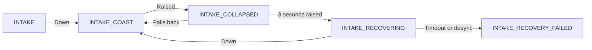
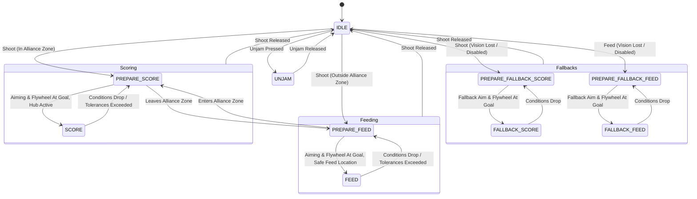
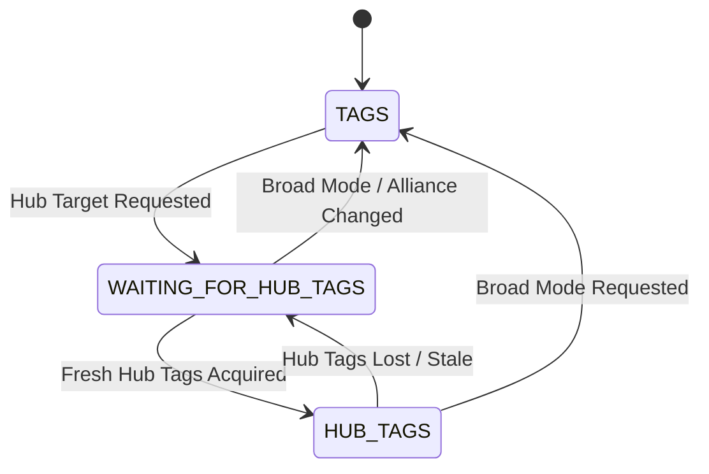

# Subsystems

## Intake Deploy

- 2 Kraken X44s on CANivore (`581CANivore`): leader 15, follower 30; ratio `36.57:1`
- Arm angle: 0° fully down, initially 88.4° collapsed; tune during bringup
- Control: Motion Magic Torque Current FOC with Position Torque Current FOC for side-to-side sync
- All PID/feedforward gains start at zero, including the desync override
- Coast when both sides are within 5° of down. Recover after either side stays above 10° for 3 seconds
- Recovery timeout (5s) or desync (>15°) latches coast until another command
- Stow, compaction, homing, and desync override act immediately; disabling resets the recovery delay
- Motion limits: 90°/s, 180°/s²; tune targets and gains on the robot

- Other states: `UNHOMED`, `STOW`, `SCORE_COMPACTION_WAITING`, `SCORE_COMPACTION`,
  `FEED_COMPACTION`, `BEAST_MODE_COMPACTION`, `FIX_DIFFERENTIAL_DESYNC`
- Homing: `HOME_INWARD` in auto, `HOME_OUTWARD` in teleop; both use current detection

## Swerve

- CANivore Bus (`581CANivore`)
- Kraken X60 drive motors, Kraken X44 steer motors
- Pigeon 2 IMU (ID 2)
- Swerve X2c X1 ratio with 10T pinion ([ratio cheatsheet](https://docs.wcproducts.com/welcome/frc-build-system/gearboxes/swerve#drive-ratios))
- Closed-loop voltage control on drive and steer
- Motion Magic Expo for slow steer movement when locking X-swerve

## Intake

- Rio CAN Bus
- 2 Kraken X60 motors (Left 16, Right 17)
- Gear Ratio: `12:20` (0.6)
- Rollers: 2" diameter + cat tongue tape
- Open-loop voltage control with FOC
- States:
  - `IDLE`: 0V
  - `INTAKE`: 12V
  - `SCORE`: 5V (lower voltage while shooting)
  - `FEED`: 5V (lower voltage while feeding)
  - `EJECT`: -12V

## Conveyor/Floor

- CANivore Bus (`581CANivore`), IDs 18 & 19
- Open-loop voltage control with FOC
- Mechanically pivot upward when deploy retracts
- Mechanisms:
  - **Floor**: 1 Kraken X60, 1.5" rollers + cat tongue, Ratio `(14/60)*(16/18)*(16/20)*(17/20)^2` (~8.35:1 reduction)
  - **Tunnel (Belts)**: 2 Kraken X60s (opposed spin), Ratio `12:30` (2.5:1)
- States:
  - `IDLE`: 0V
  - `SCORE` / `FEED` / `INITIAL_SHOT`: 10V
  - `BALL_FILLING`: 1V
  - `INTAKE`: 2V
  - `EJECT`: -12V

## Funneler

- CANivore Bus (`581CANivore`), 1 Kraken X60 (ID 27)
- Gear Ratio: `16:30` (1.875:1)
- 2" Fairlane wheels
- Open-loop voltage control with FOC
- Move balls sideways from hopper into tunnel
- States: `IDLE`, `SCORE` (10V), `FEEDING`, `INTAKE`, `BALL_FILLING`

## Feeder

- CANivore Bus (`581CANivore`), 2 Kraken X60s (IDs 20 & 21)
- Gear Ratio: `18:28` (1.556:1)
- 2" flex wheels
- Open-loop voltage control with FOC
- Roll balls up from tunnel into shooter
- States:
  - `IDLE`: 0V
  - `SCORE` / `FEED`: 10V
  - `BALL_FILLING`: 1V
  - `INTAKING`: -1V
  - `EJECT`: -6V

## Hopper Manager

- Coordinator subsystem managing intake deploy, intake rollers, floor & tunnel conveyors, funneler, and tower feeder
- Sensors:
  - DigitalInput tower beam-break sensor (Rio DIO 9) to detect fuel presence at tower entrance
  - CANrange removed (ball presence in hopper inferred from intake run duration: >3s intaking indicates full hopper)
- States:
  - `IDLE_DEPLOYED`: Deploy extended, intake idle; fills ball into tower if intake has been running and tower is empty
  - `IDLE_STOWED`: Deploy stowed; all transport mechanisms idle
  - `INTAKING`: Deploy extended, intake spinning forward (12V); runs conveyor and funneler into tower, backs feeder slightly (-1V) until filling conditions met
  - `EJECTING`: Deploy extended, intake (-12V), conveyor (-12V), and feeder (-6V) reversed to dump balls out the front; funneler idle
  - `UNJAMMING`: Deploy extended; intake and conveyor reverse using their outtake requests (-12V). Feeder and funneler use their shooting requests (10V); shooter uses its normal scoring request at a fixed 3m distance, with the normal RPM limit and pit-mode override. These requests stay active until unjam is released, then normal idle/intake requests resume. The tunnel belts are part of Conveyor/Floor and have no separate control in the current code.
  - `SCORE`: Deploy extended; intake scores (5V); conveyor runs initial shot (10V) then score (10V); feeder (10V) and funneler run forward. Compaction runs after 0.25s delay with 0.25s shuffle interval, unless beast mode is active
  - `SCORE_AND_INTAKE`: Simultaneous scoring and intaking; compaction disabled while intaking
  - `FEED`: Deploy extended; intake feeds (5V); conveyor runs initial shot (10V) then feed (10V); feeder (10V) and funneler run forward. Feed compaction activates after 0.25s delay
  - `FEED_AND_INTAKE`: Simultaneous feeding and intaking

## Shooter Hood

- CANivore Bus (`581CANivore`), 1 Talon FX (ID 22)
- Control exit angle relative to horizontal (~11° base, 13° to 45° travel)
- Position Voltage control loop
- States:
  - `UNHOMED`
  - `HOMING`: Current-based homing against hardstop
  - `IDLE`: Stow low to clear trench
  - `SCORING` / `FEEDING`: Interpolation table or regression model from distance

## Turret

- Rio CAN Bus, 1 Kraken X44 (ID 28) + CANcoder (ID 29)
- Gear Ratio: `60:1`
- Position Voltage control loop with velocity feedforward
- Travel range: Unknown (soft limits TBD; offset 4.75" back, 8.025" left)
- States:
  - `UNHOMED`
  - `SCORE` / `FEED`: Aim at target using shortest path
  - `IDLE_SCORE` / `IDLE_FEED`: Aim at target while smartly unwrapping to avoid hardstops
  - `STUCK`: Fault state when obstructed; inhibit firing

## Shooter

- CANivore Bus (`581CANivore`), 4 Talon FXs (IDs 23–26; flywheel motors TBD)
- Velocity Torque Current FOC control loop
- Apply a timed initial feedforward boost when scoring or feeding (0.7 seconds with a full hopper, 0.1 seconds otherwise)
- States:
  - `IDLE`: ~750 RPM
  - `PREPARE_SCORE` / `SCORE`: Distance-based RPM setpoint
  - `PREPARE_FEED` / `FEED`: Distance-based RPM setpoint

## Robot Manager

- Top-level coordinator for swerve, hopper, turret, shooter, hood, and power
- States:
  - `IDLE`
  - `WARMUP_SCORE` / `PREPARE_SCORE` / `SCORE`
  - `PREPARE_FORCE_SCORE` / `FORCE_SCORE` (testing override)
  - `WARMUP_FEED` / `PREPARE_FEED` / `FEED`
  - `PREPARE_FALLBACK_SCORE` / `FALLBACK_SCORE`
  - `PREPARE_FALLBACK_FEED` / `FALLBACK_FEED`
  - `UNJAM`

- Dynamic Feeding:
  - Auto-select closest unblocked feeding spot (`LEFT`, `RIGHT`, `BACKUP_LEFT`, `BACKUP_RIGHT`)
  - Switch to backup corner target if Hub blocks shot path
- Shoot-on-the-Move:
  - Lead shots using robot pose, swerve velocity, and ball time-of-flight (see [SOTM math audit and log-based calibration](../sotm-tuning.md))
  - Gate firing on turret angle, shooter RPM, hood angle, trench safety, and localization health
- Fallbacks:
  - Default to hardcoded trench shots based on Driver Station position if vision fails
- Hub Timing:
  - Spin up and shoot before Hub activates using ball time-of-flight

## Localization & Vision

- Use Spot vision coprocessor (replaces Limelights)
- 4 static chassis-mounted cameras (`left`, `right`, `front`, `back`)
- Tag Tracking:
  - Broad mode: Track all field tags for pose estimation
  - Hub mode: Filter only active alliance Hub tags for fast, accurate target tracking

- Rejection Filters:
  - Reject on high robot tilt, field boundaries, high ambiguity, or large pose jumps
  - Compensate for capture latency using odometry history
- Odometry Fusion:
  - Fuse vision poses with distance- and ambiguity-scaled standard deviations
- Trust Factor:
  - Increase uncertainty over distance driven, time elapsed, and IMU collisions
  - Reduce uncertainty with valid tag measurements
  - Trigger fallback shot logic when uncertainty threshold is exceeded ("lost")
- Driver Station:
  - Toggle vision on/off (forces fallback shots when off)
  - Fault indicators for camera and localization health

## Bringup tuning

Deploy average gains remain under `Deploy/Left` and `Deploy/Right`. Difference
axis gains are exposed under `Deploy/Left/Slot1`, `Deploy/Right/Slot1` (normal
synchronization) and `Deploy/Left/Slot2`, `Deploy/Right/Slot2` (desync override).
Each exposes kP, kI, kD, kS, kV, kA, and kG; tune both motors consistently.
