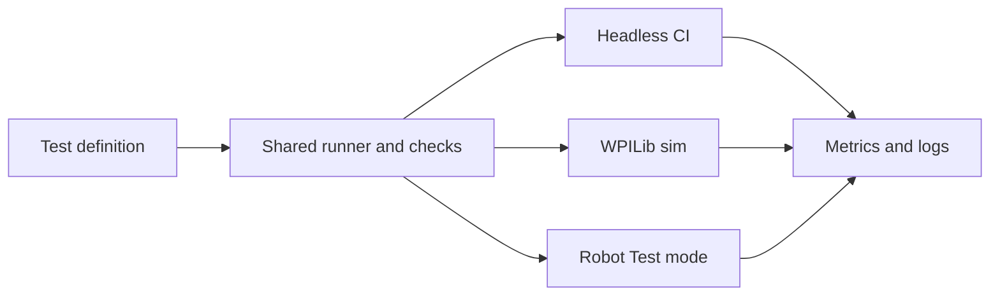

# Simple offseason testing project overview

Status: proposal, October 10, 2026. This document adds a small implementation path; it does not
implement a new runner, test API, or skill. Existing commands below are runnable; example APIs
and milestones in the linked plans are proposed.

The goal is to make a useful regression test take a student less than 10–15 minutes to add,
reuse its behavior and checks in headless simulation, interactive WPILib simulation, and on
the robot, and turn repeated hardware runs into evidence for tuning and improvement.

Implement three connected workflows: overall test-plan tracking, headless software-in-the-loop
(SIL) integration tests, and manual hardware regression with saved execution records. Validate
these workflows on the offseason bot before expanding coverage or adopting additional tooling.
Keep development-test review separate from match/practice review and share AdvantageScope for
analysis. Focus simulation on robot software verification using existing models and scripted inputs.

## Project scope

Build a small shared scenario library around the existing diagnostics. A scenario describes
setup, an action, sensor/state checks, a deadline, cleanup, and a few useful measurements.
Students and agents use the same templates. Headless CI, interactive WPILib simulation, and
robot Test mode reuse scenario behavior and checks through environment adapters.

Retain existing unit tests for math and isolated logic. Add a small coverage register and manual
procedures alongside the shared runner. Manual
tests may exercise ordinary operator controls and existing autos without new automation or
duplicate tuning. They also cover production wiring that diagnostic compositions bypass.

Keep simulation focused on existing simple mechanism models and scripted sensor inputs.
Use hardware runs to establish physical performance and tuning. Report unsupported checks
and keep simulation and hardware baselines separate.

## Focused plans

| Plan | What it covers |
|---|---|
| [Shared framework and execution environments](simple-testing-plan/architecture.md) | Runner/adapters, current integration constraints, hardware ownership, and what each environment proves |
| [Test authoring for students and agents](simple-testing-plan/authoring.md) | Java templates, temporal checks, registration, the 15-minute goal, and the proposed agent skill |
| [Initial regression suite](simple-testing-plan/initial-suite.md) | The first movement, mechanism, interlock, operator-transition, and cleanup tests |
| [Test plan tracking and manual regression](simple-testing-plan/manual-regression.md) | Coverage gaps, case definitions, hardware procedures, proposed cadence, and execution receipts |
| [Tuning and software insights](simple-testing-plan/tuning-and-insights.md) | Repeatable tuning experiments, passive log checks, small boundary sweeps, and captured bug cases |
| [Results and regression baselines](simple-testing-plan/results-and-baselines.md) | Result states, run metadata, artifacts, comparable baselines, development review, and shared analysis |
| [Implementation roadmap](simple-testing-plan/roadmap.md) | Milestones, acceptance criteria, CI adoption, maintenance measures, and deferred scope |

## Implementation map

The implementation stays in `offseason-bot/src/main/java/frc/robot/testing/` initially. Add an
immutable scenario definition, a per-enable run state, typed observation frames, temporal checks,
an explicit catalog, and versioned result records. Adapt the current drive diagnostic first;
mechanism scenarios use a separate opt-in diagnostic application with one hardware owner.
Desktop JUnit wrappers remain in `offseason-bot/src/simTest/java/frc/robot/sim/`.

Case definitions and coverage live under proposed `docs/testing/`; large run artifacts live outside
Git. A run produces JSON and Markdown, WPILOG references, and any independent manual observations.
A desktop comparator matches versioned cases and setup against explicitly approved baselines.
CI preserves JUnit results and run evidence on failure; hardware session receipts account for
both executed and not-run cases. All new classes, paths, and commands are proposed until implemented.

The linked plans specify loop ordering and lifecycle, registration and authoring steps, initial
case recipes, operator procedures, result fields, comparison rules, and verification batches.

## Delivery order and success criteria

First inventory current coverage, trial a short manual hardware protocol, and prove that one
shared routine runs in all three environments. Then validate the authoring workflow with a student
before expanding to 3–5 scenarios. Add controlled hardware comparisons
for tuning, followed by a small number of everyday log checks and boundary cases.

The project succeeds when a student can add and run a regression test in under 15 minutes using
existing adapters, the test demonstrably catches the intended bug, reports preserve useful
failure evidence, and repeated hardware runs reveal reproducible performance changes.
Every planned case has visible coverage status, and every manual session records what ran,
what did not, the observed result, and evidence for follow-up.

Defer game-piece physics, richer dynamics, HIL, a general scenario language, broad fuzzing,
whole-robot replay, database migrations, and autonomous self-improvement until a specific
problem justifies their maintenance cost. Detailed acceptance criteria are in the
[implementation roadmap](simple-testing-plan/roadmap.md).

## Existing foundation

- `./gradlew test` runs unit tests; `./gradlew headlessTest` runs the desktop integration suite.
- `TestManager`, `DiagnosticSession`, and `StraightLineDiagnostic` already share a drive diagnostic
  between headless tests and Driver Station Test mode, including interactive simulation.
- CI uploads JUnit results, motion reports, and WPILOG files even on failure. Its headless job
  currently runs on pushes; the Build job does not depend on it. Branch-protection requirements
  still need to be checked separately.
- `DiagnosticReport` writes unique Markdown results, but general per-test metrics and a common
  structured result format still need to be added.
- Some `RobotControlFlowTest` cases use reflection to set private fields/states. Treat these as
  existing focused tests, not the template students should copy.
- The current straight-line fixture uses production swerve hardware classes but bypasses normal
  robot management/localization. Its follower also differs from the production bump wrapper.
  A passing diagnostic cannot certify those unexercised paths.

[Integration testing](integration-testing.md) documents the current commands. The broader
[whole-robot proposal](robot-regression.md) is a backlog of potential coverage, not the minimum
implementation scope. Its numeric limits are uncalibrated proposals.
