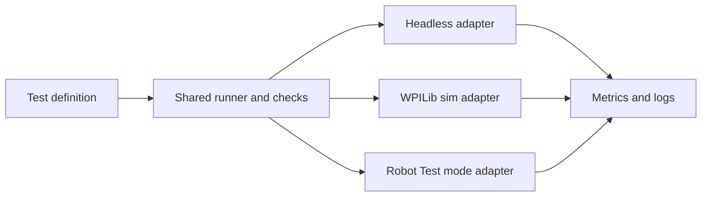

# Shared test framework and execution environments

Status: proposal, October 10, 2026. APIs and milestones described here are proposed unless explicitly identified as existing.

[Project overview](../simple-testing-plan.md)

Use a small Java scenario library containing actions, observations, temporal checks, and metrics.
Keep JUnit in desktop adapters; deployable scenarios must not depend on JUnit. WPILib's
[unit-testing documentation](https://docs.wpilib.org/en/stable/docs/software/wpilib-tools/robot-simulation/unit-testing.html)
describes desktop JUnit tests and hardware simulation; running the same scenario on a robot
requires the team's Test-mode runner rather than deploying a JUnit test.

The shared runner performs one nonblocking tick per robot loop. Adapters provide time, existing
request APIs, sensor/state observations, and setup. Headless and interactive simulation should
use the same composition and input scripts, with graphics as an optional observer. Hardware
uses measured sensors and real time. Never put sleeps, file parsing, or expensive analysis in
the enabled loop.

Initially preserve the existing real-time headless loop. Faster-than-real-time stepping is a
later optimization: vendor simulation threads and FPGA timing must agree before claiming
determinism or speedup. Preserve serial execution and native-resource isolation.

### Resolve the current integration limitation explicitly

`TestManager` currently prepares each loop by idling normal managers and exposes a drive-speed
output protocol. Simply adding a scoring action to that loop would fight the preparation callback.

First wrap the existing straight-line diagnostic with the shared checks/results. For mechanism
and coordinated scenarios, use a separate diagnostic entrypoint/fixture that constructs existing
production classes once through public constructors. Run that same diagnostic composition in all
three environments, inject public request/read adapters, and keep its cleanup and controllers
owned by test code. Generalize the test protocol beyond `requestedSpeeds()` as needed; retain the
existing straight-line adapter for compatibility.

Never construct the normal robot graph and diagnostic graph together: hardware must have one
owner. This follows the current architecture constraint in [whole-robot proposal](../robot-regression.md) without a
wholesale production IO refactor. Where existing APIs cannot provide a required stimulus or
observation, record a coverage gap rather than using reflection or inventing a result.

Label diagnostic-composition results separately from normal-robot acceptance. Retain targeted
binding/mode tests that exercise actual `Robot` wiring. Add hardware acceptance procedures for
those paths; a diagnostic fixture proves the components it exercised, not the whole deployed graph.

Manual cases use ordinary controls or existing autos to exercise the normal deployed graph,
with explicit acceptance checks and an execution receipt. They complement shared diagnostics
without requiring a second tuned auto or waiting for every behavior to be automated. Keep their
procedures and coverage status in the [manual regression plan](manual-regression.md).

### Shared checks do not imply equal evidence

Each scenario declares required capabilities. Simulated sensor overrides never run on hardware.
For example, a tower sensor can be scripted high in sim and physically occluded on the robot,
with the same subsequent state/output checks. A hardware setup step can prompt the operator and
wait for a measured prerequisite, with a deadline.

Some existing simulation paths force cameras healthy or substitute timed hopper fullness. Mark
affected checks unsupported until real inputs can exercise them. An unavailable required check
is BLOCKED, not PASS; a deliberately hardware-only case is excluded from the declared CI suite
with a visible reason. Do not silently remove checks when changing modes.

Scripted encoder/RPM values verify how code reacts to those values. They do not prove that a
controller reaches a setpoint. Existing simple mechanism simulation can exercise modeled motion;
hardware runs establish actual settling and tuning. Keep sim and hardware baselines separate.

## Code layout and adapter contracts

Keep the first implementation in `offseason-bot`; extract robot-independent helpers into
`shared` only when a second robot needs them. Add these proposed classes under
`offseason-bot/src/main/java/frc/robot/testing/`:

| Class/package | Responsibility |
|---|---|
| `scenario/ScenarioDefinition` | Immutable ID/version, parameters, capability requirements, ordered phases, checks, metric definitions, and cleanup |
| `scenario/ScenarioRun` | Per-enable mutable state: phase, phase start, hold timers, first failures, measurements, and terminal result |
| `scenario/ObservationFrame` | One immutable snapshot with loop sequence, adapter time, signal values, source timestamps, and validity |
| `scenario/Check` / `CheckResult` | Evaluate one frame; retain measured/expected values, units, first failure, and missing-data reason |
| `scenario/ScenarioCatalog` | Explicit ID-to-factory map, descriptions, supported environments, and named parameter presets |
| `scenario/ScenarioContext` | Typed request/read functions, clock, capability set, and output-neutralization callback |
| `report/RunResult` / `RunRecorder` | Immutable terminal evidence and lightweight per-loop log emission; disk export outside enabled execution |
| `ScenarioDiagnostic` | Bridge a scenario run to the existing `DiagnosticRoutine` for drive-only diagnostics |

A definition is reusable; a run is never reused across enables. Validate IDs, parameter ranges,
phase deadlines, units, and duplicate check names before starting. Map existing `PASSED`/`FAILED`
statuses to report `PASS`/`FAIL` at export; keep the existing routine enum compatible initially.

Replace the fixed selection enum with catalog-backed chooser entries in `TestManager`. Register
factories explicitly in one catalog class rather than scanning classes on the roboRIO. Adding a
case requires its definition, one catalog entry, and a thin JUnit wrapper; Gradle and CI stay unchanged.
Preserve the `STRAIGHT_LINE` chooser label and existing configuration keys during migration.

## Per-loop execution and failure handling

For new fixtures, use an explicit loop contract:

1. Check enabled/Test mode and detect entry/exit edges. On entry, snapshot selection and parameters,
   allocate a run ID, and validate configuration/capabilities while outputs remain neutral.
2. Apply simulation inputs scheduled for this loop, or evaluate hardware setup prerequisites.
   Each scripted event executes once at its declared adapter time or phase edge.
3. Issue the current phase's public requests. A sustained request is reissued each loop only when
   the production API requires it; reset request and timing state when entering another phase.
4. Run the fixture's sensor/read/control cycle once, then capture an `ObservationFrame`. Evaluate
   checks against that frame and schedule phase changes for the next loop. Never call a follower
   twice to obtain a second measurement.
5. Log phase/check changes and bounded metrics. On terminal result, neutralize outputs, clear
   requests and controller state, and freeze evidence. Remain finished until a new enable edge.

The first drive bridge retains the current `DiagnosticSession` timing. Record whether each sample
is before or after output application; its existing drive callback observes velocity before applying
that loop's command. Do not relabel those samples as a completed response to the new command.
For new compositions, call subsystems explicitly in a documented order rather than assuming
iteration of the shared sequencer's priority queue guarantees dependency order. The diagnostic
entrypoint owns this loop instead of invoking both it and `Base581Robot.robotPeriodic()`. Mirror
input refresh with `Signals.refreshAll()`, then `beforePeriodic()` for each owned state machine,
then `periodic()` exactly once in the fixture's declared order. Set up logging and metadata in
the diagnostic application independently of normal `Robot` construction.

The shared `getStage()` currently treats enabled Test mode as DISABLED. Audit each selected
mechanism's disabled lifecycle before using it in `DiagnosticRobot`; a disabled callback that
clears requests would conflict with Test-mode actions. Prove a single mechanism can respond with
unchanged production lifecycle first. If it cannot, leave that automated hardware case BLOCKED
and use the manual normal-robot procedure until a test-owned integration path is established.

Prerequisite deadline expiry is BLOCKED; an action/check deadline expiry is FAIL. Disable, mode
exit, or operator cancellation while running is ABORTED. Invalid configuration and unexpected
exceptions are FAIL with a reason. Preserve a completed result when subsequently disabling.
Cleanup is idempotent and also works before the first action. A cleanup exception adds failure
evidence and cannot produce PASS. Always attempt the independent output-neutralization callback
in `finally`, even if scenario cleanup throws. A report-writing failure is surfaced separately
and cannot erase the observed test result.

## Mechanism composition and entrypoint

Add a proposed `testing/DiagnosticRobot` and `testing/DiagnosticMain` for mechanism/coordinated
fixtures. `DiagnosticMain` starts only `DiagnosticRobot`; it never constructs ordinary `Robot`.
Create exactly one `Hardware` graph and only the production mechanisms/managers needed by the
selected composition. Use existing public constructors and requests. Keep Test-mode gating and
fixture sequencing in this entrypoint instead of changing normal managers to accept test protocols.

Add opt-in Gradle tasks `diagnosticSim` and `deployDiagnostic` only when this composition exists.
Configure a separate executable/deploy artifact with `DiagnosticMain` in its manifest; ordinary
`simulateJava` and deployment retain `frc.robot.Main`. Label the diagnostic application and
composition in metadata and on the chooser. Restoring the normal robot application is part of
ending a mechanism hardware session. These task names are proposed, not currently runnable.

Wrap fixture construction/closing with try/finally. Desktop cleanup disables `DriverStationSim`,
closes physics notifiers and vendor devices, and restores injected inputs. Preserve a fresh JVM
per physical test class. Do not construct multiple fixtures in one parameterized JUnit class
until process-wide subsystem registration and native-resource teardown are proven isolated.

Related: [test authoring](authoring.md), [initial suite](initial-suite.md), and [results and baselines](results-and-baselines.md).
