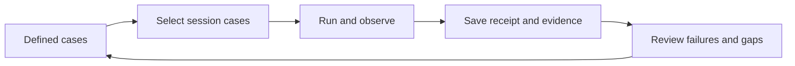

# Test plan tracking and manual regression

Status: proposal, October 10, 2026. The register and session records below are proposed;
the straight-line diagnostic is already runnable.

[Project overview](../simple-testing-plan.md)

Define test cases before execution and save results afterward. Start with repository Markdown
case definitions, a coverage register, and saved session records. Validate the workflow on the
offseason bot before expanding it.

## Make coverage visible

Create one register with stable case IDs linking to unit tests, shared scenarios, or manual
procedures. Record the behavior covered, case owner, applicable environments, implementation
status, and latest execution receipt per environment. Use planned/available for implementation;
use not run/PASS/FAIL/BLOCKED/ABORTED for execution. Availability does not imply a passing run.
An untested behavior should remain visible even when no test exists yet.

Initial inventory entries to refine during the trial:

| Case | Behavior and current coverage | Remaining gap |
|---|---|---|
| U01 | Aim calculations and deploy kinematics have unit tests | Map requirements and known bug boundaries to specific assertions |
| D01 | Straight-line diagnostic has headless tests and robot Test-mode selection | Record hardware execution and an independently measured endpoint; normal localization and production bump wrapper remain uncovered by this fixture |
| O01 | Binding/mode transitions have focused `RobotControlFlowTest` cases | Identify covered bindings and add a manual normal-robot procedure for remaining controls |
| M01 | Mechanism preparation, scoring, cancellation, and recovery are candidate cases | Write explicit manual checks first; shared scenarios remain proposed |

Assign case owners when creating the register and link execution results as runs complete.
Update affected entries with behavior changes and bug fixes; link each new regression to the bug
it catches. Review missing coverage alongside results, without treating test counts as coverage.

## Define a short hardware protocol

Each manual case needs an ID/version, purpose, prerequisites, setup, exact action sequence,
observable acceptance criteria and deadlines, cleanup, and required evidence. Use existing
controls, requests, diagnostics, and autos where possible. Dedicated automation is useful when
it makes a difficult sequence repeatable; a new auto with separate tuning is not a prerequisite.
Calibrate physical thresholds before calling a trial a qualification pass.

Start with a short session covering:

1. Run forward, reverse, and strafe using the existing Test-mode procedure in
   [robot regression](../robot-regression.md#what-can-be-run-now). Save each log and measure the
   endpoint independently; label the result as diagnostic-composition evidence.
2. Use ordinary operator controls to prepare, score, cancel, unjam, and stow. Record the expected
   request/state/output transitions, measured readiness, and counted shot outcomes where required.
   Run these as separate normal-robot cases; the current drive diagnostic cannot run scoring.
3. Check release/cancel and disable in the selected operating phases. Observe cleared requests
   and neutral commands; distinguish these from mechanical coast-down.

Agree on case-specific expectations before enabling. Missing calibration or required observations
produce BLOCKED checks. Manual counts or endpoint measurements must be attached to the case;
state transitions alone cannot prove physical success. Keep the [initial suite](initial-suite.md)
small and add cases from failures rather than attempting the entire whole-robot backlog.

## Run, review, and keep a receipt

After the initial trial, establish a weekly hardware window. Assign a session lead, operator,
and reviewer and reserve robot/field time. Also run affected cases after control, calibration,
or mechanical changes. If hardware
is unavailable, record the missed session and pending cases rather than marking them passed.



Use one session receipt containing date, participants, robot identity, Git SHA/dirty state,
configuration/calibration, battery/setup context, and the planned case list. For every case,
record version, environment/composition, observed values versus limits, terminal result, and
log/video/report links. Record not-run cases and their reasons separately; not run is a tracking
state, not a runner verdict. Preserve failures and aborted attempts when rerunning.

Close the session by updating the register and recording a follow-up owner/action for failures,
blocked cases, and important coverage gaps. A session is complete only when all planned cases
have a result or an explicit not-run reason; it passes only when all required cases pass.

Use the same evidence conventions as [results and baselines](results-and-baselines.md). Manual
receipts can be Markdown initially; automatic JSON generation is not required to start testing.
A single development-test index should link case definitions, CI artifacts, manual receipts,
and baseline comparisons. Keep this separate from match/practice review; share AdvantageScope
views and optionally link logs already stored in Fetch. Evaluate case-management or reporting
tools only after the trial exposes a concrete gap.

## Repository artifacts and session template

Create the following proposed documentation layout during milestone 0:

```text
docs/testing/coverage.md                 # case ID, owner, implementation and environment coverage
docs/testing/cases/D01-drive.md         # versioned procedure and acceptance rules
docs/testing/cases/O01-controls.md
docs/testing/sessions/YYYY-MM-DD-01.md  # planned cases, attempts and follow-up
docs/testing/index.md                  # links to definitions, CI and durable hardware evidence
```

Use ordinary relative Markdown links between these files. Keep large logs/video outside Git;
link them using durable artifact URLs and retain filename, run ID, size/hash where available.
Store a small result summary with the receipt so it remains useful if a remote link expires.

Start each case file with this copyable structure; values are filled before execution:

```text
ID / version / owner:
Purpose and bug or requirement:
Environment / composition / robot:
Prerequisites and configuration preset:
Steps: numbered action, required observation, deadline
Acceptance: measured signal, units, bound, required hold
Cleanup:
Evidence: required log traces, endpoint measurement or shot count
Known coverage gaps:
```

The session receipt contains a table with case ID/version/preset, attempt/run ID, environment,
status, measured value/limit, evidence link, and follow-up owner/action. Keep multiple attempts
as separate rows; never replace the failing row with a rerun. For a planned case not executed,
use `NOT_RUN` with a reason and next opportunity. This is a receipt-only state.

## Operator sequence for the first session

1. While disabled, identify the deployed application/build and configuration. Record robot serial,
   battery ID/starting voltage, calibration version, field setup, and the case versions selected.
2. For D01, mark start/expected finish, select `STRAIGHT_LINE` at `Tests/SelectedTest`, and set
   `Tests/StraightLine/Config/` values. Save the displayed configuration before enabling Test mode.
3. Enable once, record `Tests/Regression/RunId`, wait for terminal status or disable to abort.
   Record endpoint measurement and log time range. Disable before changing selection/configuration;
   re-enable creates another attempt. Dashboard edits during a run do not change its snapshot.
4. For O01, use the normal application in Teleop: driver left trigger starts intake and release
   cancels; left bumper requests unjam and release requests idle; right bumper requests stow and
   release cancels stow. Driver right trigger prepares score/feed and release requests idle.
   Define the expected state/output for each step in the case file, accounting for zone/config flags.
5. Finish disabled. Copy logs, attach observations, fill every planned-case row, and review failures
   and missing coverage before the session closes. Restore the normal application if a dedicated
   mechanism diagnostic build was deployed.

If the robot completes an automated routine but independent endpoint or shot evidence is missing,
record the automatic sub-result and BLOCKED physical acceptance separately. For manual observations,
record observer identity and measurement method. An operator's recollection without the required
measurement is not a PASS receipt.
