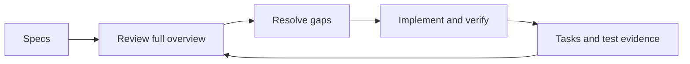

# Robot software workflow

## Find work

Start with the [2026 Offseason Project](https://github.com/orgs/team581/projects/16).

- **Full overview** shows open work under the existing robot and subsystem parents, including unassigned work. Expand a parent to see its tasks.
- **Needs tuning** shows open items in **Ready for tuning** directly, without expanding parents.
- **My work** shows your assigned, open items that are not Done. It is a shortcut, not a complete account of what the robot needs.

Keep the full overview as the default. The existing date-based views remain available for work with actual deadlines.

## Connect work to requirements

Use the [offseason spec index](offseason_bot/README.md) to find intended behavior. Read the section linked from your task before changing code.

For new issues, use the robot software task template: outcome, spec link, and verification. Search for an existing issue first and put the task under the appropriate subsystem parent. Assign it when someone takes ownership. Use a checklist for small steps; create a separate issue when work needs independent ownership or follow-up.

Keep existing issue titles and descriptions concise. Add relevant links instead of copying specs or adding repeated explanations. No separate readiness classification is needed.

Markdown specs hold the maintained behavior requirements. The [original slides](https://docs.google.com/presentation/d/1US8LnhTDj9hFo0H8eUviP4Wtik0UkSjndNLH3LLEm9o/edit) are migration reference material; bring conflicting or unresolved requirements to a software lead. Use the subsystem design sheet linked from the spec index for hardware references and verify ratios against the physical mechanism during bringup. Update affected specs alongside changes to intended behavior. Label unapproved designs and deferred features explicitly; a design document on a development branch does not establish approved rollout scope.

## Track progress

| Stage | Meaning |
| --- | --- |
| Todo | Work identified; not started. Unresolved questions may remain. |
| In progress | Someone owns the next action and is working on it. |
| Ready for sim | Implementation is ready for simulation verification. |
| Ready for tuning | Applicable simulation checks passed; robot testing or tuning remains. |
| Done | Agreed acceptance checks passed and evidence is linked. |

Skip stages that do not apply. Record a blocker and next action in the existing issue when needed. Parent sub-issue percentages count closed issues, not how much of the robot works; parents are navigation and scope containers, not a readiness score.

Both direct commits and PRs can supply implementation evidence; follow the existing [Git practices](git-best-practice.md). For robot behavior, merging or committing code does not finish verification. Use `Refs #123` or a normal issue link while physical checks remain; reserve closing references such as `Closes #123` for work whose acceptance checks are complete. Closing an issue or setting its Project status to Done currently triggers the corresponding closure/status workflow.

Before closing, record the code version, check performed, result, and log or video link where useful. The person who ran or witnessed physical verification confirms the result. Documentation and tooling tasks use checks appropriate to their scope.

## Check coverage before robot testing

The software lead coordinating the next robot test reviews the full subsystem overview against the relevant specs:

1. Check each required behavior for tracked work or completion evidence.
2. Include unassigned, blocked, and quiet issues, not just current assignments.
3. Check dependencies and unresolved requirements before scheduling the test.
4. Inspect closed work when robot verification is unclear. Search [all repository issues](https://github.com/team581/offseason-2026/issues?q=is%3Aissue), including closed issues; the Project archives closed items after one week without updates.
5. Link or update the existing task for agreed follow-up. Create a new issue only when work needs independent tracking.

A missing issue is not proof of missing implementation. A completed task queue is not proof that every spec requirement is satisfied. Keep the review in the existing specs and issues rather than creating a second status list.

## Verify behavior

Use the [integration-testing guide](integration-testing.md), [bringup checklist](subsystem-bringup-checklist.md), and [behavior verification procedure](offseason_bot/verification.md). Confirm test conditions and acceptance criteria before a robot run; simulation results do not certify physical behavior.

After two meetings using this setup, review whether students can find work, locate requirements, and distinguish implementation from robot verification. Remove steps that add little value. Agent integration and Fetch are outside this workflow rollout.
