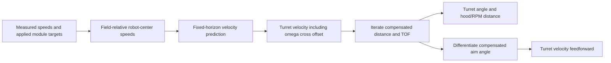

# SOTM math audit and log-based calibration

The software uses a planar empirical shot model. The equations are internally
consistent under the assumptions below, and regression tests check their signs,
frames, units, convergence and derivatives. This is **not yet a statement that
this robot only needs TOF tuning**: current real-hardware turret voltage limits
are zero, turret/shooter/hood gains are zero, and hood calibration still has TODOs.
Finish mechanism bring-up and establish repeatable stationary shots first. Those
hardware settings were deliberately not guessed or changed in this audit.

## Calculation



All translations are meters, chassis velocities m/s, angular velocities rad/s,
TOFs and response constants seconds, and drag inverse seconds. Aiming angles and
hood angles are degrees; turret motor requests convert degrees to mechanism
rotations and rad/s to rotations/s. CTRE `PositionVoltage.Velocity` is a velocity
reference, not an arbitrary voltage feedforward; its effect depends on configured
controller gains ([CTRE reference](https://api.ctr-electronics.com/phoenix6/stable/java/com/ctre/phoenix6/controls/PositionVoltage.html)).

For a held command `u`, measured velocity `v`, response constant `tau`, and fixed
prediction horizon `h`, the model is:

```
v_pred = u + (v - u) exp(-h/tau)
position(dt) = position(0) + u*dt + (v-u)*tau*(1-exp(-dt/tau))
```

The same equations apply to yaw with its own angular response constant. A reversal
first brakes, crosses zero, then approaches the opposite command. Prediction is
performed at the robot center. The turret velocity adds `omega cross R(heading) r`
using the predicted omega and the configured turret-axis offset. Measured speeds
and applied commands come from the same drivetrain snapshot. Applied commands
are reconstructed from module targets, so alliance perspective, heading snaps,
center-of-rotation changes and wheel limits are already included. Raw DriveSource
values are **not robot-relative** and must not be rotated by robot heading.

Let `p` be the turret-axis position, `g` the real goal, `v` the predicted turret
velocity, and `d` the effective stationary-shot distance. The virtual goal solves:

```
E(T,k) = (1-exp(-k*T))/k          E(T,0) = T
q = g - p - v*E(T(d),k)
d = |q|
virtualGoal = p + q
```

`E` integrates the inherited velocity under linear drag; it is not the actual
flight time. The actual `T(d)` is used for hub timing. The RPM and hood maps both
use `d`. TOF interpolation/regression selection is shared between SOTM and hub
timing. The solver checks residual <= 1e-10 m with a bounded iteration count;
turret readiness validates the current loop's `AimingParameters` directly, so
invalid/non-converging solutions, imminent unwrap flips, and targets clamped past
soft limits beyond tolerance cannot satisfy readiness. The normal
shot-cancellation/readiness policy still applies; forced/pit modes are not proof
of ballistic validity.

Turret velocity feedforward differentiates `angle(q) - robotHeading`, rather than
using tangential speed over distance to the real goal. It evaluates the full aim
solution 0.0001 s ahead using the held-command response model. This includes
changing TOF, velocity, yaw and turret offset. This tiny finite-difference step is
only a numerical derivative, **not loop-timing compensation**. The half-second
unwrap preview also recomputes the future solution. Compensation remains active
for in-place rotation and for coasting after releasing the stick. Shooter RPM,
hood and turret output requests use the latest submitted compensated distance.

## Tunable parameters

| Key | Default | Meaning | Evidence required to fit |
| --- | ---: | --- | --- |
| `ShootOnTheMove/VelocityTimeConstantSeconds` | 0.15 | Linear drivetrain response tau | WPILOG telemetry alone (`MeasuredFieldRelativeSpeeds` vs. `CommandedFieldRelativeSpeeds`, no shooting needed) |
| `ShootOnTheMove/AngularTimeConstantSeconds` | 0.15 | Angular drivetrain response tau | WPILOG telemetry alone (`omega` response, no shooting needed) |
| `ShootOnTheMove/PredictionHorizonSeconds` | 0.02 | Fixed velocity-prediction horizon | Telemetry bounds sensor/turret tracking lag; final value requires observed shot misses during acceleration/reversals |
| `ShootOnTheMoove/DragCoeff` | 0.465 | Effective linear drag, legacy spelling retained | **Observed shot results / video** (signed radial & tangential landing errors across speeds/distances with fixed stationary maps) |
| Stationary RPM, hood & TOF tables | source maps | Empirical range calibration (`Shooter/*`, `ShooterHood/*`) | **Observed stationary shots & release-to-arrival video** (cannot be inferred from robot telemetry) |

There is no scheduler-dependent adjustment. The horizon is an empirical velocity
lookahead, not a complete model of ball-release latency: it does not advance the
release position by that horizon. Do not use it to absorb the whole feeder travel
time. The robot continuously updates aim while feeding. Model response, tracking
latency and ballistic calibration must be evaluated separately.

## What must be calibrated first

1. Bring up/homing-check turret, hood and shooter, including real gains, voltage
   limits, gear ratios, offsets and localization. Verify the configured turret
   axis matches the physical release point closely enough for rotation tests.
2. Tune stationary RPM and hood maps for reliable score/feed shots over the whole
   intended distance range, then measure actual release-to-arrival TOFs for those
   settings. TOFs alone cannot repair an incorrect RPM/hood map. Do not include
   feeder-to-shooter travel in measured flight time. Log/video the range and
   actual mechanism values for each calibration shot.
3. Keep `RegressionModel` and `TofRegressionModel` off while editing interpolation
   tables. The optional polynomial models are fitted at construction and do not
   refit when the live tables change. Save accepted values to source defaults;
   development-only tunables are not a competition configuration.
4. Stay inside the stationary-calibrated distance range. Tables clamp at endpoints;
   a converged solution outside that range is not proof the shot is reachable.

The model assumes a level robot, release at the turret axis, a stationary goal,
a held command over the prediction, and linear drag on inherited velocity.
Muzzle offset, turret-induced muzzle velocity, pitch/roll, slip, module steering
delay, quadratic drag, spin and shot-to-shot variation may require further work
if validation shows systematic errors. Do not declare these effects calibrated
from simulated or successful solver outputs.

## Ten-log collection plan

Use one build and save the accepted source calibration alongside the logs. Record
at least a few seconds before/after each maneuver, battery condition, surface and
shot outcome. Use both signs/directions and several distances/speeds. Suggested
runs (repeat each maneuver several times):

| Runs | Maneuvers |
| --- | --- |
| 1–2 | Starts from rest, forward/backward and strafe |
| 3–4 | Speed increases, reductions and release-to-coast |
| 5–6 | Reversals, both axes |
| 7–8 | In-place clockwise/counterclockwise turns and combined translation/rotation |
| 9–10 | Held-out mixed scoring/feeding runs, including competition mode |

Include slow-motion video or timestamped observations of ball release, arrival,
and signed radial/tangential miss distances. Mark score versus feed and the real
landing location. A count of made/missed shots is useful but much weaker than
measured misses. Motion-response runs can be collected without shooting, but
ballistic validation cannot.

## Log contract

DogLog writes these entries to WPILOG in both development and competition modes;
NetworkTables publishing is not required. Standard DogLog files prefix these
paths with `/Robot/`; catalog the file first. Scoring and Feeding each have:

- `ShootOnTheMove/{Scoring,Feeding}/TimestampSeconds` (FPGA seconds)
- `RobotPose`, `Goal`, `MeasuredFieldRelativeSpeeds`, `CommandedFieldRelativeSpeeds`,
  `PredictedFieldRelativeSpeeds` (WPILib structs, robot-center speeds)
- `PredictionHorizonSeconds`, `LinearTimeConstantSeconds`,
  `AngularTimeConstantSeconds`, `DragPerSecond`
- `MovingSolution`, `CompensatedGoal`, `TimeOfFlightSeconds`,
  `EffectiveTimeOfFlightSeconds`, `ResidualMeters`, `SolutionValid`
- `TofRegressionEnabled`, `ShotTableRegressionEnabled`, `Parameters` (including
  angle, distance, tolerance, angular feedforward and preview angle)

Also retain `Swerve/StateTimestampSeconds` (Phoenix clock),
`Swerve/StateAgeSeconds`, `Swerve/ModuleTargets`, `Swerve/ModuleStates`,
`Turret/{Setpoint,Angle,VelocityDegreesPerSecond,FeedForwardRadiansPerSecond,Voltage,StatorCurrent}`,
`Shooter/{RpmSetpoint,TopLeft/RPM,TopRight/RPM,BottomLeft/RPM,BottomRight/RPM}`,
`ShooterHood/{GoalAngle,Angle}`, RobotManager state/readiness entries, DS enable
state, battery voltage, and `Metadata/{IsDevelopment,GitSHA,GitDirty}`. Phoenix
and FPGA timestamps have different epochs: use logged age and record timestamps
for alignment, not direct subtraction across epochs. Deduplicate scoring/feed
copies of the same chassis sample when fitting drivetrain response.

## Instructions for the analyzing agent

Use the repository's `analyze-wpilog` skill; catalog entries before decoding structs.
Reject disabled, stale, invalid, unhomed, blocked/clamped and slip-dominated segments
as appropriate. Use actual WPILOG/sample time differences for fitting; this does
not introduce a loop-timing adjustment into the robot controller.

Fit linear and angular tau from the measured/applied-command trajectory, using
`v_next = u + (v_now-u)*exp(-dt/tau)`. Note scheduler snapshot ordering:
`Swerve.collectInputs()` reads `drivetrain.getState()` before `Swerve.whileInState()`
calls `setControl()`, so a command change issued during loop `k` drives `[t_k, t_{k+1}]`
and first appears in `ModuleTargets` / `CommandedFieldRelativeSpeeds` on sample `k+1`
alongside the velocity response it produced. Account for command transitions piecewise and
check command/sensor delay separately. Score X/Y jointly for linear response and
omega separately. Report starts, speed changes, braking and reversals separately,
including sample counts and residuals. Applied voltage-mode commands are nominal
speeds, not guaranteed steady-state speeds; a sustained scale bias must be
reported rather than hidden by changing tau. Likewise, steering dead time or
non-exponential reversals may mean the single-tau model is inadequate.

Fit on whole runs and validate on separate runs. Compare measured-only prediction
with the fitted model, including production-mode data. Report confidence intervals,
coverage and whether separate response regimes actually improve held-out error.
Do not derive tau and horizon solely from the current blend fraction: those
parameters are not separately identifiable from a single predicted sample.

After fitting drivetrain response, use turret target/actual trajectories to
estimate tracking delay and assess horizon candidates. Fit drag or refine TOFs
only against observed ball flight/landing evidence, keeping the stationary shot
map fixed. The robot's computed goal, predicted velocity and TOF are model outputs,
not independent measurements of a hit. Without shot observations, return drivetrain
response estimates and tracking diagnostics only; explicitly mark ballistic
constants as unidentifiable. About ten varied logs can be enough, but the count
alone does not establish identifiability or adequate coverage.

Deliver proposed constants with units, training/held-out errors by maneuver and
mode, rejected-data reasons, unresolved model failures and a short validation run
plan. Do not automatically deploy the fit.
