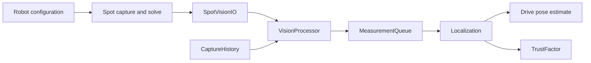

# Vision → robot integration

For camera pixel counts, code examples, every configuration option, and control values,
start with [Camera configuration](camera-configuration.md).

Spot turns camera images into possible camera positions. The robot checks those results, converts them into robot positions, and uses them to correct its driving estimate. This guide follows startup, then one observation through the system.

**Current state:** `VisionConfig.CAMERAS` is empty and `FUSION_ENABLED` is `false`. The planned cameras are `left`, `right`, `front`, and `back`, all fixed to the chassis. Measured camera settings and hardware qualification are still needed before vision can correct the robot's pose. Heading correction is also disabled.



Robot source links below point into `offseason-bot/src/main/java/frc/robot/`.

## 1. Define what Spot should run

[VisionConfig.java](../offseason-bot/src/main/java/frc/robot/vision/VisionConfig.java) owns the robot's camera definitions, measured mounts, field layout, and fusion settings. Keeping these together makes the robot's physical setup explicit.

Students add named camera constants to `VisionConfig.java`, just as they configure
other subsystems, and register them in `CAMERAS`. Settings compile with robot
code and publish to Spot automatically; no camera configuration JSON is needed.
The following values are illustrative and must be replaced with measured geometry
and verified capture settings/controls before use:

```java
public static final SpotCameraConfig FRONT = new SpotCameraConfig(
    "front", true,
    mount(.10, 0, .30, 0, 0, 0), // x/y/z metres; roll/pitch/yaw degrees
    0, // image rotation: 0 or 180 degrees
    new CaptureSettings(640, 480, 30, PixelFormat.MJPEG),
    List.of(SpotCameraConfig.Control.pinned("exposure_auto", 1)));

public static final List<SpotCameraConfig> CAMERAS = List.of(FRONT);
```

Mount axes are NWU: +X forward, +Y left, +Z up; rotations are right-handed.
Production roles remain `left`, `right`, `front`, `back`, chassis-fixed and
required, in that order. `Control.pinned(name, value)` requires the robot's value;
`Control.tunable(name, defaultValue)` permits a saved GUI override. Use the full
`Control` constructor for optional controls. `CaptureSettings` takes resolution,
FPS and USB pixel format directly. MJPEG is compressed over USB; YUYV is an
explicit option for verified uncompressed setups. The protocol's mode ID and
signature are generated internally from those settings, so students do not
configure mode names, mode lists or signature strings. Rebuild and deploy after
changing Java settings. Physical USB binding, intrinsic calibration and timing
qualification stay on the Jetson.

Capture-setting changes produce new mode identities and require matching
calibration/timing evidence. Migrating hand-named modes to this API may require
updating a saved mode selection and recalibrating/requalifying in Spot. Physical
lens/focus changes still require recalibration even with unchanged capture values.

[SpotCameraConfig.java](../offseason-bot/src/main/java/frc/robot/vision/SpotCameraConfig.java)
validates settings and converts them into protocol messages. `VisionConfig`
derives the robot's processing mounts from those same camera definitions, so
there is only one place to enter each mount. `SpotCameraProfiles.Camera` remains
the internal processing value type. The configuration defaults remain empty,
fusion remains disabled, and no placeholder mounts are published.

[SpotProtocol.java](../offseason-bot/src/main/java/frc/robot/vision/SpotProtocol.java) builds the messages, converts pose formats, and hashes the configuration. The hash lets both computers confirm they are using the same settings.

[generated/SpotProtos.java](../offseason-bot/src/main/java/frc/robot/vision/generated/SpotProtos.java) provides the generated message classes used to encode and decode packets. Its source is `proto/vision_v2.proto` in the Spot repository; regenerate it when the contract changes.

## 2. Connect vision to the robot

[Robot.java](../offseason-bot/src/main/java/frc/robot/Robot.java) constructs `SpotVisionIO` and `Vision`, supplying the configuration, a fresh session ID, the robot clock, and drivetrain/IMU history. That gives vision the context needed to interpret delayed camera results.

[config/DSOptions.java](../offseason-bot/src/main/java/frc/robot/config/DSOptions.java) supplies `UseVision` and pit-mode controls. `Robot.java` uses them to allow or suppress pose correction while observation checks and diagnostics continue.

## 3. Start each loop with capture-time context

[Vision.java](../offseason-bot/src/main/java/frc/robot/vision/Vision.java) coordinates the vision subsystem. Its `collectInputs()` first records the current motion and tilt, then reads Spot inputs once for the loop.

[CaptureHistory.java](../offseason-bot/src/main/java/frc/robot/vision/CaptureHistory.java) retrieves pose, speed, and tilt at the image's capture time. The robot may have moved since then, so comparing against its current position would give misleading results.

[util/scheduling/SubsystemPriority.java](../offseason-bot/src/main/java/frc/robot/util/scheduling/SubsystemPriority.java) places input collection in IMU → Vision → Localization order, so localization receives this loop's prepared results.

## 4. Send the request and let Spot solve

[SpotVisionIO.java](../offseason-bot/src/main/java/frc/robot/vision/SpotVisionIO.java) publishes the configuration and robot state, including the requested tag IDs, under `/Spot/v2` using NetworkTables.

On the Jetson, these files in `spot-2026/src/spot_vision/` produce the response:

- `beta_transport.py` receives the request and later publishes acknowledgements, health, and observations. It provides the connection and synchronized timing needed for usable results.
- `beta_runtime.py` applies the configuration using saved camera bindings and calibration, then coordinates capture and processing.
- `beta_capture.py` reads images with their capture timing, preserving when each observation happened.
- `beta_processing.py` detects tags and filters them to the robot's requested IDs before solving.
- `pose.py` solves the camera's field pose, supplying candidates for the robot to evaluate.

## 5. Receive one consistent input snapshot

`SpotVisionIO.java` checks configuration acknowledgements, service health, packet identity, and timestamps before returning observations. It uses the NetworkTables capture timestamp in FPGA seconds so later checks share the robot's clock.

[VisionIO.java](../offseason-bot/src/main/java/frc/robot/vision/VisionIO.java) defines that snapshot and the commands/feedback exposed by the connection. This boundary also lets tests supply inputs without a physical Jetson.

## 6. Decide whether an observation is usable

[VisionProcessor.java](../offseason-bot/src/main/java/frc/robot/vision/VisionProcessor.java) checks configuration, calibration, age, duplicates, tag IDs, ambiguity, field bounds, tilt, and agreement with capture-time history. These checks prevent a plausible-looking but unsuitable result from shifting the robot's estimate.

It converts camera pose into robot pose using the inverse measured camera mount, then assigns uncertainty. The output is [results/VisionMeasurement.java](../offseason-bot/src/main/java/frc/robot/vision/results/VisionMeasurement.java): an immutable pose, capture time, source, tag list, and uncertainty that can safely pass between stages.

## 7. Put accepted results in time order

[MeasurementQueue.java](../offseason-bot/src/main/java/frc/robot/vision/MeasurementQueue.java) holds results briefly and releases them oldest first across cameras. Network arrival order can differ from capture order; the default reorder window is 20 ms.

`Vision.java` queues results only when fusion is allowed. Before handing them off, it increases uncertainty conservatively to avoid overcounting overlapping camera evidence.

## 8. Correct the driving estimate, then update trust

[localization/Localization.java](../offseason-bot/src/main/java/frc/robot/localization/Localization.java) drains the measurements, rechecks eligibility and pose history, converts each capture timestamp to CTRE time, and calls `drivetrain.addVisionMeasurement(...)`. It is the single owner of inserting vision into the drive estimator.

Only after submission does it notify `Vision.measurementFused(...)` and update [TrustFactor.java](../offseason-bot/src/main/java/frc/robot/vision/TrustFactor.java). Trust reflects submitted vision evidence and degrades with travel, elapsed time, and collisions. This keeps an accepted observation from improving trust before it actually affects localization.

Pose or gyro resets also clear pending vision and history, preventing older frames from undoing the reset.

## 9. Use the result and choose the next tags

[health/HealthManager.java](../offseason-bot/src/main/java/frc/robot/health/HealthManager.java) reads cached camera availability. Camera health and pose trust answer different questions: a working camera can see no tags while localization trust ages.

[robot_manager/RobotManager.java](../offseason-bot/src/main/java/frc/robot/robot_manager/RobotManager.java) uses localization pose/trust for robot decisions and requests broad or alliance-hub tags for subsequent observations.

[VisionState.java](../offseason-bot/src/main/java/frc/robot/vision/VisionState.java) names the three selection states: `TAGS`, `WAITING_FOR_HUB_TAGS`, and `HUB_TAGS`. `Vision.java` acquires broadly, narrows after fresh accepted alliance-hub evidence, and returns to broad acquisition after 0.5 seconds without it. Selection changes discard pending results from the previous policy.

Finally, `Vision.java` logs status and asks `SpotVisionIO.java` to publish decision feedback, including whether a result was actually fused. That makes the full path from observation to pose correction visible during debugging.
