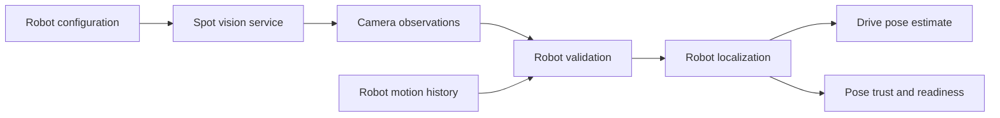

# Vision → robot integration

Spot observes AprilTags and estimates camera poses. The robot uses those observations,
its camera mounts, and its motion history to decide whether to correct its field pose.
Spot supplies vision evidence; robot code owns the decision to use it for localization.

## Configuration and ownership

The robot supplies camera and processing defaults in
`offseason-bot/src/main/deploy/spot-config.json`; field geometry and fusion policy
live in [VisionConfig.java](../offseason-bot/src/main/java/frc/robot/vision/VisionConfig.java).
Saved dashboard overrides take priority until explicitly cleared, including across
robot deployments. See the [camera configuration guide](camera-configuration.md)
for editing, exporting, and clearing settings.

Reusable robot-side support lives in
[`com.team581.vision.spot`](../shared/src/main/java/com/team581/vision/spot/):
communication, protocol data types, observation validation, capture-time history,
measurement ordering, and pose-trust utilities. Each robot owns its subsystem
integration and configuration. The offseason integration remains in
[`frc.robot.vision`](../offseason-bot/src/main/java/frc/robot/vision/).

## From an observation to a pose correction

1. **Collect robot context.** Vision needs the robot's pose and motion at the image's
   capture time. Comparing a delayed image with the robot's current position can
   make a valid observation appear wrong.
2. **Receive observations.** The robot exchanges configuration and status with Spot
   and receives camera observations with capture timing and quality information.
   The robot-side communication boundary is
   [VisionIO.java](../shared/src/main/java/com/team581/vision/spot/VisionIO.java).
3. **Validate and transform.** Robot code checks that an observation belongs to the
   active configuration, is timely, and is consistent with the field and robot
   history. It uses the measured camera mount to convert camera pose into robot
   pose and assigns measurement uncertainty.
4. **Prepare measurements.** Accepted observations are ordered by capture time.
   Overlapping camera evidence is accounted for so repeated views do not create
   unjustified confidence. Acceptance alone does not mean a measurement was fused.
5. **Update localization.**
   [Localization.java](../offseason-bot/src/main/java/frc/robot/localization/Localization.java)
   rechecks eligibility and submits measurements to the drive estimator when fusion
   is allowed. Submitted measurements provide evidence for pose trust and feedback
   for vision diagnostics.

[Vision.java](../offseason-bot/src/main/java/frc/robot/vision/Vision.java) coordinates
this flow for the offseason robot. Keep estimator updates in localization so there
is a single owner of pose corrections.

## Resets and operating policy

Initialize or reset field pose through the robot's localization API. Pending vision
and capture history must be invalidated with the reset so an older observation
cannot undo it. Vision validation depends on a sensible starting pose; receiving
camera observations does not automatically establish one.

Robot code controls whether accepted observations may affect the estimator and
which tags are relevant to the current task. Configuration, connection, or selection
changes can invalidate pending observations. Rejected or suppressed observations
must not improve pose trust.

## Health, readiness, and debugging

Camera availability, accepted observations, and localization readiness describe
different stages. A working camera may see no tags. An accepted observation may
never reach the estimator. A recent correction may still leave too much uncertainty
for a robot action that requires a trustworthy pose.

When diagnosing vision, follow that same sequence: confirm the physical camera
setup and robot configuration, check observation availability and rejection reasons,
then check whether measurements reached the estimator and whether pose trust is
sufficient. Travel, elapsed time, and collisions can reduce trust between corrections.

Use robot logs and the current implementation for exact rejection criteria, tuning
values, and readiness policy. Validate mounts, timing, and localization behavior on
the actual robot before relying on vision-dependent actions.
