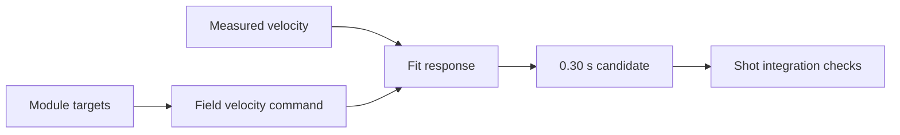

# Provisional offseason swerve response: 0.30 seconds

Use **0.30 s** for the offseason bot's linear velocity-response time constant,
with the existing **0.020 s** prediction horizon. The offseason-only tunable is
`Offseason/ShootOnTheMove/VelocityTimeConstantSeconds`. Competition/shared callers
retain their existing 0.15 s default. Angular response, drag and stationary shot
maps are unchanged.

This is a conservative starting value from competition Q64 telemetry, not a
validated offseason hardware or ball-flight calibration. With a held command,
`predicted = measured + (commanded - measured) * (1 - exp(-horizon / tau))`.
At 20 ms, the new value applies 6.45% of the velocity error instead of 12.48%.
A larger time constant gives a smaller immediate correction.



## Evidence and limitations

Source: `FRC_20260920_184531_cc_Q64.wpilog`, supplied competition match log.
The catalog contains module targets, field-relative speeds, localization pose and
DS enable/auto flags. It lacks the newer synchronized SOTM input contract and
snapshot-age telemetry. No landing observations were supplied.

There are 1,000 measured field-velocity samples and 1,196 module-target samples.
Measured sample intervals have a median of **201 ms** and 90th percentile of
**410 ms**. These are much coarser than the 20 ms prediction horizon. Do not read
the fitted response as a precise measurement of short-horizon dynamics.

The analysis averages the four target wheel vectors to recover robot-center
translation, rotates by logged localization heading, then linearly interpolates
the sparse field-relative targets. It integrates a first-order response with 20
substeps per measured interval, fitting X/Y jointly. Linear interpolation uses
later target samples for offline reconstruction; these are not future inputs
available to the controller. Neither command changes inside unlogged intervals
nor relative logger/sensor delays are identifiable from this data.

Adjacent measured intervals are rejected when disabled (233), outside 10–250 ms
(53), command error below 0.25 m/s (174), or error above 3 m/s (13). The final filter
removes extreme mismatches; it does not establish that all remaining samples are
free of slip, collisions or steering delay. Target gaps are interpolated, not
measured; even accepted measured intervals can contain uncertain command history.
Localization headings are latest-known values, without a synchronized snapshot.

Five-second blocks with `floor(FPGA_seconds / 5) % 3 == 2` are held out together.
The remaining blocks train the fit. These are held-out blocks of one match,
**not independent held-out matches**. The training minimum is **0.27 s**;
0.30 s rounds that estimate toward gentler prediction.

Velocity RMSE below is the RMS norm of the X/Y prediction error, in m/s, over the
observed approximately 200 ms intervals, not a measured 20 ms prediction error:

| Data | Intervals | Measured-only | Old 0.15 s | Candidate 0.30 s |
| --- | ---: | ---: | ---: | ---: |
| Training | 350 | 1.127 | 0.928 | 0.883 |
| Held-out blocks | 176 | 1.209 | 0.991 | 0.951 |
| Held-out starts | 5 | 0.760 | 0.327 | 0.331 |
| Held-out speed changes | 165 | 1.175 | 1.018 | 0.962 |
| Held-out braking | 6 | 2.103 | 0.460 | 0.985 |
| Held-out reversals | 0 | — | — | — |

Overall held-out RMSE improves about 4% versus 0.15 s and 21% versus measured-only.
**Braking gets worse versus 0.15 s**, although it still beats measured-only.
Across all accepted samples, per-regime minima are 0.40 s for starts (25), 0.27 s
for speed changes (483), 0.12 s for braking (16), and 0.32 s for reversals (2).
Auto's minimum is 0.22 s (43); teleop's is 0.27 s (483). These small, imbalanced
regimes do not justify separate production constants.

Timing sensitivity is substantial: linear interpolation with target timestamp
shifts of -50, 0 and +50 ms gives training minima of 0.40, 0.27 and 0.28 s.
A left-held reconstruction with no shift instead runs to the 0.80 s search
boundary. On 86 intervals with approximately steady neighboring commands, even
the 0.30 s model is worse than measured-only (0.460 vs 0.389 m/s). A sustained
speed-scale bias, steering dynamics, or timing ambiguity can be absorbed into tau.
There is no defensible confidence interval or universal single-tau calibration
from this match. The unchanged angular tau is not fitted here. Production-mode
coverage and actual ball accuracy also remain unverified.

## Shot integration results

`SwerveLagShotIntegrationTest` calls the public scoring and feeding paths using
real TOF tables, turret offsets and RPM/hood interpolation maps. It exercises
96 transient cases: starts, speed increases, braking and reversals; both signs;
radial and lateral motion; score distances 2.82/3.94/5.5 m and feed distances
6.5/8.7/12 m. Each transient has a **0.5 m/s command error**.

The test checks that more predicted velocity toward the goal reduces effective
range, lateral prediction aims against inherited lateral velocity, and the
acceleration contribution to turret angular feedforward has the corresponding
sign. Corrections are nonzero and bounded. It also compares against holding the
measured command, which disables the linear prediction/acceleration correction.

Maximum change from the old 0.15 s value across those cases:

| Shot output | Maximum change |
| --- | ---: |
| Turret angle | 0.5272 degrees |
| Compensated distance | 0.0334 m |
| Interpolated shooter speed | 18.45 RPM |
| Interpolated hood angle | 0.0871 degrees |

18 steady-velocity cases, including rest, preserve angle, distance and angular
feedforward to numerical tolerance. Larger command errors can give larger changes;
these maxima are bounds for the tested maneuvers, not every possible shot.
The RPM/hood check covers interpolation maps rather than optional regressions.
This verifies software behavior, not actual turret tracking or scored balls.

Validation completed locally:

```sh
./gradlew :offseason-bot:test --tests frc.robot.util.AimParameterUtilTest --tests frc.robot.util.SwerveLagShotIntegrationTest
./gradlew :shared:test --tests com.team581.math.ShootOnTheMoveTest :offseason-bot:headlessTest
```

The focused shot checks, analytic feedforward checks, shared math tests and full
headless robot suite passed on the original working branch. Before pushing, the
changes were also tested on main at `5afc1349`: all 12 focused aim tests and all
9 shared math tests passed. The headless suite had one failure,
`DeployStartupSimulationTest.startupStaysUnhomedUntilAutoHomingRequest`, expecting
`UNHOMED` but observing `HOME_INWARD` at line 28. Running that test on unchanged
main reproduced the identical failure. This existing deploy-startup failure was
not changed as part of the swerve calibration. Headless tests exercise the regular
robot lifecycle, including scoring, but do not calibrate physical drivetrain response.

## Reproduce and validate on hardware

Use the repository's `analyze-wpilog` skill to catalog before analysis. The script
uses the decoded struct payload API in `wpilog-parser` 3.2.1. Install it in a scratch
project, then supply the absolute path to its `dist/index.mjs`:

```sh
node /scratch/node_modules/wpilog-parser/dist/cli.mjs catalog /path/to/Q64.wpilog --json
node tools/analyze_swerve_lag.mjs /path/to/Q64.wpilog /scratch/node_modules/wpilog-parser/dist/index.mjs
```

The script writes JSON metrics to stdout. Preserve the parser version with the
results. Changing filters, target reconstruction or timestamp alignment changes
the fit; keep those assumptions visible when comparing candidates.

Before treating 0.30 s as calibrated, collect offseason runs with the current
synchronized logging: starts, speed changes, braking and reversals in both axes,
plus in-place rotation for a separate angular fit. Record whole training and
independent validation runs with battery/surface conditions. Check steady-state
command/measured speed scale separately. Compare 20 ms predictions to measured
future velocities, then compare stationary and moving shots at fixed ranges with
video or measured signed misses. Keep the 20 ms horizon and stationary maps fixed
while testing this response constant. Pay particular attention to braking.
