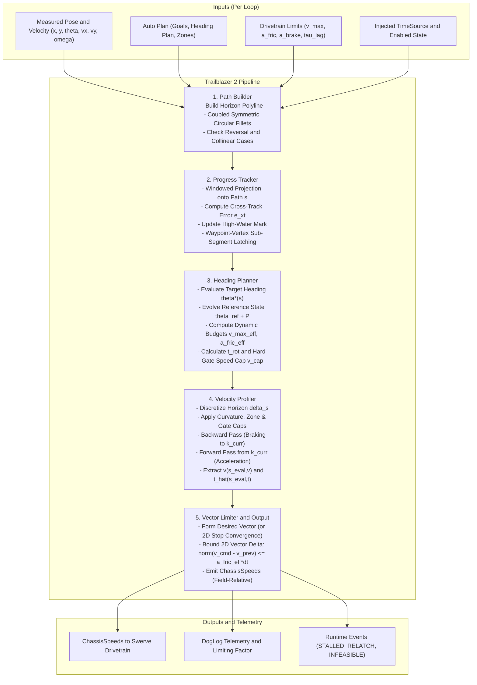
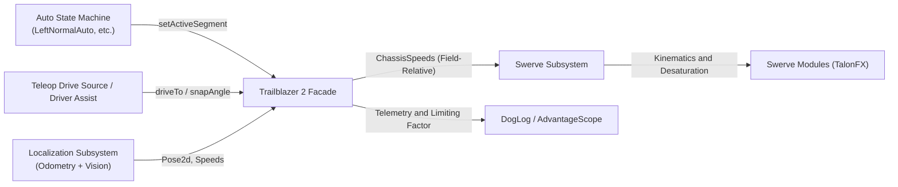

# Trailblazer 2 Design Specification: Overview and System Architecture

**Document ID:** TB2-SPEC-00
**Status:** Approved for Implementation
**Author:** Team 581 Technical Staff
**Applies To:** `com.team581.trailblazer2`, `shared`, `comp-bot`, `offseason-bot`

---

## 1. Overview

Trailblazer 2 is Team 581's autonomous and teleop path-following system for swerve drivetrains. It replaces Trailblazer 1's heuristic point-chasing and distance-PID speed control with an online, arc-length parameterized motion planner:
1. **Pure Java:** Paths are written directly in Java code—no external GUI files to export or keep in sync.
2. **Spatial (not time-based):** Speeds and headings depend on where the robot is along the path ($s$), not a stopwatch ($t$). If a bump, defense, or slow intake delays the robot, the path waits for the robot instead of running ahead without it.
3. **One API for Auto & Teleop:** The same planner runs 15-second autos, single-button teleop `driveTo` assists, and dynamic vision tracking.

---

## 2. Comparison: Trailblazer 1 vs. Alternatives

| Metric | Trailblazer 1 | Choreo | PathPlanner | 254 Hermite Splines | Trailblazer 2 |
| :--- | :--- | :--- | :--- | :--- | :--- |
| **Indexed by** | Heuristic $t \in [0, 1]$ per point | Clock time $t$ | Clock time $t$ | Arc length $s$ or time $t$ | **Path distance $s$ (Horizon)** |
| **Bump / Collision Recovery** | Jerky; target jumps when index advances | Poor; setpoint runs ahead in time | Moderate; PID winds up unless replanned | Moderate; needs high cross-track gain | **Instant; re-solves from current state** |
| **Cornering** | Straight line to point; snaps direction | Full offline solver | Bézier centripetal clamp | Curvature-bounded $\kappa(s)$ | **Circular fillets + 2-pass speed profile + 2D vector limiter** |
| **Accel vs. Braking** | Limits speed-up; no mid-path brake limit | Symmetric | Symmetric | Symmetric | **Symmetric (backward braking + forward torque)** |
| **Heading Control** | Tied to waypoints; flips mid-arc | Coupled offline | Independent profile | Coupled or decoupled | **Decoupled schedule $\theta^*(s)$ with hard/soft gates** |
| **Dynamic / Vision Goals** | Supported via `Supplier<Point>` | Offline only | Limited | Requires re-splining | **Built-in online evaluation** |
| **Preview & Testing** | None (must run on carpet) | Desktop GUI | Desktop GUI | Sim scripts | **`./gradlew previewAuto` + Live App + CI Sim** |

---

## 3. Core Design Rules

1. **Re-Solve Every Loop:** The planner is a pure function of measured state $(x, y, \theta, v_x, v_y, \omega)$, the active plan, and `DrivetrainLimits`. Persistent state is minimal (see §4.1).
2. **Declare Intent, Derive Geometry:** Autos specify tolerances (`within(0.25)`, `stop()`, `before(1.0)`), and the planner calculates corner radii and speeds from robot physics.
3. **Derive from Physics First, Tune Carpet Once:** 9 of 12 drivetrain parameters are computed from CAD and Kraken X60 datasheets (`TunerConstants`); only 3 carpet/lag parameters ($a_{fric}, a_{brake}, \tau_{lag}$) are tuned on the robot ([TB2-SPEC-07](07-empirical-calibration-routine.md)).
4. **Feasible by Construction:** The 2-pass velocity profiler and 2D vector limiter guarantee commands never exceed motor torque or tire grip.
5. **One Planner Everywhere:** Identical code runs on the roboRIO, in desktop unit tests, in `./gradlew previewAuto`, and in CI via injected `TimeSource` and `RobotStateSource` interfaces.
6. **Log the Active Limit:** Every loop logs which constraint (`TOP_SPEED`, `CORNER_CENTRIPETAL`, `GOAL_DECELERATION`, `HEADING_HARD_GATE`, etc.) is currently governing speed.

---

## 4. End-to-End Runtime Pipeline

Every control loop execution (nominally 20 ms / 50 Hz, or 10 ms / 100 Hz), Trailblazer 2 processes five discrete, stateless calculation stages:



### 4.1 Minimal Persistent State Model
The pipeline is strictly functional, with persistent state confined to:
```java
public final class TrailblazerState {
    int segmentIndex;                     // Currently active segment in state machine
    int latchedSubSegmentIndex;           // Active waypoint-to-waypoint sub-segment index k
    Translation2d latchedSubSegmentStart; // Origin of sub-segment k (P_k or re-latched robot pose)
    double progressHighWaterMark;         // Monotonic arc-length s reached along current horizon
    double headingReferenceRad;           // Continuous unwrapped heading reference state theta_ref
    ChassisSpeeds lastCommand;            // Previous loop's emitted velocity vector
    double lastTimestamp;                 // Previous loop timestamp for dynamic dt
}
```
If localization jumps or the robot is shoved laterally beyond `e_relatch`, `latchedSubSegmentStart` re-anchors to the robot's current position while preserving all downstream waypoint vertices $P_{k+1}, \dots, P_N$, and the forward profiler initializes at $k_{curr}$ with `lastCommand`. No trajectory tree is pruned; no replanning latency occurs.

---

## 5. Subsystem Interface Architecture

Trailblazer 2 acts as the **guidance and planning layer**, decoupled from low-level drivetrain motor control and high-level match state machines.



### 5.1 Separation of Responsibilities
1. **Auto State Machine (`BaseImperativeAuto`):** Runs match logic, mechanism commands, and segment transitions using `passedMarker` and `atGoal`.
2. **Trailblazer 2 (`Trailblazer`):** Solves path geometry, velocity profiles, heading schedules, and 2D vector limits; outputs field-relative `ChassisSpeeds`.
3. **Swerve Subsystem (`Swerve`):** Converts field-relative `ChassisSpeeds` to module states and controls TalonFX drive/steer motors.
4. **Localization (`Localization`):** Fuses wheel odometry and AprilTag vision into measured `Pose2d` and `ChassisSpeeds`.
