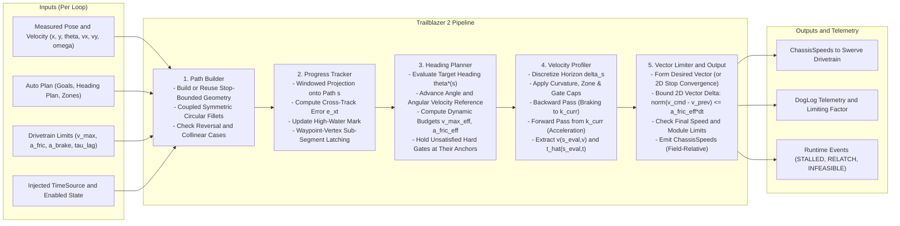
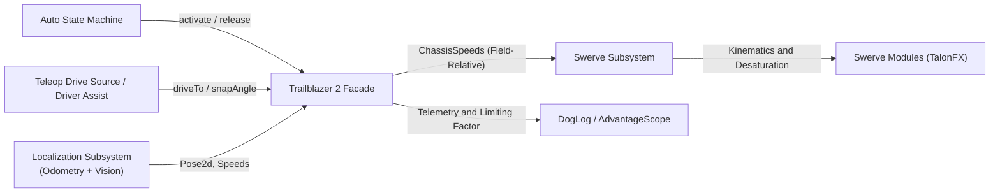

# Trailblazer 2 Design Specification: Overview and System Architecture

**Document ID:** TB2-SPEC-00
**Status:** Implementation design
**Author:** Team 581 Technical Staff
**Applies To:** `com.team581.trailblazer2`, `shared`, robot-project integration

---

## 1. Overview

The goal is a clean library for the 2027 robot codebase. Comp bot, primarily running the new-member pathway, provides intermittent testing opportunities. Old-auto compatibility and gradual TB1 replacement are not requirements; implementation order lives in [08](08-implementation-roadmap-and-migration.md).

Trailblazer 2 is Team 581's autonomous and teleop path-following system for swerve drivetrains. It replaces Trailblazer 1's heuristic point-chasing and distance-PID speed control with an online, arc-length parameterized motion planner:
1. **Pure Java:** Paths are written directly in Java code—no external GUI files to export or keep in sync.
2. **Spatial (not time-based):** Speeds and headings depend on where the robot is along the path ($s$), not a stopwatch ($t$). If a bump, defense, or slow intake delays the robot, the path waits for the robot instead of running ahead without it.
3. **One API for Auto & Teleop:** The same planner runs 15-second autos, single-button teleop `driveTo` assists, and dynamic vision tracking.

---

## 2. Comparison: Trailblazer 1 vs. Alternatives

This is a high-level design comparison, not a benchmark or a current feature audit of other libraries.

| Metric | Trailblazer 1 | Choreo | PathPlanner | 254 Hermite Splines | Trailblazer 2 |
| :--- | :--- | :--- | :--- | :--- | :--- |
| **Indexed by** | Heuristic $t \in [0, 1]$ per point | Clock time $t$ | Clock time $t$ | Arc length $s$ or time $t$ | **Path distance $s$ (Horizon)** |
| **Bump / Collision Recovery** | Jerky; target jumps when index advances | Poor; setpoint runs ahead in time | Moderate; PID winds up unless replanned | Moderate; needs high cross-track gain | **Re-solves from current state; explicit recovery policy** |
| **Cornering** | Straight line to point; snaps direction | Full offline solver | Bézier centripetal clamp | Curvature-bounded $\kappa(s)$ | **Circular fillets + 2-pass speed profile + 2D vector limiter** |
| **Accel vs. Braking** | Limits speed-up; no mid-path brake limit | Symmetric | Symmetric | Symmetric | **Bounded braking and acceleration; independently derived limits** |
| **Heading Control** | Tied to waypoints; flips mid-arc | Coupled offline | Independent profile | Coupled or decoupled | **Decoupled schedule $\theta^*(s)$ with hard/soft gates** |
| **Dynamic / Vision Goals** | Supported via `Supplier<Point>` | Offline only | Limited | Requires re-splining | **Built-in online evaluation** |
| **Preview & Testing** | None (must run on carpet) | Desktop GUI | Desktop GUI | Sim scripts | **VS Code preview + shared Java runner + CI simulation** |

---

## 3. Core Design Rules

1. **Re-Solve Every Loop:** Math calculators take measured state, plan, limits, previous state, and `dt` explicitly. Runtime owns state and IO (see §4.1); unchanged geometry can be cached.
2. **Declare Intent, Derive Geometry:** Autos specify tolerances (`within(0.25)`, `stop()`, `before(1.0)`), and the planner calculates corner radii and speeds from robot physics.
3. **Derive from Physics First, Validate on Carpet:** Start with CAD/motor estimates and validate empirical limits and controller defaults per robot ([TB2-SPEC-07](07-empirical-calibration-routine.md)).
4. **Enforce Modeled Limits:** Profile and final-command checks bound combined motion within the validated model. Infeasible initial states require explicit recovery; command bounds alone do not guarantee real tire grip.
5. **One Planner Everywhere:** Identical code runs on the roboRIO, in desktop unit tests, in the VS Code preview runner, and in CI via injected time and state.
6. **Log the Active Limit:** Every loop logs which constraint (`TOP_SPEED`, `CORNER_CENTRIPETAL`, `GOAL_DECELERATION`, `HEADING_HARD_GATE`, etc.) is currently governing speed.

---

## 4. End-to-End Runtime Pipeline

Every control loop execution (nominally 20 ms / 50 Hz, or 10 ms / 100 Hz), Trailblazer 2 processes five calculation stages, with state owned by runtime:



### 4.1 Persistent State Model
Calculators are pure; runtime owns state. Core motion fields include:
```java
public final class TrailblazerState {
    int segmentIndex;                     // Currently active segment in state machine
    int latchedSubSegmentIndex;           // Active waypoint-to-waypoint sub-segment index k
    Translation2d latchedSubSegmentStart; // Origin of sub-segment k (P_k or re-latched robot pose)
    double progressHighWaterMark;         // Monotonic progress within this geometry generation
    long geometryGeneration;             // Prevent comparing old and rebuilt arc lengths
    double headingReferenceRad;           // Continuous unwrapped heading reference state theta_ref
    double headingReferenceVelocity;     // Angular reference velocity
    ChassisSpeeds lastCommand;            // Previous loop's emitted velocity vector
    double lastTimestamp;                 // Previous loop timestamp for dynamic dt
}
```
Runtime also owns activation/goal IDs, fired markers, applied-command history, target filters, and timeout/dwell timers. Recovery remaps progress while preserving goal/event identity; see [01](01-path-geometry-and-kinematics.md). Localization supplies validity/reset signals, not TB2-specific vision-noise thresholds.

### 4.2 Tick and Lifecycle Contracts

- **Input:** One coherent `TickInput` per update: timestamp, field pose/speeds, enabled/localization status, resolved targets, and optional last-applied command. Use meters, seconds, radians, and counterclockwise-positive rotation.
- **Context:** Activation supplies robot limits, tracking policy, field bounds/keepouts, footprint, and module geometry. Pure footprint checks cover the route and permitted headings before activation or rebuild.
- **Output:** Cache `TickResult` (command, status, readiness, events, diagnostics); repeated getters do not advance execution.
- **Stops and markers:** Measured position, linear/angular speed, heading readiness, and dwell determine stop completion. Intermediate stops release explicitly. Markers fire once per activation in authored order; rebuilds cannot replay them.
- **Lifecycle:** Explicit start/update/cancel; completion is latched until restart. Invalid input, stale localization, or invalid/excessive `dt` faults without advancing events. Cancellation hands off through a seeded controller or controlled stop; disabled mode inhibits output and requires reactivation. Faults/timeouts are not success.

---

## 5. Subsystem Interface Architecture

Trailblazer 2 acts as the **guidance and planning layer**, decoupled from low-level drivetrain motor control and high-level match state machines.



### 5.1 Separation of Responsibilities
1. **Auto State Machine (`BaseImperativeAuto`):** Runs match logic, mechanism commands, and segment transitions using `passedMarker` and `atGoal`.
2. **Trailblazer 2 (`Trailblazer`):** Solves path geometry, velocity profiles, heading schedules, and 2D vector limits; outputs field-relative `ChassisSpeeds`.
3. **Swerve Subsystem (`Swerve`):** Converts field-relative `ChassisSpeeds` to module states and controls TalonFX drive/steer motors.
4. **Localization (`Localization`):** Fuses wheel odometry and AprilTag vision into measured `Pose2d` and `ChassisSpeeds`.


### 5.2 Math and Runtime Separation

Under `com.team581.trailblazer2`:

| Package / boundary | Responsibility |
| :--- | :--- |
| `model` | Immutable plans, resolved inputs/results, limits, and stable IDs |
| `math` | Pure geometry, projection, profiling, heading, and constraint calculators; explicit state and `dt`, no IO |
| `runtime` | Activation, state transitions, supplier/filter history, events, and cached output |
| Robot integration | Localization snapshots, drive-source selection, controls, telemetry, and drivetrain output |

Keep season-specific field definitions and robot configuration outside the shared engine. Desktop tooling uses the same model/math/runtime without constructing hardware.

Use the existing `DriveSource` boundary with explicit TB2 selection, preserving normal pathway operation. Only one controller owns each axis; incorporate any snap/aim demand before combined limiting ([04](04-teleop-and-dynamic-assist.md)). Report downstream saturation/applied commands; do not assume kinematics alone limits module steering or acceleration.
