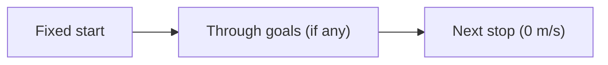

# Trailblazer 2 Design Specification: Path Geometry & Kinematics

**Document ID:** TB2-SPEC-01
**Status:** Implementation design
**Author:** Team 581 Technical Staff
**Applies To:** `PathBuilder`, `ProgressTracker`, `AutoGeometry`

---

## 1. Overview

### Trailblazer 1

- Follows a list of waypoints, with Bézier curves added by hand when needed.
- Aims directly at the next waypoint, so switching targets can change the drive direction in one 20 ms loop.
- Cuts corners by varying amounts depending on speed and when the target switches.
- Tracks progress by waypoint index and can skip ahead where the route crosses itself.
- Aims at the waypoint from its new position after a bump, which can send it across obstacles.

### Trailblazer 2

- Builds a path to the next stop by joining straight legs with tangent circular arcs called fillets.
- Sizes each fillet so its closest point to the waypoint is within the set distance, such as 25 cm for `within(0.25)`.
- Finds the closest point in a local window to avoid skipping ahead where the path crosses itself.
- Measures progress in meters along the path and separately tracks event progress, which only moves forward.
- Steers along the path tangent and uses sideways distance from the path to correct drift.
- Can rebuild the path to the next unfinished goal if the robot strays too far, with fresh checks for constraints and keepouts.

The former numerical claims in the [comparison image](tb1-vs-tb2-comparison.png) are illustrative only (see [validation](07-empirical-calibration-routine.md#3-physics-sandbox--model-validation)).

---

## 2. Circular Fillet Mathematics

A circular fillet rounds the corner at $P_k$ between consecutive goals $P_{k-1}$, $P_k$, and $P_{k+1}$. The formulas below apply to nonzero-length legs with a turn angle strictly between zero and 180 degrees; see sections 3 and 7 for degenerate cases.

The incoming and outgoing leg vectors and lengths are:

$$
\vec{L}_{in} = P_k - P_{k-1}, \qquad L_{in} = \|\vec{L}_{in}\|
$$

$$
\vec{L}_{out} = P_{k+1} - P_k, \qquad L_{out} = \|\vec{L}_{out}\|
$$

Their unit direction vectors are:

$$
\hat{u} = \frac{\vec{L}_{in}}{L_{in}}, \qquad
\hat{v} = \frac{\vec{L}_{out}}{L_{out}}
$$

### 2.1 Corner Angle and Turn Direction

The unsigned change in direction, $\theta$, is:

$$
\theta = \left|\mathrm{atan2}\left(u_x v_y - u_y v_x,\; u_x v_x + u_y v_y\right)\right|
$$

A straight path has $\theta = 0$, a right-angle turn has $\theta = \pi/2$, and a reversal approaches $\theta = \pi$.

The turn direction is stored separately for positioning the circle center:

$$
\sigma_{turn} = \mathrm{sgn}(u_x v_y - u_y v_x)
$$

Here, $+1$ means a left (counterclockwise) turn and $-1$ means a right (clockwise) turn.

### 2.2 Tangent Length and Distance from the Corner

For a fillet of radius $r$, the distance from $P_k$ to each tangent contact point ($T_{in}$ and $T_{out}$) along its leg is:

$$
t = r \tan\left(\frac{\theta}{2}\right)
$$

The distance from $P_k$ to the closest point on the arc (the arc apex) is:

$$
d_{dev} = r\left(\frac{1}{\cos(\theta/2)} - 1\right)
= r\left(\sec\left(\frac{\theta}{2}\right) - 1\right)
$$

### 2.3 Choosing the Fillet Radius

The radius must satisfy the waypoint's `within` distance and leave room for neighboring fillets. In the formulas below, $L_k$ is the length of the leg from $P_{k-1}$ to $P_k$, and $L_{k+1}$ is the length from $P_k$ to $P_{k+1}$.

**Radius allowed by `within`.** For a tolerance of $\delta_k$ meters, the largest radius satisfying $d_{dev} \le \delta_k$ is:

$$
r_{\delta,k} = \frac{\delta_k}{\sec(\theta_k/2) - 1}
$$

**Desired tangent length.** Each corner uses equal entry and exit tangent lengths. Cap the desired length at $\eta = 0.85$ of the shorter adjacent leg:

$$
t_{des,k} = \min\left(
  r_{\delta,k}\tan\left(\frac{\theta_k}{2}\right),
  \; \eta\min(L_k, L_{k+1})
\right)
$$

**Shared-leg scale factor.** The two fillets on leg $L_k$ may use at most $\gamma = 0.95$ of its length. Their scale factor is:

$$
\sigma_{leg,k} =
\begin{cases}
\dfrac{\gamma L_k}{t_{des,k-1} + t_{des,k}}
  & \text{if } t_{des,k-1} + t_{des,k} > \gamma L_k \\
1.0 & \text{otherwise}
\end{cases}
$$

**Clamped tangent length and geometric radius.** Apply the smaller scale factor from the two adjacent legs to both tangents at corner $k$:

$$
t_{clamped,k} = t_{des,k}\min\left(\sigma_{leg,k},\; \sigma_{leg,k+1}\right)
$$

$$
r_{geom,k} = \frac{t_{clamped,k}}{\tan(\theta_k/2)}
$$

This keeps neighboring fillets from overlapping while preserving equal entry and exit tangent lengths.

**Final radius.** Use the smaller of the tolerance and geometry limits:

$$
r_k = \min\left(r_{\delta,k},\; r_{geom,k}\right)
$$

If a requested pass-speed ceiling $v_{pass}$ requires a larger radius than $r_k$ at the lateral acceleration limit $a_{lat}$:

$$
r_{req} = \frac{v_{pass}^2}{a_{lat}} > r_k
$$

then `VelocityProfiler` caps corner speed at $\sqrt{a_{lat}r_k}$, and the preview runner logs a warning.

---

## 3. Boundary Conditions & Edge Cases

- **Collinear Corners:** Merge only genuinely collinear legs within documented numeric tolerance, preserving goal anchors. A blanket one-degree bypass creates a tangent discontinuity. For small nonzero turns, evaluate the denominator stably as $2\sin^2(\theta/4)/\cos(\theta/2)$ and retain the fillet; reject numerically unresolved geometry rather than inventing a sharp join.
- **Sharp Turns ($\theta_k \ge 135^\circ = 2.356\text{ rad}$):** Intentional reversals should be authored with `Goal.stop(...)`. If a near-reversal turn ($135^\circ \le \theta_k < 180^\circ$) is authored as `Goal.through(...)`, $r_{geom, k}$ naturally shrinks and slows the robot down, and the previewer logs a `NEAR_REVERSAL_CORNER` warning suggesting `Goal.stop(...)`.
- **Explicit Stop Goals (`Goal.stop(...)`):** $r_k = 0, t_k = 0$, and exit speed is pinned to $0.0\text{ m/s}$.

---

## 4. Planning Horizon

The **planning horizon** is how much of the path the planner uses to plan turns and speeds. Build from the fixed start (§6) through the next `Goal.stop(...)`, including every through goal in between.



The profiler works backward from zero speed at the stop. Neighboring fillets share the space on the straight between them (§2.3). Both calculations keep the same endpoint as the robot advances.

- **Capacity.** Check goal and sample counts before activation. Accept paths up to the configured limits and reject oversized paths without truncating them.
- **Rebuilds.** Build static geometry at activation, release from a completed stop, or recovery. Cache it between rebuilds. A dynamic goal change starts a new geometry generation (§6).
- **Future shorter horizon.** Prove that the speed at the cutoff accounts for every constraint beyond it and that neighboring fillets keep the same tangent lengths as on the full path. The straight-line braking distance `v_max²/(2*a_brake)` alone cannot establish this because cornering and rotation can reduce available braking.

---

## 5. Progress Tracking & Spatial Parameterization

The path within the horizon is parameterized by cumulative arc length $s \in [0, S_{total}]$.

```
s = 0                                                             s = S_total
|------------------*~~~~~~~~~~~~~*-----------------------------------|
[Straight Leg 1]  T_in   [Arc]   T_out        [Straight Leg 2]
```

### 5.1 Position, Tangent, and Curvature

Let $l$ be the distance from the start of the current path piece. The formulas below give its position $\mathbf{r}$, unit tangent $\hat{t}$, and curvature magnitude $\kappa$.

**Straight segment.** The straight part of leg $k$ runs from $T_{out,k-1}$ to $T_{in,k}$ in unit direction $\hat{u}_k$. Subtract the two tangent lengths to get the length of the straight segment.

$$
\Delta s_{line,k} = L_k - t_{clamped,k-1} - t_{clamped,k}
$$

For $l \in [0,\Delta s_{line,k}]$, the position starts at $\mathbf{p}_{start,k} = \mathbf{T}_{out,k-1}$.

$$
\mathbf{r}(l) = \mathbf{p}_{start,k} + l\hat{u}_k,
\qquad \hat{t}(l) = \hat{u}_k,
\qquad \kappa(l) = 0
$$

**Fillet arc.** At corner $P_k$, use the radius $r_k$, turn angle $\theta_k$, and turn sign $\sigma_{turn,k}$ from section 2. The arc length is $\Delta s_{arc,k} = r_k\theta_k$.

The entry and exit points are each $t_{clamped,k}$ from the corner along their respective legs.

$$
\mathbf{T}_{in,k} = P_k - t_{clamped,k}\hat{u}_{in,k}
$$

$$
\mathbf{T}_{out,k} = P_k + t_{clamped,k}\hat{u}_{out,k}
$$

The circle center is one radius from the entry point along the unit normal pointing into the turn.

$$
\hat{n}_{in,k} = \sigma_{turn,k}
\begin{bmatrix}
-u_{in,y} \\
u_{in,x}
\end{bmatrix},
\qquad
\mathbf{C}_k = \mathbf{T}_{in,k} + r_k\hat{n}_{in,k}
$$

The start angle is the direction from the center to the entry point. Here $T_{in,x}$ and $T_{in,y}$ are the components of $\mathbf{T}_{in,k}$.

$$
\alpha_{start,k} = \mathrm{atan2}(T_{in,y} - C_{k,y},\; T_{in,x} - C_{k,x})
$$

At distance $l$ along the arc, $\phi = l/r_k$ ranges from $0$ to $\theta_k$. The angle from the center to the current point is $\alpha = \alpha_{start,k} + \sigma_{turn,k}\phi$.

$$
\mathbf{r}(\phi) = \mathbf{C}_k + r_k
\begin{bmatrix}
\cos\alpha \\
\sin\alpha
\end{bmatrix}
$$

$$
\hat{t}(\phi) = \sigma_{turn,k}
\begin{bmatrix}
-\sin\alpha \\
\cos\alpha
\end{bmatrix},
\qquad
\kappa = \frac{1}{r_k}
$$

### 5.2 Local Projection and Progress

**Search window.** To avoid jumping to another leg at a crossing or overlap, search near the high-water mark $s_{high\_water}$. The tracking policy sets the backward and forward distances $d_{back}$ and $d_{fwd}$, which are tested against supported speeds and tick intervals. Clip the window to the path bounds.

$$
s_{min} = \max(0,\; s_{high\_water} - d_{back}),
\qquad
s_{max} = \min(S_{total},\; s_{high\_water} + d_{fwd})
$$

**Measured progress.** Project the robot position $\mathbf{p}_{robot} = (x,y)$ onto the portion of each path piece inside $[s_{min},s_{max}]$. The closest point is $\mathbf{p}^*$, and its arc-length coordinate $s_{meas}$ is used for control and speed profiling.

**Event progress.** Use the high-water mark for event ordering and to anchor the search window. Update it with the measured progress.

$$
s_{high\_water,new} = \max(s_{high\_water},\; s_{meas})
$$

Large backward displacement triggers recovery. The high-water mark is local to each geometry generation (see section 6).

**Cross-track error.** At the closest point, rotate the path tangent with components $(t_x,t_y)$ to get the left-hand unit normal.

$$
\hat{n}(s_{meas}) =
\begin{bmatrix}
-t_y \\
t_x
\end{bmatrix}
$$

Project the offset from the path to the robot onto that normal to get the signed error.

$$
e_{xt} = (\mathbf{p}_{robot} - \mathbf{p}^*) \cdot \hat{n}(s_{meas})
$$

Positive error means the robot is left of the path. The tracking calculator applies a correction along the normal with signed speed

$$
v_{xt} = \mathrm{clamp}(-e_{xt}/\tau_{xt})
$$

---

## 6. Anchors, geometry generations, and recovery

### Goal anchors and passage

An **anchor** is the point on the path that represents a goal. Use the same anchor for passage, markers, and heading references.

| Goal | Anchor |
| --- | --- |
| Rounded through goal | Fillet apex |
| Unrounded through goal | Waypoint vertex |
| Explicit stop | Path endpoint |

- **Path origin.** Fix it at activation or release from a completed stop.
- **Progress.** Use measured projection for control and the high-water mark for events (§5.2).
- **Projection.** Within the distance window, search only the pieces allowed by the active goal and path order. This prevents jumps to crossing legs.

Count a through goal as passed only if both checks pass.

1. The robot crossed the anchor. If two ticks straddle it, check the measured motion between them conservatively.
2. The measured closest approach to the goal was within tolerance.

On passage, advance the active goal ID and keep the vertex and neighboring fillets. On a miss, report failure and suppress the success marker.

### Path rebuilds

A **geometry generation** is one version of the built path. Each version has its own arc-length coordinates and high-water mark.

- Remap the active goal and path piece.
- Reproject the measured pose and track progress in the new path's coordinates.
- Carry over fired event IDs and completed goals.
- Keep unsatisfied stops and hard gates pending.
- Require measured passage even if a dynamic rebuild moves an anchor behind the robot.

### Recovery

Runtime may request recovery after sustained tracking error or an explicit localization reset.

- **Tracking error.** Store the error thresholds and required duration in a named Java tracking policy. Validate them with scenarios.
- **Localization reset.** Localization accepts measurements and signals resets. TB2 uses that signal for vision jumps.

1. Start a new geometry generation toward the next uncompleted goal. Preserve command history.
2. Check the robot's footprint along the entire connection against the supplied keepouts.
3. If the connection is invalid, stop and report a fault. The caller owns alternate routing.

## 7. Degenerate and dynamic inputs

| Input | What to do |
| --- | --- |
| Nonfinite coordinate | Reject it. |
| Consecutive through goals at the same position | Reject them and retain their IDs and markers. |
| A single stop at the same position | Allow heading-only motion. |
| Through goal at an exact reversal, or a noncollinear through corner with zero tolerance | Report a validation error and require an explicit stop. A finite-radius tangent arc is impossible. |
| Near reversal | Allow a small fillet with a warning if the radius and length meet numeric tolerances. |
| Zero-length leg | Use terminal position and heading control. Skip tangent division. |

Clamp projection and evaluation to each piece's valid domain. Use deterministic tie-breaking at joins.

For named dynamic targets, runtime evaluates suppliers and filters their values once per tick, following [04](04-runtime-integration-and-teleop-assist.md). Runtime keeps the filter history and passes only resolved values to `PathBuilder`.
