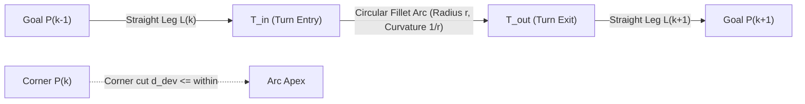
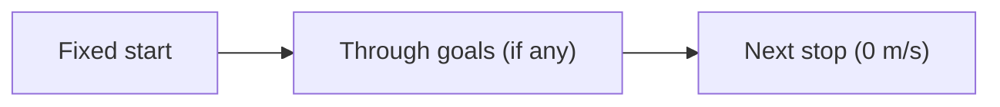

# Trailblazer 2 Design Specification: Path Geometry & Kinematics

**Document ID:** TB2-SPEC-01
**Status:** Implementation design
**Author:** Team 581 Technical Staff
**Applies To:** `PathBuilder`, `ProgressTracker`, `AutoGeometry`

---

## 1. Overview

### How Trailblazer 1 Works

Trailblazer 1 does not actually build a continuous path curve:

1. **A list of points, not a curve:** An auto is just a list of $(x, y)$ points (`AutoPoint`). There are no lines or curves connecting them unless someone manually creates a Bézier curve with hand-guessed control points.
2. **Look-at-next-point tracking:** `HeuristicPathTracker` checks the robot's distance to the next point (and up to 2 points ahead). Once the robot gets close enough to the current target point, the tracker switches the target to the next point in the list.
3. **Point-and-shoot steering:** `PidPathFollower` calculates the straight-line angle from the robot's current pose directly to that single target point (`getDriveDirection`) and tells the swerve drive to head that way.

**Why that causes problems on the robot:**

- **Instant direction snaps at every waypoint:** Because the robot drives straight toward Point 1 and then suddenly switches its target to Point 2, the commanded drive direction jumps in a single 20 ms loop. The swerve modules have to violently snap to a new angle while moving at high speed.
- **No guaranteed path between points:** If the robot gets bumped sideways by another robot, it just aims straight from its new position to the target point instead of returning to the intended lane—which can clip field obstacles (like the Reef or stage posts).
- **Corner cutting is unpredictable:** How much the robot cuts a corner depends on how fast it happens to be moving and when `HeuristicPathTracker` decides to advance the index, rather than a clear distance in meters.

---

### How Trailblazer 2 Works

Trailblazer 2 turns the list of waypoints into a **single smooth road** and tracks how far along that road the robot has traveled:

1. **Connect points with straight lines:** First, draw straight lines ("legs") connecting each waypoint to the next.
2. **Round every corner with a circle ("fillet"):** At every pass-through waypoint, replace the sharp corner with a smooth circular turn that is tangent to both straight lines. The circle is sized automatically so the curve never cuts the corner by more than the waypoint's `within` distance (e.g. `within(0.25)` means the nominal arc passes within $25\text{ cm}$ of the corner point; other points on the arc may be farther away).
3. **Measure distance along the curve ($s$):** The entire path from the start to the next stop point now has a known length in meters (arc length $s$).
4. **Find the closest spot on the path:** Every loop, `ProgressTracker` drops a perpendicular line from the robot onto the nearby section of the path to find two numbers:
   - **Progress ($s$):** How many meters along the path the robot is (with measured projection kept separate from monotonic event progress).
   - **Cross-track error ($e_{xt}$):** How many meters left or right of the path line the robot has drifted, so the controller can push it gently back onto the line.
5. **Re-anchor only if knocked far off course:** A configured recovery policy may create a new path from the measured pose to the next uncompleted goal. This changes geometry and requires fresh constraint/keepout checks; it is not automatically a collision-free recovery.

| Feature                 | Trailblazer 1                                    | Trailblazer 2                                                               |
| :---------------------- | :----------------------------------------------- | :-------------------------------------------------------------------------- |
| **Path shape**          | Disconnected points (or manual Bézier guesses)   | Straight lines automatically joined by smooth circular turns                |
| **Corner cutting**      | Unpredictable heuristic index switching          | Nominal fillet passes within the declared distance of the corner     |
| **Where to aim**        | Straight line from robot to current target point | Follow the curve tangent $\hat{t}(s)$ + push back to the line if off-center |
| **Progress tracking**   | `currentPointIndex` heuristic                    | Continuous distance $s$ (meters) along the path                             |
| **Self-crossing paths** | Can accidentally skip ahead to a later point     | Only searches a local window around current progress $s$                    |



### Historical comparison

The retained [comparison image](tb1-vs-tb2-comparison.png) is illustrative. Its former numerical claims are not acceptance evidence; see [07](07-empirical-calibration-routine.md#3-physics-sandbox--model-validation).

---

## 2. Circular Fillet Mathematics

A circular fillet rounds the corner at $P_k$ between consecutive goals $P_{k-1}$, $P_k$, and $P_{k+1}$. The formulas below apply to nonzero-length legs with a turn angle strictly between zero and 180 degrees; see sections 3 and 7 for degenerate cases.

The incoming and outgoing leg vectors and lengths are:

$$
\vec{L}_{in} = P_k - P_{k-1}, \qquad L_{in} = \|\vec{L}_{in}\|
$$

$$
\vec{L}_{out} = P_{k+1} - P_k, \qquad L_{out} = \|\vec{L}_{out}\|
$$

Their unit direction vectors are:

$$
\hat{u} = \frac{\vec{L}_{in}}{L_{in}}, \qquad
\hat{v} = \frac{\vec{L}_{out}}{L_{out}}
$$

### 2.1 Corner Angle and Turn Direction

The unsigned change in direction, $\theta$, is:

$$
\theta = \left|\mathrm{atan2}\left(u_x v_y - u_y v_x,\; u_x v_x + u_y v_y\right)\right|
$$

A straight path has $\theta = 0$, a right-angle turn has $\theta = \pi/2$, and a reversal approaches $\theta = \pi$.

The turn direction is stored separately for positioning the circle center:

$$
\sigma_{turn} = \mathrm{sgn}(u_x v_y - u_y v_x)
$$

Here, $+1$ means a left (counterclockwise) turn and $-1$ means a right (clockwise) turn.

### 2.2 Tangent Length and Distance from the Corner

For a fillet of radius $r$, the distance from $P_k$ to each tangent contact point ($T_{in}$ and $T_{out}$) along its leg is:

$$
t = r \tan\left(\frac{\theta}{2}\right)
$$

The distance from $P_k$ to the closest point on the arc (the arc apex) is:

$$
d_{dev} = r\left(\frac{1}{\cos(\theta/2)} - 1\right)
= r\left(\sec\left(\frac{\theta}{2}\right) - 1\right)
$$

### 2.3 Choosing the Fillet Radius

The radius must satisfy the waypoint's `within` distance and leave room for neighboring fillets. In the formulas below, $L_k$ is the length of the leg from $P_{k-1}$ to $P_k$, and $L_{k+1}$ is the length from $P_k$ to $P_{k+1}$.

**Radius allowed by `within`.** For a tolerance of $\delta_k$ meters, the largest radius satisfying $d_{dev} \le \delta_k$ is:

$$
r_{\delta,k} = \frac{\delta_k}{\sec(\theta_k/2) - 1}
$$

**Desired tangent length.** Each corner uses equal entry and exit tangent lengths. Cap the desired length at $\eta = 0.85$ of the shorter adjacent leg:

$$
t_{des,k} = \min\left(
  r_{\delta,k}\tan\left(\frac{\theta_k}{2}\right),
  \; \eta\min(L_k, L_{k+1})
\right)
$$

**Shared-leg scale factor.** The two fillets on leg $L_k$ may use at most $\gamma = 0.95$ of its length. Their scale factor is:

$$
\sigma_{leg,k} =
\begin{cases}
\dfrac{\gamma L_k}{t_{des,k-1} + t_{des,k}}
  & \text{if } t_{des,k-1} + t_{des,k} > \gamma L_k \\
1.0 & \text{otherwise}
\end{cases}
$$

**Clamped tangent length and geometric radius.** Apply the smaller scale factor from the two adjacent legs to both tangents at corner $k$:

$$
t_{clamped,k} = t_{des,k}\min\left(\sigma_{leg,k},\; \sigma_{leg,k+1}\right)
$$

$$
r_{geom,k} = \frac{t_{clamped,k}}{\tan(\theta_k/2)}
$$

This keeps neighboring fillets from overlapping while preserving equal entry and exit tangent lengths.

**Final radius.** Use the smaller of the tolerance and geometry limits:

$$
r_k = \min\left(r_{\delta,k},\; r_{geom,k}\right)
$$

If a requested pass-speed ceiling $v_{pass}$ requires a larger radius than $r_k$ at the lateral acceleration limit $a_{lat}$:

$$
r_{req} = \frac{v_{pass}^2}{a_{lat}} > r_k
$$

then `VelocityProfiler` caps corner speed at $\sqrt{a_{lat}r_k}$, and the preview runner logs a warning.

---

## 3. Boundary Conditions & Edge Cases

- **Collinear Corners:** Merge only genuinely collinear legs within documented numeric tolerance, preserving goal anchors. A blanket one-degree bypass creates a tangent discontinuity. For small nonzero turns, evaluate the denominator stably as $2\sin^2(\theta/4)/\cos(\theta/2)$ and retain the fillet; reject numerically unresolved geometry rather than inventing a sharp join.
- **Sharp Turns ($\theta_k \ge 135^\circ = 2.356\text{ rad}$):** Intentional reversals should be authored with `Goal.stop(...)`. If a near-reversal turn ($135^\circ \le \theta_k < 180^\circ$) is authored as `Goal.through(...)`, $r_{geom, k}$ naturally shrinks and slows the robot down, and the previewer logs a `NEAR_REVERSAL_CORNER` warning suggesting `Goal.stop(...)`.
- **Explicit Stop Goals (`Goal.stop(...)`):** $r_k = 0, t_k = 0$, and exit speed is pinned to $0.0\text{ m/s}$.

---

## 4. Planning Horizon

The **planning horizon** is how much of the path the planner uses to plan turns and speeds. Build from the fixed start (§6) through the next `Goal.stop(...)`, including every through goal in between.



The profiler works backward from zero speed at the stop. Neighboring fillets share the space on the straight between them (§2.3). Both calculations keep the same endpoint as the robot advances.

- **Capacity.** Check goal and sample counts before activation. Accept paths up to the configured limits and reject oversized paths without truncating them.
- **Rebuilds.** Build static geometry at activation, release from a completed stop, or recovery. Cache it between rebuilds. A dynamic goal change starts a new geometry generation (§6).
- **Future shorter horizon.** Prove that the speed at the cutoff accounts for every constraint beyond it and that neighboring fillets keep the same tangent lengths as on the full path. The straight-line braking distance `v_max²/(2*a_brake)` alone cannot establish this because cornering and rotation can reduce available braking.

---

## 5. Progress Tracking & Spatial Parameterization

The path within the horizon is parameterized by cumulative arc length $s \in [0, S_{total}]$.

```
s = 0                                                             s = S_total
|------------------*~~~~~~~~~~~~~*-----------------------------------|
[Straight Leg 1]  T_in   [Arc]   T_out        [Straight Leg 2]
```

### 5.1 Position, Tangent, and Curvature

Let $l$ be the distance from the start of the current path piece. The formulas below give its position $\mathbf{r}$, unit tangent $\hat{t}$, and curvature magnitude $\kappa$.

**Straight segment.** The straight part of leg $k$ runs from $T_{out,k-1}$ to $T_{in,k}$ in unit direction $\hat{u}_k$. Subtract the two tangent lengths to get the length of the straight segment.

$$
\Delta s_{line,k} = L_k - t_{clamped,k-1} - t_{clamped,k}
$$

For $l \in [0,\Delta s_{line,k}]$, the position starts at $\mathbf{p}_{start,k} = \mathbf{T}_{out,k-1}$.

$$
\mathbf{r}(l) = \mathbf{p}_{start,k} + l\hat{u}_k,
\qquad \hat{t}(l) = \hat{u}_k,
\qquad \kappa(l) = 0
$$

**Fillet arc.** At corner $P_k$, use the radius $r_k$, turn angle $\theta_k$, and turn sign $\sigma_{turn,k}$ from section 2. The arc length is $\Delta s_{arc,k} = r_k\theta_k$.

The entry and exit points are each $t_{clamped,k}$ from the corner along their respective legs.

$$
\mathbf{T}_{in,k} = P_k - t_{clamped,k}\hat{u}_{in,k}
$$

$$
\mathbf{T}_{out,k} = P_k + t_{clamped,k}\hat{u}_{out,k}
$$

The circle center is one radius from the entry point along the unit normal pointing into the turn.

$$
\hat{n}_{in,k} = \sigma_{turn,k}
\begin{bmatrix}
-u_{in,y} \\
u_{in,x}
\end{bmatrix},
\qquad
\mathbf{C}_k = \mathbf{T}_{in,k} + r_k\hat{n}_{in,k}
$$

The start angle is the direction from the center to the entry point. Here $T_{in,x}$ and $T_{in,y}$ are the components of $\mathbf{T}_{in,k}$.

$$
\alpha_{start,k} = \mathrm{atan2}(T_{in,y} - C_{k,y},\; T_{in,x} - C_{k,x})
$$

At distance $l$ along the arc, $\phi = l/r_k$ ranges from $0$ to $\theta_k$. The angle from the center to the current point is $\alpha = \alpha_{start,k} + \sigma_{turn,k}\phi$.

$$
\mathbf{r}(\phi) = \mathbf{C}_k + r_k
\begin{bmatrix}
\cos\alpha \\
\sin\alpha
\end{bmatrix}
$$

$$
\hat{t}(\phi) = \sigma_{turn,k}
\begin{bmatrix}
-\sin\alpha \\
\cos\alpha
\end{bmatrix},
\qquad
\kappa = \frac{1}{r_k}
$$

### 5.2 Local Projection and Progress

**Search window.** To avoid jumping to another leg at a crossing or overlap, search near the high-water mark $s_{high\_water}$. The tracking policy sets the backward and forward distances $d_{back}$ and $d_{fwd}$, which are tested against supported speeds and tick intervals. Clip the window to the path bounds.

$$
s_{min} = \max(0,\; s_{high\_water} - d_{back}),
\qquad
s_{max} = \min(S_{total},\; s_{high\_water} + d_{fwd})
$$

**Measured progress.** Project the robot position $\mathbf{p}_{robot} = (x,y)$ onto the portion of each path piece inside $[s_{min},s_{max}]$. The closest point is $\mathbf{p}^*$, and its arc-length coordinate $s_{meas}$ is used for control and speed profiling.

**Event progress.** Use the high-water mark for event ordering and to anchor the search window. Update it with the measured progress.

$$
s_{high\_water,new} = \max(s_{high\_water},\; s_{meas})
$$

Large backward displacement triggers recovery. The high-water mark is local to each geometry generation (see section 6).

**Cross-track error.** At the closest point, rotate the path tangent with components $(t_x,t_y)$ to get the left-hand unit normal.

$$
\hat{n}(s_{meas}) =
\begin{bmatrix}
-t_y \\
t_x
\end{bmatrix}
$$

Project the offset from the path to the robot onto that normal to get the signed error.

$$
e_{xt} = (\mathbf{p}_{robot} - \mathbf{p}^*) \cdot \hat{n}(s_{meas})
$$

Positive error means the robot is left of the path. The tracking calculator applies a correction along the normal with signed speed

$$
v_{xt} = \mathrm{clamp}(-e_{xt}/\tau_{xt})
$$

---

## 6. Anchors, geometry generations, and recovery

Latch the origin once at activation or release from a completed stop. Passing a through goal advances its identity without cutting away its vertex or changing neighboring fillets. Define a rounded through-goal anchor at the arc apex; an unrounded goal anchors at its vertex. Explicit stops anchor at the endpoint. Use these same anchors for passage, markers, and heading references.

Keep measured projection separate from monotonic event progress. Projection windows must also be restricted by the active goal/piece topology; distance alone cannot disambiguate nearby crossing legs. A through-goal passage requires crossing its anchor and measured closest approach within its tolerance. If discrete ticks straddle the crossing, check the intervening measured motion conservatively. A miss reports failure, not a successful marker.

Monotonic progress is meaningful only within one geometry generation. Rebuilds must remap the active goal/piece and reproject the measured pose; never compare an old arc length to a new path's coordinate. Preserve fired event IDs and completed goals across a rebuild, and never skip an unsatisfied stop or hard gate. Dynamic rebuilds cannot manufacture a goal passage merely by moving its anchor behind the robot.

The runtime may request recovery after sustained excessive tracking error or an explicit localization reset. Store tracking thresholds/dwell in a named Java tracking policy and validate them with scenarios. Localization owns measurement acceptance and reset detection; TB2 does not infer a vision jump from a hardcoded pose-noise threshold. Recovery starts a new geometry generation toward the next uncompleted goal and preserves command history. Revalidate the entire connecting path/footprint against supplied keepouts. If no valid connection exists, stop/fault and let the caller choose another route. TB2 does not perform obstacle routing.

## 7. Degenerate and dynamic inputs

- Reject nonfinite coordinates. Consecutive coincident through goals are invalid; do not silently discard their IDs or markers. A single coincident stop is valid for heading-only motion.
- Exact reversal and a zero-tolerance noncollinear through corner have no finite-radius tangent solution. Require an explicit stop and report a validation error. Near reversals may retain a small fillet and warning, provided numeric radius/length tolerances remain valid.
- A zero-length leg uses terminal position/heading control without tangent division. Clamp projection/evaluation to valid piece domains and define deterministic tie-breaking at joins.
- Runtime resolves and filters named dynamic targets once per tick, following [04](04-teleop-and-dynamic-assist.md). `PathBuilder` receives only resolved values; it owns neither supplier evaluation nor filtering history.
