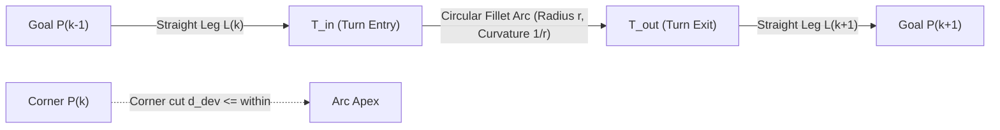
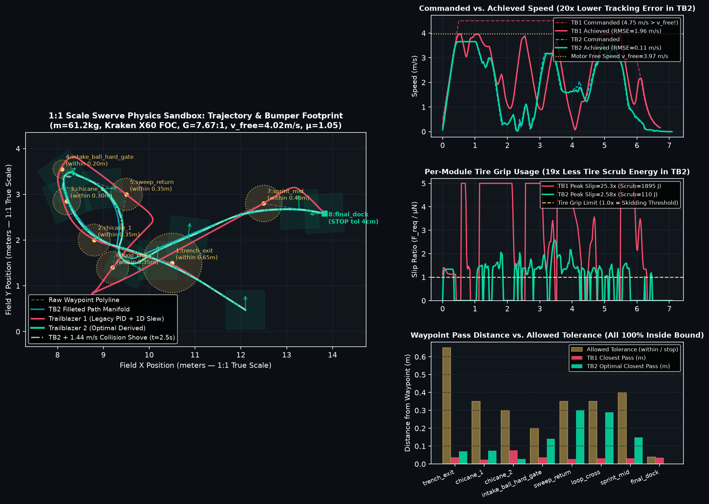

# Trailblazer 2 Design Specification: Path Geometry & Kinematics

**Document ID:** TB2-SPEC-01
**Status:** Approved for Implementation
**Author:** Team 581 Technical Staff
**Applies To:** `PathBuilder`, `ProgressTracker`, `AutoGeometry`

---

## 1. Overview

### How Trailblazer 1 Works

Trailblazer 1 does not actually build a continuous path curve:

1. **A list of points, not a curve:** An auto is just a list of $(x, y)$ points (`AutoPoint`). There are no lines or curves connecting them unless someone manually creates a Bézier curve with hand-guessed control points.
2. **Look-at-next-point tracking:** `HeuristicPathTracker` checks the robot's distance to the next point (and up to 2 points ahead). Once the robot gets close enough to the current target point, the tracker switches the target to the next point in the list.
3. **Point-and-shoot steering:** `PidPathFollower` calculates the straight-line angle from the robot's current pose directly to that single target point (`getDriveDirection`) and tells the swerve drive to head that way.

**Why that causes problems on the robot:**

- **Instant direction snaps at every waypoint:** Because the robot drives straight toward Point 1 and then suddenly switches its target to Point 2, the commanded drive direction jumps in a single 20 ms loop. The swerve modules have to violently snap to a new angle while moving at high speed.
- **No guaranteed path between points:** If the robot gets bumped sideways by another robot, it just aims straight from its new position to the target point instead of returning to the intended lane—which can clip field obstacles (like the Reef or stage posts).
- **Corner cutting is unpredictable:** How much the robot cuts a corner depends on how fast it happens to be moving and when `HeuristicPathTracker` decides to advance the index, rather than a clear distance in meters.

---

### How Trailblazer 2 Works

Trailblazer 2 turns the list of waypoints into a **single smooth road** and tracks how far along that road the robot has traveled:

1. **Connect points with straight lines:** First, draw straight lines ("legs") connecting each waypoint to the next.
2. **Round every corner with a circle ("fillet"):** At every pass-through waypoint, replace the sharp corner with a smooth circular turn that is tangent to both straight lines. The circle is sized automatically so the curve never cuts the corner by more than the waypoint's `within` distance (e.g. `within(0.25)` means stay within $25\text{ cm}$ of the corner point).
3. **Measure distance along the curve ($s$):** The entire path from the start to the next stop point now has a known length in meters (arc length $s$).
4. **Find the closest spot on the path:** Every loop, `ProgressTracker` drops a perpendicular line from the robot onto the nearby section of the path to find two numbers:
   - **Progress ($s$):** How many meters along the path the robot is (which only moves forward, never backward).
   - **Cross-track error ($e_{xt}$):** How many meters left or right of the path line the robot has drifted, so the controller can push it gently back onto the line.
5. **Re-anchor only if knocked far off course:** If the robot is shoved more than $40\text{ cm}$ off the path (or vision snaps the pose), it smoothly draws a new starting line from the robot's current position to the next waypoint without altering any of the upcoming waypoints.

| Feature                 | Trailblazer 1                                    | Trailblazer 2                                                               |
| :---------------------- | :----------------------------------------------- | :-------------------------------------------------------------------------- |
| **Path shape**          | Disconnected points (or manual Bézier guesses)   | Straight lines automatically joined by smooth circular turns                |
| **Corner cutting**      | Unpredictable heuristic index switching          | Exact meter bound (`within(0.25)` stays $\le 25\text{ cm}$ from corner)     |
| **Where to aim**        | Straight line from robot to current target point | Follow the curve tangent $\hat{t}(s)$ + push back to the line if off-center |
| **Progress tracking**   | `currentPointIndex` heuristic                    | Continuous distance $s$ (meters) along the path                             |
| **Self-crossing paths** | Can accidentally skip ahead to a later point     | Only searches a local window around current progress $s$                    |



### Visual Comparison (1:1 Scale Swerve Physics Sandbox)

The figure below runs both controllers through the same 8-waypoint course on an identical 1000 Hz 4-module swerve physics model (`CompTunerConstants`: $m = 61.2\text{ kg}$, $0.84\text{ m}$ bumpers, Kraken X60 FOC, $v_{free} = 4.02\text{ m/s}$, $\mu = 1.05$):

- **Red (Trailblazer 1):** Drives straight at each waypoint and snaps its target direction at the corner, causing the tires to break traction ($25.3\times$ slip) and skid wide outside the path at `4:intake_ball_hard_gate`, `5:sweep_return`, and `6:loop_cross`.
- **Green (Trailblazer 2):** Rounds every corner along the cyan circular fillet inside the yellow `within` circles, slows down before entering each turn, and tracks commanded speed with $20\times$ lower error ($0.11\text{ m/s}$ vs. $1.96\text{ m/s}$) and $19\times$ less tire scrub.



---

## 2. Circular Fillet Mathematics

Consider three consecutive goals: $P_{k-1}$, $P_k$, and $P_{k+1}$ in 2D space.

Let incoming leg vector be $\vec{L}_{in} = P_k - P_{k-1}$, with length $L_{in} = \|\vec{L}_{in}\|$.
Let outgoing leg vector be $\vec{L}_{out} = P_{k+1} - P_k$, with length $L_{out} = \|\vec{L}_{out}\|$.

Unit direction vectors:
$$\hat{u} = \frac{\vec{L}_{in}}{L_{in}}, \quad \hat{v} = \frac{\vec{L}_{out}}{L_{out}}$$

### 2.1 Corner Deflection Angle $\theta$ and Turn Orientation

The corner deflection angle magnitude $\theta \in [0, \pi)$ represents the unsigned angular change between legs:
$$\theta = \left| \mathrm{atan2}\left(u_x v_y - u_y v_x, \; u_x v_x + u_y v_y\right) \right|$$

Taking the absolute value is critical: a signed angle ($\theta < 0$ for clockwise turns) would yield a negative tangent length $t = r \tan(\theta/2) < 0$, corrupting fillet geometry and arc length parameterization.

The turn direction sign $\sigma_{turn} \in \{-1, +1\}$ is preserved separately to position the fillet circle center $C$:
$$\sigma_{turn} = \mathrm{sgn}(u_x v_y - u_y v_x) \quad (+1 = \text{Left / CCW turn}, \; -1 = \text{Right / CW turn})$$

- $\theta = 0$: Collinear, straight motion (no turn).
- $\theta = \frac{\pi}{2}$ ($90^\circ$): Right-angle turn.
- $\theta \to \pi$ ($180^\circ$): Complete directional reversal.

### 2.2 Tangent Length $t$ and Maximum Corner Deviation $d_{dev}$

For a circular fillet of radius $r$:
The tangent length $t$ (distance from corner $P_k$ to the tangent contact points $T_{in}$ and $T_{out}$ along the legs) is:
$$t = r \tan\left(\frac{\theta}{2}\right)$$

The maximum deviation $d_{dev}$ from the sharp corner $P_k$ to the closest point on the circular arc (the arc apex) is:
$$d_{dev} = r \left( \frac{1}{\cos(\theta/2)} - 1 \right) = r \left( \sec\left(\frac{\theta}{2}\right) - 1 \right)$$

```
          P_k (Goal)
          / \
         /   \
        /     \
  T_in *   .   * T_out
      /     .   \
     /    d_dev  \
    /       .     \
   /      [Arc]    \
  /                 \
P_{k-1}             P_{k+1}
```

### 2.3 Radius Bounds & Coupled Symmetric Tangent Allocation

The fillet radius $r_k$ at corner $k$ is computed in three steps:

1. **Deviation Limit (`within` $\delta_k$):**
   To keep the corner cut within $\delta_k$ meters of $P_k$:
   $$d_{dev} \le \delta_k \implies r_{\delta, k} = \frac{\delta_k}{\sec(\theta_k/2) - 1}$$

2. **Coupled Symmetric Tangent Allocation ($t_{in, k} = t_{out, k} = t_k$):**
   A circular arc tangent to two straight lines must have equal entry and exit tangent lengths ($t_{in, k} = t_{out, k}$). To guarantee adjacent corner fillets never overlap on a shared leg $L_k$ while preserving equal tangents at each corner:
   - Desired tangent per corner (capped at $\eta = 0.85$ of its two adjacent legs):
     $$t_{des, k} = \min\left(r_{\delta, k} \tan\left(\frac{\theta_k}{2}\right), \; \eta \cdot \min(L_{k}, \; L_{k+1})\right)$$
   - Shared leg scale factor on leg $L_k$ (capped at $\gamma = 0.95$ of leg length):
     $$\sigma_{leg, k} = \begin{cases} \dfrac{\gamma \cdot L_k}{t_{des, k-1} + t_{des, k}} & \text{if } t_{des, k-1} + t_{des, k} > \gamma \cdot L_k \\ 1.0 & \text{otherwise} \end{cases}$$
   - Clamped symmetric tangent and geometric radius at corner $k$:
     $$t_{clamped, k} = t_{des, k} \cdot \min\left(\sigma_{leg, k}, \; \sigma_{leg, k+1}\right), \quad r_{geom, k} = \frac{t_{clamped, k}}{\tan(\theta_k/2)}$$

3. **Final Fillet Radius:**
   $$r_k = \min\left(r_{\delta, k}, \; r_{geom, k}\right)$$
   _(If the author also requested a minimum pass speed $v_{pass}$ where $r_{req} = v_{pass}^2 / a_{lat} > r_k$, `VelocityProfiler` caps corner speed to $\sqrt{a_{lat} r_k}$ and the CLI previewer logs a warning).\_

---

## 3. Boundary Conditions & Edge Cases

- **Collinear Corners ($\theta_k < 1.0^\circ = 0.0175\text{ rad}$):** Omit the fillet ($r_k = 0, t_k = 0$) and merge the legs into a straight line ($\kappa = 0$) to avoid dividing by zero in $\sec(\theta_k/2) - 1$.
- **Sharp Turns ($\theta_k \ge 135^\circ = 2.356\text{ rad}$):** Intentional reversals should be authored with `Goal.stop(...)`. If a sharp turn ($\theta_k \ge 135^\circ$) is authored as `Goal.through(...)`, $r_{geom, k}$ naturally shrinks and slows the robot down, and the previewer logs a `NEAR_REVERSAL_CORNER` warning suggesting `Goal.stop(...)`.
- **Explicit Stop Goals (`Goal.stop(...)`):** $r_k = 0, t_k = 0$, and exit speed is pinned to $0.0\text{ m/s}$.

---

## 4. Planning Horizon

Each loop, `PathBuilder` builds the path forward from the current sub-segment origin until:

1. Cumulative distance exceeds $d_{horizon} = \frac{v_{max}^2}{2 \cdot a_{brake}} + 1.0\text{ m}$, **OR**
2. A `Goal.stop(...)` goal is reached, **OR**
3. The active segment ends.

Goals past a `Goal.stop(...)` cannot affect current braking decisions, keeping the horizon bounded to $O(K)$ ($K \le 5$ goals).

---

## 5. Progress Tracking & Spatial Parameterization

The path within the horizon is parameterized by cumulative arc length $s \in [0, S_{total}]$.

```
s = 0                                                             s = S_total
|------------------*~~~~~~~~~~~~~*-----------------------------------|
[Straight Leg 1]  T_in   [Arc]   T_out        [Straight Leg 2]
```

### 5.1 Piecewise Arc Length Discretization & Explicit Fillet Center Construction

For a path with $M$ pieces (alternating straight lines and circular arcs):

- **Straight Segment $k$:** Connects $T_{out, k-1}$ to $T_{in, k}$ along unit direction $\hat{u}_k$, with length $\Delta s_{line, k} = L_k - t_{clamped, k-1} - t_{clamped, k}$:
  $$\mathbf{r}(l) = \mathbf{p}_{start, k} + l \cdot \hat{u}_k, \quad \hat{t}(l) = \hat{u}_k, \quad \kappa(l) = 0 \quad \text{for } l \in [0, \Delta s_{line, k}]$$
- **Fillet Arc $k$ (at corner $P_k$):** Has radius $r_k$, deflection angle $\theta_k$, turn sign $\sigma_{turn, k} \in \{-1, +1\}$, and arc length $\Delta s_{arc, k} = r_k \cdot \theta_k$:
  - **Tangent Entry & Exit Points:**
    $$\mathbf{T}_{in, k} = P_k - t_{clamped, k} \cdot \hat{u}_{in, k}, \quad \mathbf{T}_{out, k} = P_k + t_{clamped, k} \cdot \hat{u}_{out, k}$$
  - **Circle Center $\mathbf{C}_k$ and Start Angle $\alpha_{start, k}$:**
    $$\hat{n}_{in, k} = \sigma_{turn, k} \begin{bmatrix} -u_{in, y} \\ u_{in, x} \end{bmatrix}, \quad \mathbf{C}_k = \mathbf{T}_{in, k} + r_k \cdot \hat{n}_{in, k}$$
    $$\alpha_{start, k} = \mathrm{atan2}\left(T_{in, y} - C_{k, y}, \; T_{in, x} - C_{k, x}\right)$$
  - **Position and Unit Tangent at Local Angle $\phi = l / r_k \in [0, \theta_k]$:**
    $$\mathbf{r}(\phi) = \mathbf{C}_k + r_k \begin{bmatrix} \cos(\alpha_{start, k} + \sigma_{turn, k} \phi) \\ \sin(\alpha_{start, k} + \sigma_{turn, k} \phi) \end{bmatrix}, \quad \hat{t}(\phi) = \sigma_{turn, k} \begin{bmatrix} -\sin(\alpha_{start, k} + \sigma_{turn, k} \phi) \\ \cos(\alpha_{start, k} + \sigma_{turn, k} \phi) \end{bmatrix}, \quad \kappa = \frac{1}{r_k}$$

### 5.2 Windowed Orthogonal Projection onto Path

To prevent jumping across overlapping legs on figure-8 or out-and-back paths, $\mathbf{p}_{robot} = (x, y)$ is projected onto path pieces within a local search window around the monotonic high-water mark $s_{high\_water}$:
$$s_{cand} \in \left[\max(0, \; s_{high\_water} - d_{back}), \; \min(S_{total}, \; s_{high\_water} + d_{fwd})\right]$$
where $d_{back} = 0.25\text{ m}$ and $d_{fwd} = \max(1.20\text{ m}, \; \|\vec{v}_{meas}\| \cdot 0.35\text{ s})$.

1. Among all pieces $m$ overlapping $[s_{min}, s_{max}]$, find the closest point $\mathbf{p}^*$ and its arc-length coordinate $s_{meas}$.
2. Update monotonic progress:
   $$s = \max\left(s_{high\_water}, \; s_{meas}\right)$$
   $s_{high\_water}$ only resets when advancing past a stop goal or re-latching.
3. Compute signed cross-track error $e_{xt}$ using the left-hand path normal $\hat{n}(s_{meas}) = \begin{bmatrix} -t_y \\ t_x \end{bmatrix}$:
   $$e_{xt} = (\mathbf{p}_{robot} - \mathbf{p}^*) \cdot \hat{n}(s_{meas})$$
   _($e_{xt} > 0$ means the robot is left of the path, so `VelocityProfiler` applies negative feedback $v_{xt} = \mathrm{clamp}(-e_{xt} / \tau_{xt})$ along $\hat{n}$).\_

---

## 6. Waypoint-Vertex Sub-Segment Latching

To prevent drift while keeping corner geometry fixed as the robot drives:

1. **Latch Origin Once per Sub-Segment:** When a segment starts (or departs a `Goal.stop`), $\mathbf{p}_{origin}$ latches to the robot's current pose (or completed stop vertex).
2. **Keep Through-Waypoints Fixed:** All interior `Goal.through(...)` points $(\mathbf{p}_{origin}, P_1, P_2, \dots, P_{stop})$ keep their exact authored coordinates. Passing a through-waypoint at $s_{anchor, k}$ advances the goal index and fires markers **without** chopping the polyline or shifting $P_k$ to $T_{out, k}$ (which would shrink the next leg and alter the next corner's fillet).
3. **Re-Latch Only on Large Disturbances:** $\mathbf{p}_{origin}$ re-anchors to $\mathbf{p}_{robot}$ (and resets $s_{high\_water} = 0$) only when:
   - Cross-track error exceeds $e_{relatch} = 0.40\text{ m}$ (e.g. heavy collision),
   - A single-loop vision update jumps pose by $> \Delta p_{vision} = 0.25\text{ m}$, or
   - The active segment changes.
4. **Velocity Continuity Across Re-Latch:** Re-latching updates geometry but keeps $v_{start} = \|\vec{v}_{last\_command}\|$, and the 2D Vector Limiter smoothly rotates $\vec{v}_{cmd}$ onto the new line.

---

## 7. Dynamic (`Supplier<Pose2d>`) Goals

When a goal uses a dynamic `Supplier<Pose2d>` (such as game-piece vision tracking), `PathBuilder` evaluates the supplier each loop, applies an exponential low-pass filter ($\tau = 0.10\text{ s}$) to prevent camera jitter, and recomputes the fillet algebraically.
