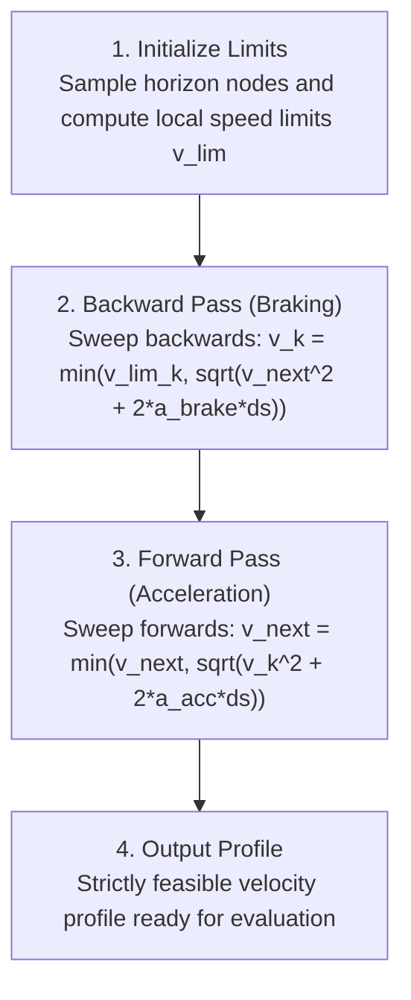

# Trailblazer 2 Design Specification: Velocity Profiling & Physical Limits

**Document ID:** TB2-SPEC-02
**Status:** Approved for Implementation
**Author:** Team 581 Technical Staff
**Applies To:** `VelocityProfiler`, `DrivetrainLimits`, `VectorLimiter`, `ConstraintsCalculator` (replacement)

---

## 1. Overview

### How Trailblazer 1 Works

Trailblazer 1 treats a path like a list of points to chase one by one:

1. **Pick a target point:** `HeuristicPathTracker` picks the next waypoint in the list (looking a couple points ahead if waypoints are close together).
2. **Drive straight at it:** `PidPathFollower` points the velocity vector directly at that target point (`getDriveDirection`).
3. **Use a PID loop to pick speed:** It feeds the remaining distance to the end of the path into a PID controller ($kP = 3.5$). Far from the goal, the PID output is huge, so it just gets clamped to `maxVelocity`. Near the goal, the PID output drops off as distance shrinks.
4. **Limit speed-up, ignore slow-down and turning:** `ConstraintsCalculator` limits how fast the robot _accelerates_ (speeding up), but has **no limit on slowing down** for an intermediate waypoint and **no limit on how sharply the velocity direction can snap** when switching from one waypoint to the next.

**Why that causes problems on the robot:**

- **Sharp corner snaps:** When switching from Point A to Point B, the target direction changes instantly. At $4\text{ m/s}$, snapping the velocity direction by $90^\circ$ in one loop asks the wheels to change direction infinitely fast—so the tires skid and scrub across the carpet.
- **No braking lookahead for corners:** Because the PID loop only cares about distance to the _final_ point, the robot charges into tight mid-path corners at full speed and only tries to slow down _after_ it has already entered the turn.
- **Fake numbers per auto:** Every auto or waypoint has made-up speed and acceleration numbers (`4.75 m/s`, `8.0 m/s^2`) that are faster than the physical motors or carpet can actually deliver.

---

### How Trailblazer 2 Works

Instead of chasing one point at a time with a distance PID loop, Trailblazer 2 plans speeds along the **whole upcoming path** using real robot physics:

1. **Round the corners first:** Sharp corners between waypoints are replaced with smooth circular arcs sized to stay inside each waypoint's `within` tolerance.
2. **Slice the path into $5\text{ cm}$ steps:** The upcoming path is broken into $5\text{ cm}$ checkpoints from where the robot is now to where it next stops.
3. **Set speed limits at every step:** Tighter turns automatically get lower speed limits so the tires never slide sideways ($v \le \sqrt{a_{lat} \cdot r}$). Stop points get a speed limit of $0\text{ m/s}$.
4. **Two quick passes (Backward then Forward):**
   - **Backward pass (Braking):** Starting from the end of the path and working backward, it calculates the fastest speed the robot can be going at each step and still brake in time for upcoming corners and stops.
   - **Forward pass (Accelerating):** Starting from the robot's current speed and working forward, it caps how fast the robot can speed up based on real Kraken X60 motor torque and tire grip.
5. **Follow the curve + smooth 2D vector clamp:** The robot drives along the curve's direction (plus a gentle push back toward the line if bumped off course), and a final 2D limiter ensures the _combined_ speed and direction change in any single loop never exceeds tire grip.

| Feature                     | Trailblazer 1                                          | Trailblazer 2                                                          |
| :-------------------------- | :----------------------------------------------------- | :--------------------------------------------------------------------- |
| **How speed is chosen**     | Distance-to-end PID loop                               | 2-pass physics profile (braking backward, motor torque forward)        |
| **How corners are handled** | Drive straight at point, snap direction to next point  | Smooth circular turn + automatic slow-down _before_ the turn           |
| **Slowing down mid-path**   | Drops speed limit instantly (infinite braking)         | Smoothly brakes ahead of time using $a_{brake}$                        |
| **Direction changes**       | Only 1D speed is limited; direction can flip instantly | Full 2D vector $(v_x, v_y)$ change is limited by tire grip             |
| **What you tune**           | Per-auto / per-point magic speeds & PID gains          | **0 per-auto tuning** (9 constants from CAD/motors, 3 robot constants) |

---

## 2. Drivetrain Physical Limits Model

Instead of guessing constraints per auto (`LinearConstraintOptions(4.5, 8.0)`), physical properties are defined once for the robot in an immutable record:

```java
public record DrivetrainLimits(
    double maxLinearVelocity,       // v_max (m/s): Derived loaded top speed on carpet
    double freeLinearAcceleration,  // a_0 (m/s^2): Derived stall/zero-speed acceleration
    double motorFreeSpeed,          // v_free (m/s): Derived motor theoretical free speed
    double maxBrakingDeceleration,  // a_brake (m/s^2): On-robot tuned safe braking
    double frictionLimit,           // a_fric (m/s^2): On-robot tuned tire traction (μ * g)
    double maxLateralAcceleration,  // a_lat (m/s^2): Derived cornering limit (0.85 * a_fric)
    double maxAngularVelocity,      // omega_max (rad/s): Derived maximum rotation rate
    double maxAngularAcceleration,  // alpha_max (rad/s^2): Derived maximum rotational acceleration
    double driveResponseLagSeconds, // tau_lag (s): On-robot tuned velocity tracking lag (~0.04s)
    double crossTrackTimeConstant,  // tau_xt (s): Derived cross-track convergence time constant (~0.20-0.25s)
    double maxCrossTrackCorrection, // v_xt_max (m/s): Derived max lateral correction velocity (~1.20m/s)
    double headingKp                // kP_theta (s^-1): Derived heading disturbance gain (~6.67s^-1)
) {}
```

- **9 Derived Parameters ($v_{free}, v_{max}, a_0, a_{lat}, \omega_{max}, \alpha_{max}, \tau_{xt}, v_{xt, max}, kP_\theta$):** Computed directly from CAD geometry, `TunerConstants`, and Kraken X60 FOC motor datasheets.
- **3 On-Robot Tuned Parameters ($a_{fric}, a_{brake}, \tau_{lag}$):** Tuned once on the physical robot carpet; all dependent limits and tracking gains update automatically from them.
- **Motor Torque-Speed Curve:** Brushless drive motors lose torque linearly as speed approaches $v_{free}$:
  $$a_{motor}(v) = a_0 \left(1 - \frac{v}{v_{free}}\right)$$

> See **[TB2-SPEC-07: Parameter Derivation & Physics Sandbox Validation](07-empirical-calibration-routine.md)** for the exact parameter derivation formulas, CAD/datasheet input constraints, and physics sandbox validation benchmarks.

---

## 3. Two-Pass Spatial Horizon Profiler

The horizon path of total length $S_{horizon}$ is discretized at uniform arc-length intervals $\Delta s$ (default: $\Delta s = 0.05$ m, or 5 cm).
This yields $N = \lceil S_{horizon} / \Delta s \rceil$ discrete nodes $k \in \{0, 1, \dots, N-1\}$.

```
Node:     0        1        2        k       k+1               N-1 (End)
Arc (s):  0.00     0.05     0.10 ... s_k     s_{k+1} ...       S_horizon
          |--------|--------|--------|--------|-----------------|
                   Δs = 0.05m
```

### 3.1 Node-Level Limit Formulation

Given the instantaneous rotational velocity command $\omega_{cmd}$ and angular acceleration $\alpha_{cmd}$ from `HeadingPlanner` ([TB2-SPEC-03 §5](03-heading-and-rotation.md#5-swerve-traction-coupling-wheel-speed-allocation)), the effective translational speed and friction ceilings available to `VelocityProfiler` and `VectorLimiter` are:
$$v_{max, eff} = \max\left(v_{min}, \; v_{max} - \gamma_\omega |\omega_{cmd}| R_{chassis}\right), \quad a_{fric, eff} = \sqrt{\max\left(a_{min}^2, \; a_{fric}^2 - \left(\gamma_\alpha R_{chassis} \alpha_{cmd}\right)^2\right)}$$
_(with defaults $v_{min} = 0.25\text{ m/s}$, $a_{min} = 1.00\text{ m/s}^2$, $\gamma_\omega = 0.70$, $\gamma_\alpha = 0.70$; when $\omega_{cmd} = 0$ and $\alpha_{cmd} = 0$, $v_{max, eff} = v_{max}$ and $a_{fric, eff} = a_{fric}$).\_

At each spatial sample $k$, the local velocity limit $v_{lim, k}$ is bounded by:

1. **Effective Translational Velocity Limit:** $v_{max, eff}$
2. **Curvature / Centripetal Acceleration Limit:**
   For local path curvature $\kappa_k = \frac{1}{r_k}$:
   $$a_{lat} \ge v^2 \kappa_k \implies v_{corner, k} = \sqrt{\frac{a_{lat}}{\kappa_k + \epsilon}}$$
   _(On straight segments where $\kappa_k = 0$, $v_{corner, k} = \infty$).\_
3. **Zone & Hard Heading Gate Constraints:** $v_{zone, k}$ (e.g. speed caps inside trench or scoring areas) and $v_{cap, k}$ (if $k$ lies within a `HARD` heading gate approach corridor $[k_{curr}, k_{anchor}]$ per [TB2-SPEC-03 §4.2](03-heading-and-rotation.md#42-hard-gate-policy-analytical-speed-capping--pacing)).
4. **Goal Exit Constraints:** If sample $k$ corresponds to a `stop` goal, $v_{goal, k} = 0.0$. If a `through(v_{pass})` goal, $v_{goal, k} = v_{pass}$.

The composite speed ceiling at sample $k$ is:
$$v_{lim, k} = \min\left(v_{max, eff}, \; \sqrt{\frac{a_{lat}}{\kappa_k + \epsilon}}, \; v_{zone, k}, \; v_{cap, k}, \; v_{goal, k}\right)$$

### 3.2 Friction Circle Coupling (Tangential Acceleration Capacity)

When cornering at speed $v$, lateral acceleration $a_{lat} = v^2 \kappa$ consumes a portion of the effective translational tire friction ($a_{fric, eff}$).
By the circular friction envelope ($a_{tangential}^2 + a_{lateral}^2 \le a_{fric, eff}^2$), the remaining tangential acceleration capacity is:
$$a_{t}(v, \kappa) = \sqrt{\max\left(0, \; a_{fric, eff}^2 - (v^2 \kappa)^2\right)}$$

### 3.3 Dynamic Programming Sweeps

#### Pass 1: Backward Pass (Enforcing Braking Limits down to $k_{curr}$)

The backward pass iterates from the horizon terminus $k = N-1$ down to the robot's current progress node $k_{curr} = \lfloor s / \Delta s \rfloor$. It propagates braking deceleration backwards to guarantee the robot can stop or slow down in time for all upcoming corners and goals.

To eliminate circular dependency during backward integration (since $v_k$ is the unknown being computed), braking traction capacity is evaluated using the known downstream state at node $k+1$:
$$a_{t, k+1} = a_t(v_{k+1}, \kappa_{k+1}) = \sqrt{\max\left(0, \; a_{fric, eff}^2 - (v_{k+1}^2 \kappa_{k+1})^2\right)}$$
$$a_{brake, k+1} = \min\left(a_{brake}, \; a_{t, k+1}\right)$$

1. Initialize terminal node: $v_{N-1} = v_{lim, N-1}$.
2. For $k = N-2$ down to $k_{curr}$:
   $$v_k \leftarrow \min\left(v_{lim, k}, \; \sqrt{v_{k+1}^2 + 2 \cdot a_{brake, k+1} \cdot \Delta s}\right)$$

_(Note: Curvature centripetal constraints at node $k$ are strictly enforced by $v_{lim, k} \le \sqrt{a*{lat}/(\kappa_k + \epsilon)}$, ensuring $v_k$ never exceeds local traction limits).*

#### Pass 2: Forward Pass (Enforcing Motor Acceleration Limits from Current Node $k_{curr}$)

The forward pass sweeps from the **robot's current progress node $k_{curr} = \lfloor s / \Delta s \rfloor$** (not the sub-segment origin $k = 0$) up to $N-1$, ensuring velocity increases smoothly from the current state according to available motor torque and traction:

1. Seed current progress node $k_{curr}$:
   $$v_{k_{curr}} \leftarrow \min\left(v_{k_{curr}}, \; v_{start}\right)$$
2. For $k = k_{curr}$ up to $N-2$:
   Compute available motor acceleration at the known upstream state $v_k$:
   $$a_{t, k} = a_t(v_k, \kappa_k) = \sqrt{\max\left(0, \; a_{fric, eff}^2 - (v_k^2 \kappa_k)^2\right)}$$
   $$a_{acc, k} = \max\left(0.0, \; \min\left(a_0 \left(1 - \frac{v_k}{v_{free}}\right), \; a_{t, k}\right)\right)$$
   _(Guarding against negative acceleration when $v_k > v_{free}$, which would cause $v_k^2 + 2 a_{acc, k} \Delta s < 0$ and result in `NaN` during the forward pass)._
   $$v_{k+1} \leftarrow \min\left(v*{k+1}, \; \sqrt{v_k^2 + 2 \cdot a*{acc, k} \cdot \Delta s}\right)$$



### 3.4 Initial Velocity Selection and Chatter Elimination

To guarantee smooth control and avoid velocity chatter caused by noisy wheel odometry:

- Under nominal tracking: $v_{start} = \|\vec{v}_{last\_command}\|$.
- **Disturbance / Slip Override:** If measured chassis velocity diverges significantly from the last command:
  $$\left| \|\vec{v}_{meas}\| - \|\vec{v}_{last\_command}\| \right| > v_{diverge\_thresh} \quad (0.75 \text{ m/s})$$
  $v_{start}$ re-seeds to $\|\vec{v}_{meas}\|$ to prevent integrator windup and acknowledge physical slip or severe collision.

---

## 4. Latency Compensation (Lookahead Advance)

To compensate for CAN, motor filter, and steering response lag ($\tau_{lag} \approx 0.040\text{ s}$) without getting stuck at $v = 0$ from rest, `VelocityProfiler` evaluates speed and tangent direction at decoupled lookahead distances:

1. **Tapering Near Stop Goals (No Endpoint Chatter):**
   Within braking distance $d_{brake} = \max\left(0.30\text{ m}, \; \frac{v^2}{2 a_{brake}}\right)$ of a stop goal, lookahead tapers smoothly to zero:
   $$\tau_{effective} = (\Delta t + \tau_{lag}) \cdot \min\left(1.0, \; \frac{S_{horizon} - s}{d_{brake}}\right)$$
2. **Second-Order Speed Lookahead ($s_{eval, v}$):**
   $$a_{avail}(s) = \max\left(0.0, \; a_0 \left(1 - \frac{v(s)}{v_{free}}\right)\right)$$
   $$s_{eval, v} = s + v(s) \cdot \tau_{effective} + \frac{1}{2} a_{avail}(s) \cdot \tau_{effective}^2$$
   _(At rest $v(s) = 0$, the $\frac{1}{2} a_0 \tau_{effective}^2$ term advances $s_{eval, v} > s$ so the robot launches with $v_{profile} = a_0 \tau_{effective}$ instead of deadlocking at $0\text{ m/s}$).\_
3. **Half-Lead Tangent Lookahead ($s_{eval, t}$):**
   Evaluating $\hat{t}$ at full $s_{eval, v}$ turns into corners too early ($\sim 60\text{ ms}$ before $T_{in}$). Instead:
   $$s_{eval, t} = s + v(s) \cdot \left(\frac{1}{2} \Delta t + \frac{1}{2} \tau_{lag}\right)$$
   - **Profile speed $v_{profile}$:** Linearly interpolated at $s_{eval, v}$.
   - **Path unit tangent $\hat{t}_{eval}$:** Evaluated at $s_{eval, t}$.
   - **Path unit normal $\hat{n}(s)$:** Evaluated at $s$.

---

## 5. Cross-Track Control, Stop Convergence & 2D Vector Limiter

1. **Cross-Track Feedback Velocity ($v_{xt}$):**
   Since $e_{xt} = (\mathbf{p}_{robot} - \mathbf{p}^*(s)) \cdot \hat{n}(s) > 0$ when left of the path, negative feedback pushes the robot back onto the line:
   $$v_{xt, limit} = \min(v_{xt, max}, \; v_{max, eff}), \quad v_{xt} = \mathrm{clamp}\left(-\frac{e_{xt}}{\tau_{xt}}, \; -v_{xt, limit}, \; v_{xt, limit}\right)$$
2. **Upstream Elliptical Priority Desaturation:**
   Reserve wheel speed for cross-track correction first so `SwerveDriveKinematics.desaturateWheelSpeeds` does not unpredictably scale down forward speed:
   $$v_{profile} \leftarrow \min\left(v_{profile}, \; \sqrt{\max\left(0.0, \; v_{max, eff}^2 - v_{xt}^2\right)}\right)$$
   $$\vec{v}_{des} = v_{profile} \hat{t}_{eval} + v_{xt} \hat{n}(s)$$
3. **Terminal 2D Convergence at Stop Goals:**
   Because $v_{xt} \hat{n}(s)$ only pushes perpendicular to $\hat{t}$, any residual inline lag when $s$ reaches $S_{horizon}$ would remain uncorrected. Inside the final braking zone of a `Goal.stop` ($S_{horizon} - s < 0.20\text{ m}$ and $d_{stop} = \|\mathbf{p}_{stop} - \mathbf{p}_{robot}\| < 0.25\text{ m}$), $\vec{v}_{des}$ points directly at $\mathbf{p}_{stop}$:
   $$\vec{e}_{stop} = \mathbf{p}_{stop} - \mathbf{p}_{robot}, \quad v_{term} = \min\left(v_{max, eff}, \; \sqrt{2 \cdot a_{brake} \cdot d_{stop}}, \; \frac{d_{stop}}{0.85 \cdot \tau_{xt}}\right)$$
   $$\vec{v}_{des} = v_{term} \frac{\vec{e}_{stop}}{d_{stop} + \epsilon}$$
4. **Isotropic 2D Vector Acceleration Clamp (`VectorLimiter`):**
   Bound the 2D velocity change from the previous loop's command $\vec{v}_{prev}$ to $\Delta v_{max} = a_{fric, eff} \cdot \Delta t$:
   $$\Delta \vec{v} = \vec{v}_{des} - \vec{v}_{prev}, \quad \vec{v}_{cmd} = \begin{cases} \vec{v}_{prev} + \Delta \vec{v} \cdot \dfrac{\Delta v_{max}}{\|\Delta \vec{v}\|} & \text{if } \|\Delta \vec{v}\| > \Delta v_{max} \\ \vec{v}_{des} & \text{otherwise} \end{cases}$$

---

## 6. Zero-Allocation Execution & Telemetry

- **Preallocated Arrays:** Horizon buffers (`double[] s_nodes`, `v_lim`, `v_profile`, `kappa`) of length $\lceil 8.0\text{ m} / 0.05\text{ m} \rceil = 160$ are allocated once at startup. The 2-pass solve runs in $< 35 \; \mu\text{s}$ with zero GC allocations.
- **Limiting Factor Logging:** Every loop logs `Trailblazer/LimitingFactor` to DogLog so AdvantageScope shows why the robot ran at its commanded speed:
  ```java
  public enum LimitingFactor {
      TOP_SPEED, CORNER_CENTRIPETAL, ZONE_SPEED_CAP, GOAL_DECELERATION,
      MOTOR_ACCELERATION, HEADING_HARD_GATE, VECTOR_SLEW_LIMIT
  }
  ```
