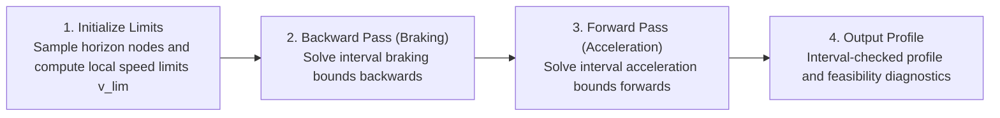

# 02 — Velocity Profiler and Limits

**Applies To:** `VelocityProfiler`, `DrivetrainLimits`, `VectorLimiter`

---

## 1. Scope: Speed Planning and Drive Commands

This spec turns the path and measured progress from [01 — Geometry and progress](01-path-geometry-and-kinematics.md) into a speed profile and bounded translational command.

- **Inputs:** Path geometry, measured progress and cross-track error, measured/applied velocity, drivetrain limits, zones, and heading budgets/gates from [03](03-heading-and-rotation.md).
- **Outputs:** Profile speeds, final translation command, feasibility status, and active constraints.
- **Owns:** Physical limits, profile sampling, braking/acceleration passes, lookahead, cross-track feedback, terminal convergence, and final command limiting.

---

## 2. Drivetrain Physical Limits Model

Define robot physical limits once in an immutable record:

```java
public record DrivetrainLimits(
    double maxLinearVelocity,       // v_max (m/s): Derived loaded top speed on carpet
    double freeLinearAcceleration,  // a_0 (m/s^2): Derived stall/zero-speed acceleration
    double motorFreeSpeed,          // v_free (m/s): Derived motor theoretical free speed
    double maxBrakingDeceleration,  // a_brake (m/s^2): On-robot tuned safe braking
    double frictionLimit,           // a_fric (m/s^2): On-robot tuned tire traction (μ * g)
    double maxLateralAcceleration,  // a_lat (m/s^2): Derived cornering limit (0.85 * a_fric)
    double maxAngularVelocity,      // omega_max (rad/s): Derived maximum rotation rate
    double maxAngularAcceleration,  // alpha_max (rad/s^2): Derived maximum rotational acceleration
    double driveResponseLagSeconds  // tau_lag (s): On-robot validated velocity tracking lag
) {}
```

- **Derived Estimates:** Estimate speed/acceleration limits from CAD, gearing, motor data, and calibration; validate on each robot.

- **Empirical Parameters:** Traction $a_{fric}$, braking $a_{brake}$, and lag $\tau_{lag}$ are primary carpet measurements. Acceleration and braking need not be symmetric.

- **Tracking Policy:** Keep $\tau_{xt}$, $v_{xt,max}$, $kP_\theta$, sampling, and recovery thresholds separate from physical capabilities. Supply module locations through the execution context.

- **Motor Torque-Speed Approximation:**
  $$a_{motor}(v) = a_0 \max\left(0, 1 - \frac{v}{v_{free}}\right)$$

> See **[TB2-SPEC-07: Parameter Derivation & Physics Sandbox Validation](07-empirical-calibration-routine.md)** for derivation estimates, input assumptions, and calibration.

---

## 3. Two-Pass Spatial Horizon Profiler

Sample the [horizon defined in 01 §4](01-path-geometry-and-kinematics.md#4-planning-horizon) at maximum spacing $\Delta s = 0.05$ m initially.

1. **Include both endpoints:** Uniform sampling needs $N = \lceil S_{horizon}/\Delta s\rceil + 1$ nodes, indexed $0$ through $N-1$.
2. **Insert exact boundaries:** Add current measured progress, piece boundaries, goals, heading anchors, and zone boundaries. Recount $N$ after insertion; use actual interval length $\Delta s_k=s_{k+1}-s_k$.
3. **Handle zero length:** Use terminal position/heading control directly; do not divide by path length.

```
Node:     0        1        2        k       k+1               N-1 (End)
Arc (s):  0.00     0.05     0.10 ... s_k     s_{k+1} ...       S_horizon
          |--------|--------|--------|--------|-----------------|
                   Δs = 0.05m
```

A future shorter horizon must account for every downstream constraint in its cutoff speed. The straight-line braking distance `v_max²/(2*a_brake)` alone is insufficient because cornering and rotation can reduce available braking.

### 3.1 Node-Level Limit Formulation

Use the final angular command and its actual change to obtain $v_{max,eff}$ and $a_{fric,eff}$ from [TB2-SPEC-03 §5](03-heading-and-rotation.md#5-swerve-wheel-speed--friction-allocation). These budgets can reach zero; do not add positive floors that exceed available capacity.

At each spatial sample $k$, the local velocity limit $v_{lim, k}$ is bounded by:

1. **Effective Translational Velocity Limit:** $v_{max, eff}$
2. **Curvature / Centripetal Acceleration Limit:**
   For local curvature magnitude $|\kappa_k|$ and $a_{lat,eff}=\min(a_{lat},a_{fric,eff})$:
   $$v_{corner,k}=\sqrt{\frac{a_{lat,eff}}{|\kappa_k|}}$$
   (On straight segments where $\kappa_k = 0$, $v_{corner,k}=\infty$.)
3. **Zone & Hard Heading Gate Constraints:** Apply zone speed ceilings. An unsatisfied hard gate inserts a zero-speed barrier at its anchor; the backward pass propagates braking upstream ([TB2-SPEC-03 §4](03-heading-and-rotation.md#4-translation-rotation-coupling-hard-vs-soft-gates)).
4. **Goal Exit Constraints:** A stop has $v_{goal,k}=0$. A through goal may declare a speed ceiling $v_{pass}$, never a required minimum; otherwise $v_{goal,k}=\infty$.

The composite speed ceiling is:
$$v_{lim,k}=\min(v_{max,eff},v_{corner,k},v_{zone,k},v_{gate,k},v_{goal,k})$$

For fillet radius $r_k$ from [01 §2.3](01-path-geometry-and-kinematics.md#23-choosing-the-fillet-radius), if a requested pass-speed ceiling $v_{pass}$ requires a larger radius at lateral acceleration limit $a_{lat}$:

$$
r_{req} = \frac{v_{pass}^2}{a_{lat}} > r_k
$$

then `VelocityProfiler` caps corner speed at $\sqrt{a_{lat}r_k}$, and the preview runner logs a warning.

### 3.2 Friction Circle Coupling (Tangential Acceleration Capacity)

At speed $v$, lateral acceleration $a_{lateral} = v^2 |\kappa|$ consumes effective translational traction ($a_{fric, eff}$).
Under the friction envelope ($a_{tangential}^2 + a_{lateral}^2 \le a_{fric, eff}^2$), the remaining tangential acceleration capacity is:
$$a_{t}(v, \kappa) = \sqrt{\max\left(0, \; a_{fric, eff}^2 - (v^2 \kappa)^2\right)}$$

### 3.3 Dynamic Programming Sweeps

#### Pass 1: Backward Pass (Enforcing Braking Limits down to $k_{curr}$)

The backward pass propagates braking from the terminal node to $k_{curr}$, the inserted node at current measured progress.

1. **Initialize:** $v_{N-1}=v_{lim,N-1}$.
2. **Bound traction over each interval:** For candidate endpoints, use $\bar v=\max(v_k,v_{k+1})$ and the greatest curvature magnitude $\bar\kappa$ on that interval:
   $$a_{dec,k}=\min\left(a_{brake},a_t(\bar v,\bar\kappa)\right)$$
3. **Solve backward, $k=N-2$ down to $k_{curr}$:** Choose the largest nonnegative $v_k$ satisfying both:
   $$v_k\le v_{lim,k},\qquad v_k^2\le v_{k+1}^2+2a_{dec,k}\Delta s_k$$

**Interval check:** Evaluating traction only at the slower downstream endpoint overestimates available braking on a curve. Use a bounded scalar solve or conservative interval bound, and check the resulting interval independently.

#### Pass 2: Forward Pass (Enforcing Motor Acceleration Limits from Current Node $k_{curr}$)

1. **Seed current progress:**
   $$v_{k_{curr}}\leftarrow\min(v_{k_{curr}},v_{start})$$
   If measured motion exceeds the backward envelope, report `INFEASIBLE` and use bounded recovery (§3.4); clamping the profile does not make the measured state feasible.
2. **Bound acceleration over each interval:**
   $$a_{acc,k}=\max\left(0,\min\left(a_{motor}(\bar v),a_t(\bar v,\bar\kappa)\right)\right)$$
3. **Solve forward, $k=k_{curr}$ through $N-2$:** Choose the largest nonnegative $v_{k+1}$ satisfying its existing ceiling and:
   $$v_{k+1}^2\le v_k^2+2a_{acc,k}\Delta s_k$$

**Interval check:** Evaluating motor torque only at the slower upstream endpoint overestimates acceleration. Use actual interval lengths and bounded solving with explicit failure handling in both passes.



### 3.4 Initial Velocity Selection and Chatter Elimination

1. **Nominal tracking:** Project the previous applied velocity onto the current path tangent:
   $$v_{start}=\max(0,\vec v_{applied}\cdot\hat t(s))$$
   Total vector magnitude would incorrectly count sideways correction as forward speed.
2. **Activation / missing applied command:** Seed from measured velocity. If integration only reports the requested command, label it as such and monitor measured divergence.
3. **Disturbance detection:** Compare vectors, so opposite or sideways motion is detected even at equal speed:
   $$\|\vec v_{meas}-\vec v_{applied}\|>v_{diverge,threshold}$$
   The tracking policy owns threshold/dwell and reseeding; preserve event identity during recovery.
4. **Infeasible motion:** Negative forward velocity needs bounded arrest. Motion above the braking envelope emits `INFEASIBLE`; brake/recover without declaring a stop or gate successfully reached.

---

## 4. Latency Compensation (Lookahead Advance)

`VelocityProfiler` uses separate speed and tangent lookaheads to compensate for CAN, motor-filter, and steering lag ($\tau_{lag} \approx 0.040\text{ s}$) and avoid startup deadlock at $v = 0$:

1. **Tapering Near Stop Goals (No Endpoint Chatter):**
   Using a conservative available deceleration $a_{dec}>0$, within $d_{brake} = \max\left(0.30\text{ m}, \; \frac{v^2}{2 a_{dec}}\right)$ of a stop goal, lookahead tapers smoothly to zero:
   $$\tau_{effective} = (\Delta t + \tau_{lag}) \cdot \min\left(1.0, \; \frac{S_{horizon} - s}{d_{brake}}\right)$$
2. **Second-Order Speed Lookahead ($s_{eval, v}$):**
   $$a_{avail}(s)=\min(a_{motor}(v(s)),a_t(v(s),\kappa(s)))$$
   $$s_{eval, v} = s + v(s) \cdot \tau_{effective} + \frac{1}{2} a_{avail}(s) \cdot \tau_{effective}^2$$
   At rest with positive available acceleration, the second-order term prevents startup deadlock; final command limits still apply.
3. **Half-Lead Tangent Lookahead ($s_{eval, t}$):**
   Full speed lookahead can turn into corners early. Start with half-lead tangent evaluation and validate it in simulation/carpet tests:
   $$s_{eval, t} = s + v(s) \cdot \left(\frac{1}{2} \Delta t + \frac{1}{2} \tau_{lag}\right)$$
   - **Profile speed $v_{profile}$:** Linearly interpolated at $s_{eval, v}$.
   - **Path unit tangent $\hat{t}_{eval}$:** Evaluated at $s_{eval, t}$.
   - **Path unit normal $\hat{n}(s)$:** Evaluated at measured projection $s$.
4. **Bounds:** Clamp both lookaheads to the leg and any closed gate. Lookahead never advances event progress or samples beyond a required stop. With no braking capacity, enter infeasible recovery rather than divide by zero.

---

## 5. Cross-Track Control, Stop Convergence & 2D Vector Limiter

1. **Cross-Track Feedback Velocity ($v_{xt}$):**
   Use the signed error and normal from [01 §5.2](01-path-geometry-and-kinematics.md#52-local-projection-and-progress) for negative feedback:
   $$v_{xt, limit} = \min(v_{xt, max}, \; v_{max, eff}), \quad v_{xt} = \mathrm{clamp}\left(-\frac{e_{xt}}{\tau_{xt}}, \; -v_{xt, limit}, \; v_{xt, limit}\right)$$
2. **Combine Forward and Cross-Track Demand:**
   $$\vec v_{des}=v_{profile}\hat t_{eval}+v_{xt}\hat n(s)$$
   The lookahead tangent and current normal need not be perpendicular. Apply speed/module limits to their actual sum, including any target feedforward; $\sqrt{v_{max,eff}^2-v_{xt}^2}$ alone is not sufficient.
3. **Terminal 2D Convergence at Stop Goals:**
   Cross-track feedback $v_{xt} \hat{n}(s)$ acts perpendicular to $\hat{t}$, leaving inline lag when $s$ reaches $S_{horizon}$. Near `Goal.stop`, blend into position convergence using $d_{stop}=\|\mathbf p_{stop}-\mathbf p_{robot}\|$ and tracking-policy blend distance/hysteresis:
   $$\vec{e}_{stop} = \mathbf{p}_{stop} - \mathbf{p}_{robot}, \quad v_{term} = \min\left(v_{max, eff}, \; \sqrt{2 \cdot a_{dec} \cdot d_{stop}}, \; \frac{d_{stop}}{0.85 \cdot \tau_{xt}}\right)$$
   $$\vec{v}_{des}=\begin{cases}v_{term}\vec e_{stop}/d_{stop}&d_{stop}>0\\0&d_{stop}=0\end{cases}$$
   Reuse this controller to hold an interior hard gate. Completion requires measured pose/speed/heading and dwell, not zero profile speed ([04](04-runtime-integration-and-teleop-assist.md#4-stops-and-markers)).
4. **Isotropic 2D Vector Acceleration Clamp (`VectorLimiter`):**
   Bound the 2D velocity change from the previous applied command $\vec{v}_{prev}$ to $\Delta v_{max} = a_{fric, eff} \cdot \Delta t$:
   $$\Delta \vec{v} = \vec{v}_{des} - \vec{v}_{prev}, \quad \vec{v}_{cmd} = \begin{cases} \vec{v}_{prev} + \Delta \vec{v} \cdot \dfrac{\Delta v_{max}}{\|\Delta \vec{v}\|} & \text{if } \|\Delta \vec{v}\| > \Delta v_{max} \\ \vec{v}_{des} & \text{otherwise} \end{cases}$$

5. **Intersect Final Constraints:** Select the closest desired command satisfying the slew bound, speed/module limits, and motor/braking bounds together. Sequential speed and slew clamps can invalidate each other.
6. **Shrinking Envelope:** If no reachable command satisfies all new bounds, emit `INFEASIBLE`, reduce angular demand where possible, and apply bounded braking toward the admissible region. Do not claim simultaneous instantaneous bounds during recovery. Disabled/emergency output inhibition takes precedence.

---

## 6. Execution Budget & Telemetry

- **Bounded Buffers:** Size profile arrays for validated capacity, both endpoints, and inserted boundaries; reject overflow without dropping constraints. Reuse buffers where profiling warrants it.

- **Measured Performance:** Benchmark worst-case runtime and allocation on the target robot; record acceptance evidence in [06](06-verification-simulation-and-ci.md).

- **Limiting Factor Logging:** Log `Trailblazer/LimitingFactor` to DogLog every loop for AdvantageScope:
  ```java
  public enum LimitingFactor {
      TOP_SPEED, CORNER_CENTRIPETAL, ZONE_SPEED_CAP, GOAL_DECELERATION,
      MOTOR_ACCELERATION, HEADING_HARD_GATE, VECTOR_SLEW_LIMIT, MODULE_SPEED, INFEASIBLE
  }
  ```

Log profile and final-command constraints separately; more than one limit may be active.
