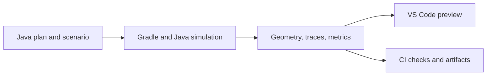

# 05 — Developer Tooling

**Applies To:** `MotionPlan`, `Goal`, `HeadingPlan`, `FieldAnchors`, `AutoPreviewTask`, `TrailblazerPreviewExtension`

---

## 1. Pure-Java Specification

Define autos in Java:

1. **One source:** Autos like [`LeftNormalAuto.java`](../../../../../../../../comp-bot/src/main/java/frc/robot/autos/auto_state_machines/LeftNormalAuto.java) mix path goals with dynamic lambdas (`() -> getCollisionPoint(...)`), IMU triggers, and enum markers (`passedMarker(READY_TO_CROSS_BUMP)`). Keep these together in Java.
2. **Compile-Time Safety:** `javac`, ErrorProne, and IDE refactoring check changes.
3. **No parser:** No YAML/JSON schema or reflection layer.

---

## 2. Canonical Java Fluent DSL

Use a typed fluent builder for immutable `MotionPlan` records; examples below show the proposed API. Plan factories must run without hardware; runtime resolves suppliers before calling math.

### 2.1 Specification Example: `LeftNormalAuto.java`
```java
public class LeftNormalAuto extends BaseImperativeAuto<NormalAutoState> {

  public enum Markers {
    PRIORITIZE_INTAKE,
    START_SHOOT_RQ,
    READY_TO_CROSS_BUMP
  }

  // Canonical pure-Java auto specification
  private final MotionPlan intakeFirstCycle =
      Trailblazer.plan("intake_first_cycle")
          .withLimits(LimitsProfile.FAST)
          .addGoal(
              Goal.through(FieldAnchors.RED_DEPOT_TRENCH)
                  .within(0.75))
          .addGoal(
              Goal.through(() -> getCollisionPoint(FieldAnchors.BALL_A))
                  .within(0.30)
                  .heading(HeadingPlan.to(Rotation2d.fromDegrees(115.0)).before(1.0).gate(GatePolicy.SOFT))
                  .marker(Markers.PRIORITIZE_INTAKE))
          .addGoal(
              Goal.stop(FieldAnchors.offset(FieldAnchors.RED_DEPOT_BUMP, 0, BUMP_OFFSET, Rotation2d.kZero))
                  .finish(0.20, Rotation2d.fromDegrees(3), 0.20)
                  .marker(Markers.READY_TO_CROSS_BUMP))
          .build();
}
```

### 2.2 Core Data Model

#### `Goal` Definition
```java
public record Goal(
    String id,                          // Stable across geometry rebuilds
    Supplier<Pose2d> poseSupplier,       // Absolute, anchor offset, or dynamic supplier
    PassType passType,                   // STOP or THROUGH
    double withinMeters,                 // Nominal closest-approach bound; not obstacle clearance
    OptionalDouble maxPassSpeedMetersPerSec, // Optional speed ceiling for THROUGH goals
    FinishTolerance finishTolerance,     // Position, heading, linear/angular speed, and dwell for STOP
    Optional<HeadingKeyframe> heading,   // Associated heading schedule keyframe
    Optional<Enum<?>> marker             // Event marker emitted when progress crosses goal
) {}
```

#### `HeadingPlan` Keyframe
```java
public record HeadingKeyframe(
    AnchorDistance activation,           // Start rotating here
    AnchorDistance anchor,               // Arrival: atGoal, before(meters), after(meters)
    HeadingTarget target,                // fixed(rot), faceTravel(), facePoint(x,y), hold()
    TurnDirection direction,             // SHORTEST, CW, CCW
    GatePolicy gate,                     // SOFT readiness vs HARD arrival barrier; see spec 03
    Rotation2d tolerance,               // Arrival angular tolerance
    double angularSpeedTolerance,       // rad/s
    double dwellSeconds
) {}
```

---

## 3. Centralized Field Anchor Dictionary (`FieldAnchors.java`)

Centralize field coordinates in season-owned `FieldAnchors.java`; supply them to TB2 outside the shared engine:

```java
public final class FieldAnchors {
  // Illustrative 2026 anchors authored for red in the fixed field frame
  public static final Pose2d RED_DEPOT_TRENCH = new Pose2d(10.489, 1.500, Rotation2d.fromDegrees(90));
  public static final Pose2d RED_DEPOT_BUMP   = new Pose2d(13.576, 2.450, Rotation2d.kZero);
  public static final Translation2d HUB_CENTER = new Translation2d(12.100, 4.034);
  public static final Pose2d BALL_A           = new Pose2d(8.744, 2.021, Rotation2d.fromDegrees(115));

  // Algebraic offset helper
  public static Pose2d offset(Pose2d base, double dx, double dy, Rotation2d dTheta) {
    return new Pose2d(base.getX() + dx, base.getY() + dy, base.getRotation().plus(dTheta));
  }

  // 180-degree alliance rotation for this field
  public static Pose2d flipToBlue(Pose2d redPose) {
    return FieldUtil.pathflip(redPose);
  }

  private FieldAnchors() {}
}
```

---

## 4. Tooling Architecture: VS Code MVP + Shared Runner

The VS Code MVP uses the same Java runner as CI, like the Spot previewer. Author in Java; generate preview data.



---

## 5. Headless Runner: `./gradlew previewAuto -Pauto=<Name>`

1. Loads a Java `PreviewScenario` through the normal build/classpath without hardware. The scenario supplies the plan factory, robot limits, field/footprint, starting state, alliance, seed, dynamic targets, and stop-release inputs.
2. Steps the same runtime in closed-loop simulation. Missing dynamic/mechanism inputs are reported rather than assumed successful.
3. Outputs under `build/reports/autos/<name>/`:
   - Versioned preview data: input/build identity, geometry, timestamped motion, headings, limits, events, and assertion results.
   - `.wpilog` trace, `.png` trajectory map, and terminal metrics summary.
4. Returns nonzero on failed assertions or build/runner errors. Measure cold-build, warm-refresh, and simulation times separately.

---

## 6. MVP Viewer: VS Code Previewer

1. **Selection:** Choose scenario, robot configuration, alliance, and seed.
2. **Refresh:** Invoke the shared runner on command or debounced save; no separate Java parser or planner in TypeScript.
3. **View:** Display goals, fillets, keepouts, swept footprint, motion/heading playback, velocity graphs, markers, and limiting factors.
4. **Diagnostics:** Show compile errors and failed assertions. Cancel superseded runs, discard stale results, and label the last successful preview stale after a failed build.
5. **Integration:** Respect workspace trust, clean up child processes/watchers, and test the extension against the runner's versioned output.

---

## 7. Authoring Validation

- Require stable goal/keyframe IDs, finite values, valid anchor order, and a terminal stop. Intermediate stops release explicitly; see [04](04-runtime-integration-and-teleop-assist.md#4-stops-and-markers).
- Dynamic suppliers require runtime timestamp/validity metadata ([04](04-runtime-integration-and-teleop-assist.md)). Preview scenarios provide deterministic replacements.
- Apply alliance transforms once; do not re-transform field-relative vision targets. `FieldUtil.pathflip` rotates 180 degrees, preserving CW/CCW; reflection reverses them.
