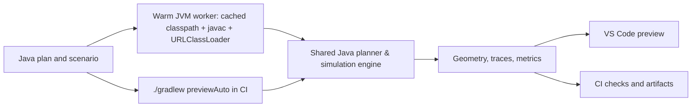

# 05 — Developer Tooling

**Applies To:** `MotionPlan`, `Goal`, `HeadingPlan`, `FieldAnchors`, `AutoPreviewTask`, `TrailblazerPreviewExtension`

---

## 1. Pure-Java Specification

Define autos in Java:

1. **One source:** Autos like [`LeftNormalAuto.java`](../../../../../../../../comp-bot/src/main/java/frc/robot/autos/auto_state_machines/LeftNormalAuto.java) mix path goals with dynamic lambdas (`() -> getCollisionPoint(...)`), IMU triggers, and enum markers (`passedMarker(READY_TO_CROSS_BUMP)`). Keep these together in Java.
2. **Compile-Time Safety:** `javac`, ErrorProne, and IDE refactoring check changes.
3. **No parser:** No YAML/JSON schema or reflection layer.

---

## 2. Canonical Java Fluent DSL

Use a typed fluent builder for immutable `MotionPlan` records; examples below show the proposed API. Plan factories must run without hardware; runtime resolves suppliers before calling math.

### 2.1 Specification Example: `LeftNormalAuto.java`
```java
public class LeftNormalAuto extends BaseImperativeAuto<NormalAutoState> {

  public enum Markers {
    PRIORITIZE_INTAKE,
    START_SHOOT_RQ,
    READY_TO_CROSS_BUMP
  }

  // Canonical pure-Java auto specification
  private final MotionPlan intakeFirstCycle =
      Trailblazer.plan("intake_first_cycle")
          .withLimits(LimitsProfile.FAST)
          .addGoal(
              Goal.through(FieldAnchors.RED_DEPOT_TRENCH)
                  .within(0.75))
          .addGoal(
              Goal.through(() -> getCollisionPoint(FieldAnchors.BALL_A))
                  .within(0.30)
                  .heading(HeadingPlan.to(Rotation2d.fromDegrees(115.0)).before(1.0).gate(GatePolicy.SOFT))
                  .marker(Markers.PRIORITIZE_INTAKE))
          .addGoal(
              Goal.stop(FieldAnchors.offset(FieldAnchors.RED_DEPOT_BUMP, 0, BUMP_OFFSET, Rotation2d.kZero))
                  .finish(0.20, Rotation2d.fromDegrees(3), 0.20)
                  .marker(Markers.READY_TO_CROSS_BUMP))
          .build();
}
```

### 2.2 Core Data Model

#### `Goal` Definition
```java
public record Goal(
    String id,                           // Stable across geometry rebuilds
    Supplier<Pose2d> poseSupplier,       // Absolute, anchor offset, or dynamic supplier (non-null)
    PassType passType,                   // STOP, THROUGH, or CRUISE_THROUGH
    double withinMeters,                 // Nominal closest-approach bound; not obstacle clearance
    OptionalDouble maxPassSpeedMetersPerSec, // Ceiling for THROUGH; target cruise speed for CRUISE_THROUGH
    OptionalDouble maxOverrunMeters,     // CRUISE_THROUGH overrun ray length past terminal goal
    TargetLossPolicy targetLossPolicy,   // HOLD_LAST_VALID, HOLD_POSITION, or ABORT_PLAN (for dynamic suppliers)
    FinishTolerance finishTolerance,     // Position, heading, linear/angular speed, and dwell for STOP
    Optional<HeadingKeyframe> heading,   // Associated heading schedule keyframe
    Optional<Enum<?>> marker             // Event marker emitted on passage or release
) {}
```

> Use `Goal.stop(...)`, `Goal.through(...)`, and `Goal.cruiseThrough(...)` factory/builder helpers so static goals default `TargetLossPolicy` cleanly and `CRUISE_THROUGH` requires positive `cruiseSpeedMetersPerSec` and `maxOverrunMeters`.

#### `HeadingPlan` Keyframe
```java
public record HeadingKeyframe(
    AnchorDistance activation,           // Start rotating here
    AnchorDistance anchor,               // Arrival: atGoal, before(meters), after(meters)
    HeadingTarget target,                // fixed(rot), faceTravel(), facePoint(x,y), hold()
    TurnDirection direction,             // SHORTEST, CW, CCW
    GatePolicy gate,                     // SOFT readiness vs HARD arrival barrier; see spec 03
    Rotation2d tolerance,               // Arrival angular tolerance
    double angularSpeedTolerance,       // rad/s
    double dwellSeconds
) {}
```

---

## 3. Centralized Field Anchor Dictionary (`FieldAnchors.java`)

Centralize field coordinates and declared field symmetry in season-owned `FieldAnchors.java`; supply them to TB2 outside the shared engine:

```java
public enum FieldSymmetry {
  /** Blue/Red related by 180-deg rotation: (L-x, W-y, theta + pi). Preserves CW/CCW. */
  ROTATIONAL_180,
  /** Blue/Red related by X-mirroring across field centerline: (L-x, y, pi - theta). Reverses CW <-> CCW. */
  MIRROR_X
}

public final class FieldAnchors {
  // Illustrative 2026 anchors authored for red in the fixed field frame
  public static final FieldSymmetry SEASON_SYMMETRY = FieldSymmetry.ROTATIONAL_180;
  public static final Pose2d RED_DEPOT_TRENCH = new Pose2d(10.489, 1.500, Rotation2d.fromDegrees(90));
  public static final Pose2d RED_DEPOT_BUMP   = new Pose2d(13.576, 2.450, Rotation2d.kZero);
  public static final Translation2d HUB_CENTER = new Translation2d(12.100, 4.034);
  public static final Pose2d BALL_A           = new Pose2d(8.744, 2.021, Rotation2d.fromDegrees(115));

  // Algebraic offset helper
  public static Pose2d offset(Pose2d base, double dx, double dy, Rotation2d dTheta) {
    return new Pose2d(base.getX() + dx, base.getY() + dy, base.getRotation().plus(dTheta));
  }

  // Transform an authored static anchor to the target alliance using SEASON_SYMMETRY
  public static Pose2d flipToBlue(Pose2d redPose, FieldSymmetry symmetry) {
    return switch (symmetry) {
      case ROTATIONAL_180 -> FieldUtil.pathflip(redPose); // (L-x, W-y), theta + pi; CW/CCW unchanged
      case MIRROR_X -> new Pose2d(
          FieldUtil.FIELD_LENGTH - redPose.getX(),
          redPose.getY(),
          Rotation2d.fromRadians(MathUtil.angleModulus(Math.PI - redPose.getRotation().getRadians())));
          // Caller/plan builder reverses TurnDirection CW <-> CCW under MIRROR_X
    };
  }

  private FieldAnchors() {}
}
```

Never apply alliance flipping to live Blue-origin field-frame vision suppliers (`Pose2d` already reported in the unified field coordinate system); transform only static authored anchors and explicitly flipped static points.

---

## 4. Tooling Architecture: VS Code MVP + Warm Worker + CI Runner

Interactive previews use a long-lived warm-JVM stdio worker for sub-second iteration, while CI runs the exact same shared Java planning and simulation engine through Gradle (`ErrorProne` / `Refaster` checked):



---

## 5. Runners: CI Gradle Task & Warm-JVM Preview Worker

1. **CI Headless Runner (`./gradlew previewAuto -Pauto=<Name>`):** Loads a Java `PreviewScenario` through the normal build/classpath without hardware (enforcing full compilation and `ErrorProne`/`Refaster`). The scenario supplies the plan factory, robot limits, field/footprint, starting state, alliance, seed, dynamic targets, and stop-release inputs.
2. **VS Code Warm-JVM Stdio Worker:** Reads a cached Gradle classpath manifest on startup, compiles only modified Java plan/scenario files incrementally via `ToolProvider.getSystemJavaCompiler()` (or JDT LS output) bypassing cold Gradle startup, and loads scenario classes through a fresh disposable child `URLClassLoader` per request closed inside `try-with-resources` so Windows JAR/class locks and stale class state cannot accumulate. If `build.gradle` or dependencies change, the worker refreshes the classpath manifest automatically.
3. **Closed-Loop Simulation & Outputs (`build/reports/autos/<name>/`):**
   - Versioned preview data: input/build identity, geometry, timestamped motion, headings, limits, events, `GoalPassageStatus`, and assertion results.
   - `.wpilog` trace, `.png` trajectory map, and terminal metrics summary.
4. Returns nonzero on failed assertions or build/runner errors. Measure cold-build, warm-refresh, and simulation times separately.

---

## 6. MVP Viewer: VS Code Previewer

1. **Selection:** Choose scenario, robot configuration, alliance, and seed.
2. **Refresh:** Invoke the warm stdio preview worker on command or debounced save (falling back to Gradle when build scripts change); no separate Java parser or planner in TypeScript.
3. **View:** Display goals, fillets, keepouts (`K_hard` and `K_margin`), swept footprint, motion/heading playback, velocity graphs, markers, and limiting factors.
4. **Diagnostics:** Show compile errors and failed assertions. Cancel superseded runs, discard stale results, and label the last successful preview stale after a failed build.
5. **Integration:** Respect workspace trust, clean up worker/child processes and watchers on shutdown, and test both the warm worker and Gradle runner against the same versioned output schema.

---

## 7. Authoring Validation

- Require stable goal/keyframe IDs, finite values, valid anchor order, and a terminal `Goal.stop` or valid `Goal.cruiseThrough` (`cruiseSpeedMetersPerSec > 0`, `maxOverrunMeters > 0`). Intermediate stops release explicitly; see [04](04-runtime-integration-and-teleop-assist.md#4-stops-and-markers).
- Dynamic suppliers require runtime timestamp/validity metadata ([04](04-runtime-integration-and-teleop-assist.md)) and an explicit `TargetLossPolicy`. Preview scenarios provide deterministic replacements.
- Require explicit `FieldSymmetry` on alliance flips: `ROTATIONAL_180` maps $(L-x, W-y, \theta+\pi)$ and preserves `CW`/`CCW`; `MIRROR_X` maps $(L-x, y, \pi-\theta)$ and reverses `CW <-> CCW`. Reject or flag double-flipped live Blue-origin field-frame vision suppliers.
