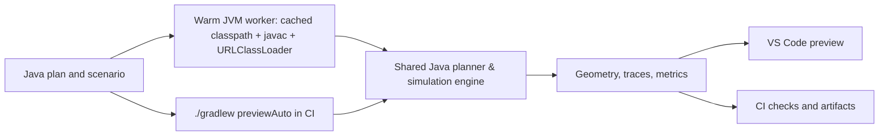

# 05 — Developer Tooling

**Applies To:** `MotionPlan`, `Goal`, `HeadingPlan`, `FieldAnchors`, `AutoPreviewTask`, `TrailblazerPreviewExtension`

---

## 1. Pure-Java Specification

Define autos in Java:

1. **One source:** Robot autos mix path goals with dynamic suppliers (`() -> getPickupTarget(...)`), mechanism triggers, and enum markers (`passedMarker(READY_TO_SCORE)`). Keep these together in Java rather than split across JSON path files.
2. **Compile-Time Safety:** `javac`, ErrorProne, and IDE refactoring check changes.
3. **No parser:** No YAML/JSON schema or reflection layer.

---

## 2. Canonical Java Fluent DSL

Use a typed fluent builder for immutable `MotionPlan` records; examples below show the proposed 2027 API. Plan factories must run without hardware and are authored in the canonical **Blue-origin field frame** before alliance transformation via `forAlliance(...)`; runtime resolves dynamic suppliers before calling math.

### 2.1 Specification Example: `ExampleCycleAuto.java`
```java
public class ExampleCycleAuto {

  public enum Markers {
    START_INTAKE,
    READY_TO_SCORE
  }

  // Canonical pure-Java auto specification (authored in Blue-origin field coordinates)
  public MotionPlan buildCyclePlan(
      Alliance alliance, Supplier<TimestampedTarget<Pose2d>> pickupSupplier) {
    return Trailblazer.plan("example_cycle")
        .withLimits(LimitsProfile.FAST)
        .addGoal(
            Goal.through(SeasonAnchors.STAGE_PASS)
                .within(0.75))
        .addGoal(
            Goal.through(pickupSupplier, TargetLossPolicy.holdLastValid(0.25))
                .within(0.30)
                .heading(HeadingPlan.to(Rotation2d.fromDegrees(115.0)).before(1.0).gate(GatePolicy.SOFT))
                .marker(Markers.START_INTAKE))
        .addGoal(
            Goal.stop(SeasonAnchors.SCORE_POSE)
                .finish(0.03, Rotation2d.fromDegrees(2), 0.10)
                .marker(Markers.READY_TO_SCORE))
        .build()
        .forAlliance(alliance, SeasonField.GEOMETRY);
  }
}
```

### 2.2 Core Data Model

#### `Goal` Definition
```java
public record Goal(
    String id,                           // Stable across geometry rebuilds
    Supplier<Pose2d> poseSupplier,       // Absolute, anchor offset, or dynamic supplier (non-null)
    PassType passType,                   // STOP, THROUGH, or CRUISE_THROUGH
    double withinMeters,                 // Nominal closest-approach bound; not obstacle clearance
    OptionalDouble maxPassSpeedMetersPerSec, // Ceiling for THROUGH; target cruise speed for CRUISE_THROUGH
    OptionalDouble maxOverrunMeters,     // CRUISE_THROUGH overrun ray length past terminal goal
    TargetLossPolicy targetLossPolicy,   // HoldLastValid, FallbackNominal, or ControlledStop (for dynamic suppliers)
    FinishTolerance finishTolerance,     // Position, heading, linear/angular speed, and dwell for STOP
    Optional<HeadingKeyframe> heading,   // Associated heading schedule keyframe
    Optional<Enum<?>> marker             // Event marker recorded as passed on passage or stop completion
) {}
```

> Use `Goal.through(Translation2d / Supplier)` (accepts position directly or ignores `Pose2d` rotation unless `.heading(...)` is explicitly attached, preventing accidental TB1-style waypoint heading snaps), `Goal.stop(Pose2d)` (defaults finish heading to `pose.getRotation()` unless overridden by `.heading(...)`), and `Goal.cruiseThrough(...)` (`cruiseSpeedMetersPerSec > 0` and `maxOverrunMeters > 0`). Static goals default `TargetLossPolicy` to `ControlledStop`.

#### `HeadingPlan` Keyframe
```java
public record HeadingKeyframe(
    AnchorDistance activation,           // Start rotating here
    AnchorDistance anchor,               // Arrival: atGoal, before(meters), after(meters)
    HeadingTarget target,                // fixed(rot), faceTravel(), facePoint(x,y), hold()
    TurnDirection direction,             // SHORTEST, CW, CCW
    GatePolicy gate,                     // SOFT readiness vs HARD arrival barrier; see spec 03
    Rotation2d tolerance,               // Arrival angular tolerance
    double angularSpeedTolerance,       // rad/s
    double dwellSeconds
) {}
```

---

## 3. Canonical Field Symmetry & Whole-Plan Alliance Transforms (`FieldGeometry`)

Define field dimensions and symmetry in a self-contained record—with zero hardcoded season dimensions or external game utilities inside TB2—while season code owns field coordinates outside `shared`:

```java
public enum FieldSymmetry {
  /** Blue/Red related by 180-deg rotation: (L-x, W-y, theta + pi). det(J) = +1; preserves CW/CCW. */
  ROTATIONAL_180,
  /** Blue/Red related by X-mirroring across field centerline: (L-x, y, pi - theta). det(J) = -1; reverses CW <-> CCW. */
  MIRROR_X
}

public record FieldGeometry(double lengthMeters, double widthMeters, FieldSymmetry symmetry) {
  public Pose2d flipPose(Pose2d bluePose) {
    return switch (symmetry) {
      case ROTATIONAL_180 -> new Pose2d(
          lengthMeters - bluePose.getX(),
          widthMeters - bluePose.getY(),
          bluePose.getRotation().plus(Rotation2d.kPi));
      case MIRROR_X -> new Pose2d(
          lengthMeters - bluePose.getX(),
          bluePose.getY(),
          Rotation2d.fromRadians(MathUtil.angleModulus(Math.PI - bluePose.getRotation().getRadians())));
    };
  }

  public Translation2d flipPoint(Translation2d bluePoint) {
    return switch (symmetry) {
      case ROTATIONAL_180 -> new Translation2d(lengthMeters - bluePoint.getX(), widthMeters - bluePoint.getY());
      case MIRROR_X -> new Translation2d(lengthMeters - bluePoint.getX(), bluePoint.getY());
    };
  }
}
```

**Why whole-plan transformation (`MotionPlan.forAlliance(Alliance, FieldGeometry)`) is mandatory:** World offsets `offset(P, dx, dy, dTheta)` and local `Pose2d.transformBy(...)` do **not** commute with `MIRROR_X` ($\det J = -1$), because reflecting negates $\Delta y$ and $\Delta\theta$. Author the entire `MotionPlan` (including all offsets) once in the canonical **Blue-origin field frame**, and call `plan.forAlliance(alliance, geometry)`:

1. **Static Goal Poses & Headings:** Transform static `Goal` poses, `HeadingTarget.fixed(Rotation2d)`, and static `HeadingTarget.facePoint(Translation2d)` via `FieldGeometry`. Leave dynamic Blue-origin vision goals and `facePointDynamic(Supplier<TimestampedTarget<Translation2d>>)` untouched, and never negate a physical robot-frame mechanism angle offset $\psi_{mech}$ (robot hardware chirality does not mirror across alliances).
2. **`TurnDirection` (`CW` / `CCW`):** Preserve under `ROTATIONAL_180`; swap `CW <-> CCW` under `MIRROR_X`.
3. **Zone & Keepout Polygons:** When reflecting polygon vertices under `MIRROR_X`, **reverse the vertex winding list** after transforming coordinates so `CCW` outward normals and signed distances $d_{signed}(K_{hard})$ remain positive outside obstacles.
4. **`PreviewScenario` Initial Velocities:** Transform field-relative starting velocities as $(-v_x, -v_y, +\omega)$ under `ROTATIONAL_180` vs. $(-v_x, +v_y, -\omega)$ under `MIRROR_X`.

---

## 4. Tooling Architecture: VS Code MVP + Warm Worker + CI Runner

Interactive previews use a long-lived warm-JVM stdio worker for sub-second iteration, while CI runs the exact same shared Java planning and simulation engine through Gradle (`ErrorProne` / `Refaster` checked):



---

## 5. Runners: CI Gradle Task & Warm-JVM Preview Worker

1. **CI Headless Runner (`./gradlew previewAuto -Pauto=<Name>`):** Loads a Java `PreviewScenario` through the normal build/classpath without hardware (enforcing full compilation and `ErrorProne`/`Refaster`). The scenario supplies the plan factory, robot limits, field/footprint, starting state, alliance, seed, dynamic targets, and stop-release inputs.
2. **VS Code Warm-JVM Stdio Worker:** Launch under the full **Java 21 JDK** toolchain (`ToolProvider.getSystemJavaCompiler()` returns `null` under a JRE). Reads a cached Gradle classpath manifest on startup, compiles only modified Java plan/scenario files incrementally into an **isolated overlay output directory**, and loads scenario classes through a fresh disposable child `URLClassLoader` (with the overlay directory placed ahead of the cached Gradle classpath) closed inside `try-with-resources` so Windows JAR/class locks and stale class state cannot accumulate. If `build.gradle` or dependencies change, the worker refreshes the classpath manifest automatically.
3. **Closed-Loop Simulation & Outputs (`build/reports/autos/<name>/`):**
   - Versioned preview data: input/build identity, geometry, timestamped motion, headings, limits, events, `GoalPassageStatus`, and assertion results.
   - `.wpilog` trace, `.png` trajectory map, and terminal metrics summary.
4. Returns nonzero on failed assertions or build/runner errors. Measure cold-build, warm-refresh, and simulation times separately.

---

## 6. MVP Viewer: VS Code Previewer

1. **Selection:** Choose scenario, robot configuration, alliance, and seed.
2. **Refresh:** Invoke the warm stdio preview worker on command or debounced save (falling back to Gradle when build scripts change); no separate Java parser or planner in TypeScript.
3. **View:** Display goals, fillets, keepouts (`K_hard` and `K_margin`), swept footprint, motion/heading playback, velocity graphs, markers, and limiting factors.
4. **Diagnostics:** Show compile errors and failed assertions. Cancel superseded runs, discard stale results, and label the last successful preview stale after a failed build.
5. **Integration:** Respect workspace trust, clean up worker/child processes and watchers on shutdown, and test both the warm worker and Gradle runner against the same versioned output schema.

---

## 7. Authoring Validation

- Require stable goal/keyframe IDs, finite values, valid nominal anchor order (with dynamic rebuilds/relatches clamping relative `beforeGoal` / `afterGoal` offsets cleanly per [03 §2.1](03-heading-and-rotation.md)), and a terminal `Goal.stop` or valid `Goal.cruiseThrough` (`cruiseSpeedMetersPerSec > 0`, `maxOverrunMeters > 0`, flagging `CRUISE_OVERRUN_LIMITED` if obstacles clip `d_overrun`). Intermediate stops release explicitly; see [04](04-runtime-integration-and-teleop-assist.md#4-stops-and-markers).
- Dynamic suppliers require runtime timestamp/validity metadata ([04](04-runtime-integration-and-teleop-assist.md)) and an explicit `TargetLossPolicy`. Preview scenarios provide deterministic replacements.
- Require explicit `FieldGeometry` (`ROTATIONAL_180` vs `MIRROR_X`) in `MotionPlan.forAlliance`, using type-distinct static vs. dynamic `Goal` / `facePoint` factories so live Blue-origin vision targets cannot be double-flipped.
