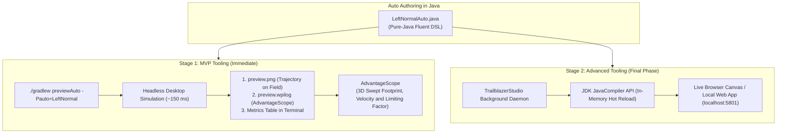

# Trailblazer 2 Design Specification: Java Specification Model, DSL & Tooling

**Document ID:** TB2-SPEC-05  
**Status:** Approved for Implementation  
**Author:** Team 581 Technical Staff  
**Applies To:** `AutoPlan`, `Goal`, `HeadingPlan`, `FieldAnchors`, `AutoPreviewTask`, `TrailblazerLivePreviewer`  

---

## 1. Pure-Java Specification

Trailblazer 2 keeps all auto definitions in **100% Pure Java** rather than YAML/JSON:
1. **No Split-Brain Logic:** Autos like [`LeftNormalAuto.java`](../../../../../../../../comp-bot/src/main/java/frc/robot/autos/auto_state_machines/LeftNormalAuto.java) mix path goals with dynamic lambdas (`() -> getCollisionPoint(...)`), IMU triggers, and enum markers (`passedMarker(READY_TO_CROSS_BUMP)`). Keeping everything in Java avoids splitting logic between config files and code.
2. **Compile-Time Safety:** `javac` and ErrorProne catch typos at build time, and IDE refactoring works out of the box.
3. **Zero Parser Maintenance:** No YAML/JSON schema or reflection plumbing to maintain.

---

## 2. Canonical Java Fluent DSL

Autos are authored using a strongly typed, fluent Java builder API that constructs immutable `AutoPlan` records.

### 2.1 Specification Example: `LeftNormalAuto.java`
```java
public class LeftNormalAuto extends BaseImperativeAuto<NormalAutoState> {

  public enum Markers {
    PRIORITIZE_INTAKE,
    START_SHOOT_RQ,
    READY_TO_CROSS_BUMP
  }

  // Canonical pure-Java auto specification
  private final AutoSegment intakeFirstCycle =
      Trailblazer.plan("intake_first_cycle")
          .withLimits(LimitsProfile.FAST)
          .addGoal(
              Goal.through(FieldAnchors.RED_DEPOT_TRENCH)
                  .within(0.75))
          .addGoal(
              Goal.through(() -> getCollisionPoint(FieldAnchors.BALL_A))
                  .within(0.30)
                  .heading(HeadingPlan.to(Rotation2d.fromDegrees(115.0)).before(1.0).gate(GatePolicy.SOFT))
                  .marker(Markers.PRIORITIZE_INTAKE))
          .addGoal(
              Goal.stop(FieldAnchors.RED_DEPOT_BUMP.plus(0, BUMP_OFFSET))
                  .finish(0.20, Rotation2d.fromDegrees(3), 0.20)
                  .marker(Markers.READY_TO_CROSS_BUMP))
          .build();
}
```

### 2.2 Core Data Model

#### `Goal` Definition
```java
public record Goal(
    Supplier<Pose2d> poseSupplier,       // Absolute, anchor offset, or dynamic supplier
    PassType passType,                   // STOP, THROUGH, or THROUGH_WITH_MIN_SPEED
    double withinMeters,                 // Maximum corner deviation (fillet bound)
    double minPassSpeedMetersPerSec,     // Requested exit speed for THROUGH goals
    FinishTolerance finishTolerance,     // Position, heading, and velocity tolerances for STOP
    Optional<HeadingKeyframe> heading,   // Associated heading schedule keyframe
    Optional<Enum<?>> marker             // Event marker emitted when progress crosses goal
) {}
```

#### `HeadingPlan` Keyframe
```java
public record HeadingKeyframe(
    AnchorDistance anchor,               // atGoal, before(meters), after(meters)
    HeadingTarget target,                // fixed(rot), faceTravel(), facePoint(x,y), hold()
    TurnDirection direction,             // SHORTEST, CW, CCW
    GatePolicy gate,                     // SOFT (unconstrained speed) vs HARD (speed-capped)
    Rotation2d tolerance                // Arrival angular tolerance
) {}
```

---

## 3. Centralized Field Anchor Dictionary (`FieldAnchors.java`)

To eliminate hardcoded floating-point meter constants and coordinate duplication, field geometry is centralized in `shared/src/main/java/com/team581/autos/FieldAnchors.java`:

```java
public final class FieldAnchors {
  // 2026 Reefscape / Offseason Field Geometry (Red Reference Frame)
  public static final Pose2d RED_DEPOT_TRENCH = new Pose2d(10.489, 1.500, Rotation2d.fromDegrees(90));
  public static final Pose2d RED_DEPOT_BUMP   = new Pose2d(13.576, 2.450, Rotation2d.kZero);
  public static final Translation2d HUB_CENTER = new Translation2d(12.100, 4.034);
  public static final Pose2d BALL_A           = new Pose2d(8.744, 2.021, Rotation2d.fromDegrees(115));

  // Algebraic offset helper
  public static Pose2d offset(Pose2d base, double dx, double dy, Rotation2d dTheta) {
    return new Pose2d(base.getX() + dx, base.getY() + dy, base.getRotation().plus(dTheta));
  }

  // Pure mathematical alliance mirror
  public static Pose2d flipToBlue(Pose2d redPose) {
    return FieldUtil.pathflip(redPose);
  }

  private FieldAnchors() {}
}
```

---

## 4. Two-Tier Tooling Architecture

Tooling development is phased into two distinct stages:
1. **MVP Tooling (Immediate Priority):** Headless `./gradlew previewAuto` simulation task integrated with AdvantageScope.
2. **Advanced Tooling (Final Phase):** Standalone In-Memory Live Previewer application (`TrailblazerStudio`).



---

## 5. MVP Tooling: `./gradlew previewAuto -Pauto=<Name>`

Runs the auto in a headless desktop simulation in $\approx 150\text{ ms}$ using the existing Gradle build:
1. Instantiates the Java auto class directly on the desktop JVM.
2. Steps the closed-loop physics model at $50\text{ Hz}$ across all segments.
3. Outputs:
   - `build/reports/autos/<name>.wpilog` for AdvantageScope (3D robot footprint, filleted path, velocity curves, and `LimitingFactor` timeline).
   - `build/reports/autos/<name>.png` top-down field trajectory image.
   - Terminal summary table (duration, peak speed/accel, min keepout clearance, and stop error).

---

## 6. Final Phase Tooling: Live Previewer (`TrailblazerStudio`)

Scheduled as the final project phase, `TrailblazerStudio` provides sub-300 ms live previewing on `Ctrl+S`:
1. **`WatchService`:** Watches `comp-bot/src/main/java/frc/robot/autos/` for saves.
2. **In-Memory `JavaCompiler`:** Compiles the modified auto class in memory via `ToolProvider.getSystemJavaCompiler()` and loads it in a disposable `ClassLoader`.
3. **WebSocket Push (`localhost:5801`):** Evaluates the path in $< 50 \; \mu\text{s}$ and pushes the updated trajectory to a lightweight local browser canvas served by WPILib's `WebServer`.

---

## 7. Tooling Comparison Summary

| Feature | MVP: `./gradlew previewAuto` | Final Phase: `TrailblazerStudio` |
| :--- | :--- | :--- |
| **Status** | **Immediate MVP Priority** | **Final Project Phase** |
| **Invocation** | Terminal command: `./gradlew previewAuto -Pauto=...` | Background daemon / auto-run on save |
| **Turnaround Time** | $\approx 2.0$ seconds | $< 300$ milliseconds |
| **Viewer** | AdvantageScope (`.wpilog`) + PNG image | Embedded Browser Canvas (`localhost:5801`) |
| **Dependencies** | Existing GradleRIO + WPILib desktop tasks | JDK `JavaCompiler` + Local WebServer |
| **CI Integration** | Runs directly in GitHub Actions PR checks | Local developer workstation use |
| **Maintenance Cost** | Minimal ($\approx 200$ lines of Gradle/Java runner) | Medium ($\approx 600$ lines of daemon/web UI) |
