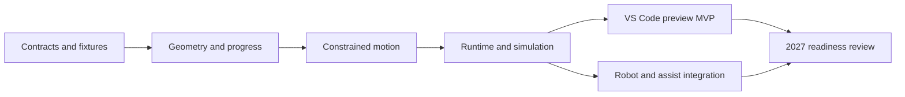

# Trailblazer 2: Implementation Roadmap for 2027

**Document ID:** TB2-SPEC-08
**Status:** Implementation plan
**Scope:** Build order, deliverables, and acceptance evidence

## 1. Objective

Deliver a clean, tested TB2 library ready for the new 2027 robot codebase. There are no remaining competition-readiness or old-auto compatibility requirements. Comp bot primarily runs the new-member pathway; occasional carpet sessions validate TB2 as opportunities arise.

Build TB2 directly in its own namespace with the math/runtime separation in [00](00-overview-and-architecture.md). Do not retrofit the TB1 follower, construct legacy adapters, or migrate old autos to establish correctness. Existing code may remain while still referenced; deleting it is dependency cleanup, not a milestone. Keep the repository compiling and preserve the pathway's normal operating mode.

## 2. Requirement ownership

This roadmap orders work. It does not define another set of formulas, physical constants, localization thresholds, or tooling requirements.

| Concern | Authoritative document |
| --- | --- |
| Packages, lifecycle, robot boundary | [00: Architecture](00-overview-and-architecture.md) |
| Geometry, progress, recovery | [01: Geometry](01-path-geometry-and-kinematics.md) |
| Speed profile and command bounds | [02: Velocity and limits](02-velocity-profiler-and-limits.md) |
| Heading schedule and readiness gates | [03: Heading](03-heading-and-rotation.md) |
| Teleop arbitration and dynamic targets | [04: Assist](04-teleop-and-dynamic-assist.md) |
| Java model, field transforms, VS Code preview | [05: Authoring and tooling](05-spec-model-dsl-and-tooling.md) |
| Fixtures, simulation, CI, acceptance measurements | [06: Verification](06-verification-simulation-and-ci.md) |
| Robot parameters and calibration | [07: Calibration](07-empirical-calibration-routine.md) |

## 3. Implementation order

Each step delivers usable code and its tests. CI starts with the first step. Hardware access is not required to progress through the desktop implementation; hardware qualification remains necessary before claiming robot readiness.

### Step 1 — Establish contracts and a desktop entry point

Deliver:

- `model` values for plans, goals, heading intent, limits, tick input/output, statuses, and stable event IDs. Use the minimal fluent builder in [05](05-spec-model-dsl-and-tooling.md); do not defer the public intent model until after algorithms are built.
- Validation for invalid numbers, identities, terminal behavior, and unresolved target/heading references.
- A Java fixture catalog with an initial straight stop and turn-in-place case. These construct plans without `Robot`, HAL devices, or mechanisms.
- Unit-test wiring in `shared` and a desktop scenario runner skeleton, using the repository's existing Gradle/JUnit conventions. Establish build/check commands before adding more modules.

Done when the example plans compile, invalid plans produce useful diagnostics, and the catalog loads on desktop without hardware side effects.

### Step 2 — Implement geometry and progress calculators

Deliver line/arc primitives, coupled fillet construction, exact path samples, goal anchors, local projection, and explicit next-progress calculations per [01](01-path-geometry-and-kinematics.md). Cover static paths through the next stop before optimizing horizon storage. Resolve duplicate points and exact reversals explicitly.

Done when geometric/property tests cover adjacent short corners, zero-length geometry, figure-8 crossings, through-goal passage, and geometry-generation changes. A rebuild must preserve goal/event identity without comparing distances from different geometries.

### Step 3 — Implement constrained translation and heading math

Deliver the backward/forward profile, bounded heading reference step, heading readiness barriers, terminal pose convergence, and final combined command allocation per [02](02-velocity-profiler-and-limits.md) and [03](03-heading-and-rotation.md). Keep recovery and gate decisions outside generic geometry calculations.

Implement conservative interval constraint checks before performance shortcuts. Explicitly represent an infeasible measured state or a newly tightened command envelope; never hide it by clamping a simulated initial velocity and calling the result feasible.

Done when tests cover startup, braking inside corners, missed/overshot gates, angle wrapping and directed turns, shrinking translation budgets during rotation, and the final command after cross-track/target feedforward is added. The constraint checks must independently evaluate the output, not duplicate its implementation.

### Step 4 — Assemble the runtime and closed-loop evidence

Deliver plan activation/update/cancel/release, input snapshots, dynamic-target state, event history, cached output, and timeout/fault behavior. Connect calculators through this runtime and run it against the desktop plant.

Add the complete representative fixture suite and seeded disturbances in [06](06-verification-simulation-and-ci.md). Produce versioned preview results, traces, diagnostics, and CI summaries from the same execution. Add replay input support without confusing open-loop replay with closed-loop validation.

Done when valid scenarios complete, invalid/unreachable scenarios produce their expected failure status, markers behave correctly through relatches, and repeat runs with the same inputs reproduce results within documented numerical tolerances.

### Step 5 — Deliver the VS Code preview MVP

Implement the extension and Java runner contract in [05](05-spec-model-dsl-and-tooling.md). The editor selects a Java scenario, invokes the normal build/runner, and displays path geometry, footprint playback, headings, limits, events, and diagnostics. Refresh on save and explicit command; clearly distinguish a failed build from an up-to-date result.

Done when a student can edit a Java plan, see it run in VS Code, locate a failed constraint, and reproduce the same result with the headless CI command. Test compile errors, cancellation, stale results, and robot/alliance selection. Measure actual cold/warm refresh times; do not gate on invented latency claims.

### Step 6 — Integrate the robot and teleop assist

Add a TB2 drive source and explicit test-mode selection to the deployed robot project, starting with the new-member pathway configuration used on comp bot. Feed coherent measured state, honor control ownership, log requested/applied motion, and support cancellation. Do not redirect existing normal driving merely to exercise TB2.

Use short dedicated test paths: straight stop, rounded corner, consecutive corners, heading gate, and displaced-start recovery. Derive the test robot's limits and validate them using [07](07-empirical-calibration-routine.md). Add static drive-to, then timestamped dynamic targets and hybrid axis ownership as specified in [04](04-teleop-and-dynamic-assist.md).

Done when desktop integration tests verify mode transitions and hardware sessions demonstrate the core cases with recorded traces. Document untested cases if robot time is limited; that limits the readiness claim, not continued tooling/math work.

### Step 7 — Review 2027 portability and completion

Deliver a small integration example and checklist for supplying robot limits/module locations, localization snapshot, field context, drive output, telemetry, and scenario fixtures. Build that example with a second synthetic robot configuration to expose hardcoded 2026 assumptions.

Done when:

- Shared math/runtime imports no season-specific robot, field, or mechanism code.
- Unit, property, closed-loop, perturbation, and preview integration checks pass under [06](06-verification-simulation-and-ci.md).
- The VS Code workflow and command-line runner consume the same Java plans and diagnostics.
- Robot validation evidence and remaining limitations are recorded, with performance measured on the target hardware.
- The 2027 integration checklist is sufficient to bind the library without altering planner math.

Old-auto parity, TB1 deletion, localization tuning, and unrelated applications are not completion criteria. No commit, push, deployment, or shared-service change is authorized by this implementation plan itself.
