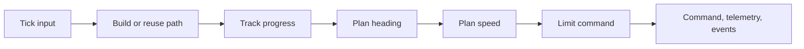
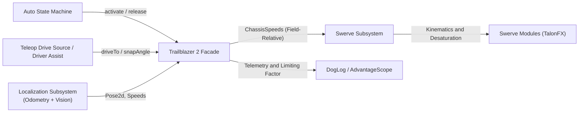

# Trailblazer 2 Design Specification: Overview and System Architecture

**Document ID:** TB2-SPEC-00
**Status:** Implementation design
**Author:** Team 581 Technical Staff
**Applies To:** `com.team581.trailblazer2`, `shared`, robot-project integration

These documents describe intended implementation, not an already verified controller. See the [implementation roadmap](08-implementation-roadmap-and-migration.md) for build order and the document index.

---

## 1. Overview

Trailblazer 2 is intended to make swerve path following more predictable and optimal. It replaces Trailblazer 1's point-chasing and distance-PID speed control with rounded paths and explicit acceleration, braking, and turning limits. It still replans every loop, and keeps everything in code.

---

## 2. Comparison: Trailblazer 1 vs. Alternatives

| Metric                        | Trailblazer 1                            | Choreo                            | PathPlanner                             | 254 Hermite Splines                   | Trailblazer 2                                                      |
| :---------------------------- | :--------------------------------------- | :-------------------------------- | :-------------------------------------- | :------------------------------------ | :----------------------------------------------------------------- |
| **Indexed by**                | Heuristic $t \in [0, 1]$ per point       | Clock time $t$                    | Clock time $t$                          | Arc length $s$ or time $t$            | **Path distance $s$ (Horizon)**                                    |
| **Bump / Collision Recovery** | Jerky; target jumps when index advances  | Poor; setpoint runs ahead in time | Moderate; PID winds up unless replanned | Moderate; needs high cross-track gain | **Re-solves from current state; explicit recovery policy**         |
| **Cornering**                 | Straight line to point; snaps direction  | Full offline solver               | Bézier centripetal clamp                | Curvature-bounded $\kappa(s)$         | **Circular fillets + 2-pass speed profile + 2D vector limiter**    |
| **Accel vs. Braking**         | Limits speed-up; no mid-path brake limit | Symmetric                         | Symmetric                               | Symmetric                             | **Bounded braking and acceleration; independently derived limits** |
| **Heading Control**           | Tied to waypoints; flips mid-arc         | Coupled offline                   | Independent profile                     | Coupled or decoupled                  | **Decoupled schedule $\theta^*(s)$ with hard/soft gates**          |
| **Dynamic / Vision Goals**    | Supported via `Supplier<Point>`          | Offline only                      | Limited                                 | Requires re-splining                  | **Built-in online evaluation**                                     |
| **Preview & Testing**         | None (must run on carpet)                | Desktop GUI                       | Desktop GUI                             | Sim scripts                           | **VS Code preview + shared Java runner + CI simulation**           |

---

## 3. Core Design Rules

### Everything in code

Define paths in Java so the code is the single source of truth. [Tooling spec](05-developer-tooling.md)

### Replan every loop

Use fresh measurements each loop to respond to how the robot actually moved, and reuse the path geometry when it still applies. [Runtime spec](04-runtime-integration-and-teleop-assist.md)

### Let autos specify goals and tolerances

Autos say where to go and how close is good enough, so the planner can use robot physics to choose corner radii and speeds.

### Start with physics and verify on carpet

Use CAD and motor estimates as a starting point, then test each robot on carpet to confirm its limits and controller defaults. [Calibration spec](07-empirical-calibration-routine.md)

### Enforce limits and recover when needed

Check the speed profile and final command against the robot’s combined driving and turning limits, and use explicit recovery when the measured motion is already outside what the model allows.

### Run the same planner everywhere

Pass time and robot state as inputs so desktop tests, the VS Code preview, and CI can run the same planner as the roboRIO.

### Clarity

- Preview the path, heading, speed, and markers in VS Code [Tooling spec](05-developer-tooling.md#6-mvp-viewer-vs-code-previewer)
- Log robot telemetry and the active speed constraint each tick so developers can see what happened in logs.
- Publish CI check results and previews so reviewers can see how a change affects an auto. [Verification spec](06-verification-simulation-and-ci.md)

---

## 4. End-to-End Runtime Pipeline

The planner runs once per robot control loop. Each update is a **tick**. It takes a `TickInput` and returns a `TickResult`.

1. Build or reuse the path to the next stop. [Geometry spec](01-path-geometry-and-kinematics.md#4-planning-horizon)
2. Find how far along the path the robot is with measured pose. [Geometry spec](01-path-geometry-and-kinematics.md#52-local-projection-and-progress)
3. Plan which way the robot should face and how much of the drivetrain’s capacity to use for driving vs. turning. [Heading spec](03-heading-and-rotation.md)
4. Plan speed along the path. Work backward to account for braking and forward to account for acceleration. [Velocity spec](02-velocity-profiler-and-limits.md#3-two-pass-spatial-horizon-profiler)
5. Limit the final command before sending it to swerve. [Velocity spec](02-velocity-profiler-and-limits.md#5-cross-track-control-stop-convergence--2d-vector-limiter)

The runtime keeps state between ticks, handles tick inputs and outputs, and manages when plans start and stop. [Runtime spec](04-runtime-integration-and-teleop-assist.md)

---

## 5. Subsystem Architecture

Trailblazer 2 is decoupled from low-level drivetrain motor control and high-level match state machines.

### 5.1 Separation of Responsibilities

1. **Auto State Machine:** Runs overall autos and uses `passedMarker` and `atGoal` to transition states.
2. **Trailblazer:** Solves path geometry, velocity heading, and outputs field-relative `ChassisSpeeds`.
3. **Swerve Subsystem:** Uses `ChassisSpeeds` to control drive/steer motors.
4. **Localization:** Fuses wheel odometry and AprilTag vision into `Pose2d` and `ChassisSpeeds`.

### 5.2 Math and Runtime Separation

To make sure math vs. logic is easy to find, they're in separate places.

| Package / boundary | Responsibility                                                                                            |
| :----------------- | :-------------------------------------------------------------------------------------------------------- |
| `model`            | Immutable plans, resolved inputs/results, limits, and stable IDs                                          |
| `math`             | Pure geometry, projection, profiling, heading, and constraint calculators; explicit state and `dt`, no IO |
| `runtime`          | Activation, state transitions, supplier/filter history, events, and cached output                         |
| Robot integration  | Localization snapshots, drive-source selection, controls, telemetry, and drivetrain output                |

### Extra Notes

- Keep season-specific field definitions and robot configuration outside shared part.
- Any tooling should use the same model/math/runtime without constructing hardware.
- Use the existing `DriveSource` boundary to choose between Trailblazer vs. Driver speeds, like before.
