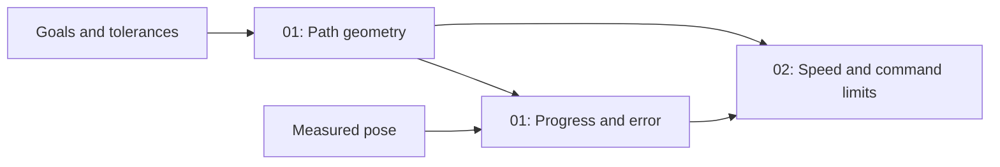
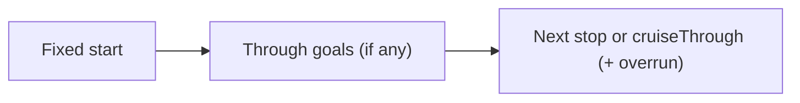

# 01 — Path Geometry and Kinematics

**Applies To:** `PathBuilder`, `ProgressTracker`, `AutoGeometry`

---

## 1. Scope: Path Shape and Robot Position

This spec defines the path and locates the robot on it. [02 — Velocity and limits](02-velocity-profiler-and-limits.md) uses that geometry to choose speeds and drive commands.

- **Inputs:** Resolved goals, tolerances, measured pose, tracking policy, and field keepouts.
- **Outputs:** Straight segments and tangent circular fillets; position, tangent, and curvature along the path; measured progress, event progress, and signed cross-track error.
- **Owns:** Fillet sizing, the stop-bounded horizon, projection, goal anchors/passage, and geometry rebuilds.



---

## 2. Circular Fillet Mathematics

A circular fillet rounds the corner at $P_k$ between consecutive goals $P_{k-1}$, $P_k$, and $P_{k+1}$. These formulas require nonzero-length legs and a turn angle strictly between zero and 180 degrees; see sections 3 and 7 for degenerate cases.

The incoming and outgoing leg vectors and lengths are:

$$
\vec{L}_{in} = P_k - P_{k-1}, \qquad L_{in} = \|\vec{L}_{in}\|
$$

$$
\vec{L}_{out} = P_{k+1} - P_k, \qquad L_{out} = \|\vec{L}_{out}\|
$$

Their unit direction vectors are:

$$
\hat{u} = \frac{\vec{L}_{in}}{L_{in}}, \qquad
\hat{v} = \frac{\vec{L}_{out}}{L_{out}}
$$

### 2.1 Corner Angle and Turn Direction

The unsigned change in direction, $\theta$, is:

$$
\theta = \left|\mathrm{atan2}\left(u_x v_y - u_y v_x,\; u_x v_x + u_y v_y\right)\right|
$$

A straight path has $\theta = 0$, a right-angle turn has $\theta = \pi/2$, and a reversal approaches $\theta = \pi$.

Store turn direction separately to position the circle center:

$$
\sigma_{turn} = \mathrm{sgn}(u_x v_y - u_y v_x)
$$

$+1$ means left (counterclockwise); $-1$ means right (clockwise).

### 2.2 Tangent Length and Distance from the Corner

For a fillet of radius $r$, the distance from $P_k$ to each tangent contact point ($T_{in}$ and $T_{out}$) along its leg is:

$$
t = r \tan\left(\frac{\theta}{2}\right)
$$

The distance from $P_k$ to the closest point on the arc (the arc apex) is:

$$
d_{dev} = r\left(\frac{1}{\cos(\theta/2)} - 1\right)
= r\left(\sec\left(\frac{\theta}{2}\right) - 1\right)
$$

### 2.3 Choosing the Fillet Radius

The radius must satisfy the waypoint's `within` distance and leave room for neighboring fillets. $L_k$ is the leg length from $P_{k-1}$ to $P_k$, and $L_{k+1}$ is the length from $P_k$ to $P_{k+1}$.

**Radius allowed by `within`.** For a tolerance of $\delta_k$ meters, reserve inward tracking margin $\epsilon_{track}$ (tracking-policy default `0.05 m`) without collapsing small tolerances to zero. The largest radius satisfying $d_{dev} \le \delta_{geom,k}$ is:

$$
\delta_{geom,k} = \max\left(0.5\,\delta_k,\; \delta_k - \epsilon_{track}\right), \qquad
r_{\delta,k} = \frac{\delta_{geom,k}}{\sec(\theta_k/2) - 1}
$$

**Desired tangent length.** Each corner uses equal entry and exit tangent lengths. Cap the desired length at $\eta = 0.85$ of the shorter adjacent leg:

$$
t_{des,k} = \min\left(
  r_{\delta,k}\tan\left(\frac{\theta_k}{2}\right),
  \; \eta\min(L_k, L_{k+1})
\right)
$$

**Shared-leg scale factor.** The two fillets on leg $L_k$ may use at most $\gamma = 0.95$ of its length. Their scale factor is:

$$
\sigma_{leg,k} =
\begin{cases}
\dfrac{\gamma L_k}{t_{des,k-1} + t_{des,k}}
  & \text{if } t_{des,k-1} + t_{des,k} > \gamma L_k \\
1.0 & \text{otherwise}
\end{cases}
$$

**Clamped tangent length and geometric radius.** Apply the smaller scale factor from the two adjacent legs to both tangents at corner $k$:

$$
t_{clamped,k} = t_{des,k}\min\left(\sigma_{leg,k},\; \sigma_{leg,k+1}\right)
$$

$$
r_{geom,k} = \frac{t_{clamped,k}}{\tan(\theta_k/2)}
$$

**Final radius.** Use the smaller of the tolerance and geometry limits:

$$
r_k = \min\left(r_{\delta,k},\; r_{geom,k}\right)
$$

Corner-speed limits and pass-speed warnings belong to [02 §3.1](02-velocity-profiler-and-limits.md#31-node-level-limit-formulation).

---

## 3. Boundary Conditions & Edge Cases

- **Collinear Corners:** Merge only collinear legs within documented numeric tolerance, preserving goal anchors; a blanket one-degree bypass breaks tangency.
  For small nonzero turns, evaluate the denominator stably as $2\sin^2(\theta/4)/\cos(\theta/2)$ and retain the fillet; reject numerically unresolved geometry rather than inventing a sharp join.

- **Sharp Turns ($\theta_k \ge 135^\circ = 2.356\text{ rad}$):** Intentional reversals should be authored with `Goal.stop(...)`. If a near-reversal turn ($135^\circ \le \theta_k < 180^\circ$) is authored as `Goal.through(...)`, $r_{geom, k}$ shrinks; the previewer logs a `NEAR_REVERSAL_CORNER` warning suggesting `Goal.stop(...)`.

- **Explicit Stop Goals (`Goal.stop(...)`):** $r_k = 0, t_k = 0$. Stop-speed constraints are defined in [02 §3.1](02-velocity-profiler-and-limits.md#31-node-level-limit-formulation).

---

## 4. Planning Horizon

Build the **planning horizon** from the fixed start (§6) through the next **terminal goal** (`Goal.stop(...)` or `Goal.cruiseThrough(...)`), including every through goal in between.



Neighboring fillets share straight-leg space (§2.3). Keep the nominal horizon endpoint $S_{total}$ fixed as the robot advances.

- **Terminal Cruise Overrun (`PassType.CRUISE_THROUGH`):** When the terminal goal is `Goal.cruiseThrough(...)` with target speed $v_{cruise} > 0$, extend a post-anchor tangent overrun ray past $S_{total}$ of length $d_{overrun} = \max\left(1.5\text{ m},\; 1.15\frac{v_{cruise}^2}{2\min(a_{brake}, a_{fric})}\right)$ (clipped to field-wall and $K_{hard}$ clearance, logging `CRUISE_OVERRUN_LIMITED` if clipping reduces $v(S_{total}) < v_{cruise}$) terminating in a safety stop ($v = 0$) at $S_{total} + d_{overrun}$. This prevents premature braking across scoring, handoff, or zone transitions while preventing wall/obstacle collisions if the caller delays transitioning.

- **Capacity.** Check goal and sample counts before activation. Accept paths up to the configured limits and reject oversized paths without truncating them.

- **Rebuilds.** Build and cache static geometry at activation, release from a completed stop, or recovery. For dynamic goals, compare each resolved target against the **snapshot stored when the current `geometryGeneration` was built** (never tick $n$ vs. tick $n-1$, which misses slow steady drift): increment `geometryGeneration` and rebuild curve geometry when any resolved goal's **position** shifts by $\|\Delta \mathbf{p}_{goal}\| > \epsilon_{rebuild,pos}$ (`0.01 m`), whereas pure goal-heading shifts ($|\Delta \theta_{goal}| > 0.5^\circ$ with $\|\Delta \mathbf{p}_{goal}\| \le 0.01\text{ m}$) update the target heading in place without resetting arc-length coordinates (re-checking terminal footprint clearance if outside rotational margin).

- **Future shorter horizon.** Preserve neighboring fillets’ full-path tangent lengths and satisfy the [profiler’s cutoff requirements](02-velocity-profiler-and-limits.md#3-two-pass-spatial-horizon-profiler).

---

## 5. Progress Tracking & Spatial Parameterization

The path within the horizon is parameterized by cumulative arc length $s \in [0, S_{horizon}]$, where $S_{horizon} = S_{total} + d_{overrun}$ for `PassType.CRUISE_THROUGH` and $S_{total}$ otherwise.

```
s = 0                                                             s = S_total
|------------------*~~~~~~~~~~~~~*-----------------------------------|
[Straight Leg 1]  T_in   [Arc]   T_out        [Straight Leg 2]
```

### 5.1 Position, Tangent, and Curvature

Let $l$ be the distance from the start of the current path piece. The formulas give its position $\mathbf{r}$, unit tangent $\hat{t}$, and curvature magnitude $\kappa$.

**Straight segment.** The straight part of leg $k$ runs from $T_{out,k-1}$ to $T_{in,k}$ in unit direction $\hat{u}_k$. Subtract both tangent lengths for its length.

$$
\Delta s_{line,k} = L_k - t_{clamped,k-1} - t_{clamped,k}
$$

For $l \in [0,\Delta s_{line,k}]$, the position starts at $\mathbf{p}_{start,k} = \mathbf{T}_{out,k-1}$.

$$
\mathbf{r}(l) = \mathbf{p}_{start,k} + l\hat{u}_k,
\qquad \hat{t}(l) = \hat{u}_k,
\qquad \kappa(l) = 0
$$

**Fillet arc.** At corner $P_k$, use the radius $r_k$, turn angle $\theta_k$, and turn sign $\sigma_{turn,k}$ from section 2. The arc length is $\Delta s_{arc,k} = r_k\theta_k$.

The entry and exit points are each $t_{clamped,k}$ from the corner along their respective legs.

$$
\mathbf{T}_{in,k} = P_k - t_{clamped,k}\hat{u}_{in,k}
$$

$$
\mathbf{T}_{out,k} = P_k + t_{clamped,k}\hat{u}_{out,k}
$$

The circle center is one radius from the entry point along the unit normal pointing into the turn.

$$
\hat{n}_{in,k} = \sigma_{turn,k}
\begin{bmatrix}
-u_{in,y} \\
u_{in,x}
\end{bmatrix},
\qquad
\mathbf{C}_k = \mathbf{T}_{in,k} + r_k\hat{n}_{in,k}
$$

The start angle is the direction from the center to the entry point. Here $T_{in,x}$ and $T_{in,y}$ are the components of $\mathbf{T}_{in,k}$.

$$
\alpha_{start,k} = \mathrm{atan2}(T_{in,y} - C_{k,y},\; T_{in,x} - C_{k,x})
$$

At distance $l$ along the arc, $\phi = l/r_k$ ranges from $0$ to $\theta_k$. The angle from the center to the current point is $\alpha = \alpha_{start,k} + \sigma_{turn,k}\phi$.

$$
\mathbf{r}(\phi) = \mathbf{C}_k + r_k
\begin{bmatrix}
\cos\alpha \\
\sin\alpha
\end{bmatrix}
$$

$$
\hat{t}(\phi) = \sigma_{turn,k}
\begin{bmatrix}
-\sin\alpha \\
\cos\alpha
\end{bmatrix},
\qquad
\kappa = \frac{1}{r_k}
$$

### 5.2 Local Projection and Progress

**Search window.** To avoid jumping to another leg at a crossing or overlap, search near the high-water mark $s_{high\_water}$. The tracking policy sets loop-rate-independent spatial backward/forward distances $d_{back}$ and $d_{fwd}$ ($d_{fwd} \ge v_{max} T_{relatch\_dwell} + e_{vision\_max} + v_{max}\Delta t_{max}$, default `1.5 m`; $d_{back} \ge \max(d_{gate\_hold}, 0.6\text{ m})$) so high-rate control loops (`100–250 Hz`) never shrink the search window while $s_{high\_water}$ is frozen; clip to active horizon bounds ($S_{horizon} = S_{total} + d_{overrun}$ for `Goal.cruiseThrough`, else $S_{total}$).

$$
s_{min} = \max(0,\; s_{high\_water} - d_{back}),
\qquad
s_{max} = \min(S_{horizon},\; s_{high\_water} + d_{fwd})
$$

**Measured progress.** Project the robot position $\mathbf{p}_{robot} = (x,y)$ onto the portion of each path piece inside $[s_{min},s_{max}]$. The closest point is $\mathbf{p}^*$, and its arc-length coordinate $s_{meas}$ is used for control and speed profiling.

- **Exact fillet-arc projection.** To avoid center-of-curvature discontinuities when inward cross-track error exceeds $r_k$, let $\alpha_{mid,k} = \alpha_{start,k} + \sigma_{turn,k}\theta_k/2$ and compute:

  $$
  \Delta\alpha = \mathrm{angleModulus}\left(\mathrm{atan2}(p_{robot,y} - C_{k,y},\; p_{robot,x} - C_{k,x}) - \alpha_{mid,k}\right)
  $$

  If $\|\mathbf{p}_{robot} - \mathbf{C}_k\| > 10^{-6}$ and $|\Delta\alpha| \le \theta_k/2$, use $\phi = \theta_k/2 + \sigma_{turn,k}\Delta\alpha$; otherwise choose $\arg\min_{\mathbf{T} \in \{\mathbf{T}_{in,k}, \mathbf{T}_{out,k}\}} \|\mathbf{p}_{robot} - \mathbf{T}\|^2$ (tie-breaking to $\mathbf{T}_{in,k}$).

**Event progress.** Update the high-water mark with measured progress only while inside the tracking corridor ($|e_{xt}| \le e_{relatch}$), and clamp to the earliest unsatisfied interior `HARD` heading gate ($s_{hard\_gate}$) so off-track sweeps or closed-gate overshoots cannot advance events:

$$
s_{high\_water,new} =
\begin{cases}
\max\left(s_{high\_water},\; \min(s_{meas},\; s_{hard\_gate})\right) & \text{if } |e_{xt}| \le e_{relatch} \\
s_{high\_water} & \text{otherwise}
\end{cases}
$$

Large backward displacement or sustained $|e_{xt}| > e_{relatch}$ triggers recovery. The high-water mark is local to each geometry generation (see section 6).

**Cross-track error.** At the closest point, rotate the path tangent with components $(t_x,t_y)$ to get the left-hand unit normal.

$$
\hat{n}(s_{meas}) =
\begin{bmatrix}
-t_y \\
t_x
\end{bmatrix}
$$

Project the offset from the path to the robot onto that normal to get the signed error.

$$
e_{xt} = (\mathbf{p}_{robot} - \mathbf{p}^*) \cdot \hat{n}(s_{meas})
$$

Positive error means the robot is left of the path. [02 §5](02-velocity-profiler-and-limits.md#5-cross-track-control-stop-convergence-7-set-2d-projection--feedforwards) converts this error into a bounded correction velocity.

---

## 6. Anchors, geometry generations, and recovery

### Goal anchors and passage

An **anchor** is the point on the path that represents a goal. Use the same anchor for passage, markers, and heading references.

| Goal | Anchor |
| --- | --- |
| Rounded through goal | Fillet apex |
| Unrounded through goal | Waypoint vertex |
| Explicit stop | Path endpoint |
| Cruise-through terminal | Path endpoint ($S_{total}$ before overrun ray) |

- **Path origin.** Fix it at activation or release from a completed stop.

- **Progress.** Use measured projection for control and corridor-gated high-water mark for events (§5.2).

- **Projection.** Within the distance window, search only the pieces allowed by the active goal and path order. This prevents jumps to crossing legs.

For a `Goal.through(...)`, let $d_{closest,k} = \min_n \mathrm{dist}(P_k, \overline{\mathbf{p}_{n-1}\mathbf{p}_n})$ be the measured segment-to-goal closest approach while goal $k$ is active (if $s_{high\_water}$ advances past multiple closely spaced anchors in a single tick, evaluate segment $\overline{\mathbf{p}_{n-1}\mathbf{p}_n}$ against each crossed anchor in authored order), and define capture radius $d_{capture,k} = \max(e_{relatch},\; 2\delta_k + 0.15\text{ m})$. When $s_{high\_water} \ge s_{anchor,k}$ (with no closed `HARD` gate at or before $s_{anchor,k}$):

1. **$d_{closest,k} \le \delta_k$:** Advance active goal ID, record `marker` as passed, and record `PASSED_WITHIN_TOLERANCE`.
2. **$\delta_k < d_{closest,k} \le d_{capture,k}$:** Advance active goal ID, **still record `marker` as passed** so minor carpet disturbances do not starve auto state transitions, and record `PASSED_OUTSIDE_TOLERANCE` with $d_{closest,k}$ for CI/preview failure checks.
3. **$d_{closest,k} > d_{capture,k}$:** Do **not** pass the goal or record `marker` as passed; trigger recovery toward the unpassed goal.

`Goal.stop(...)` markers are recorded as passed only upon full stop completion ([04 §4](04-runtime-integration-and-teleop-assist.md#4-stops-and-markers)), whereas `Goal.cruiseThrough(...)` terminal markers are recorded as passed on anchor passage within $d_{capture,k}$.

### Path rebuilds

A **geometry generation** is one version of the built path. Each has its own arc-length coordinates, high-water mark, and resolved dynamic-goal snapshot (§4).

- Remap the active goal and path piece.
- Reproject the measured pose and track progress in the new path's coordinates.
- Carry over passed markers, completed goals, and `GoalPassageStatus` history.
- Keep unsatisfied stops and hard gates pending.
- Require measured passage even if a dynamic rebuild moves an anchor behind the robot.

### Moving activation and recovery

- **Moving activation:** Keep Leg 1 as $\mathbf{p}_{start} \to P_1$ without inserting a virtual lead-in vertex. Include the initial arrest bow $\mathbf{p}_{start} + \frac{\|\vec{v}_{meas}\|}{2\min(a_{brake}, a_{fric})}\vec{v}_{meas}$ in activation footprint checks, and pause tracking-error relatch dwell while initial perpendicular speed $|\vec{v}_{prev}\cdot\hat{n}_1| > v_{xt,max}$ is actively decaying toward Leg 1.

- **Tracking error.** Store the error thresholds and required duration in a named Java tracking policy. Validate them with scenarios.

- **Localization reset.** Localization accepts measurements and signals resets. TB3 uses that signal for vision jumps.

- **Two-tier keepouts:** Separate **hard obstacle polygons** $K_{hard}$ (field structures, walls, and pillars) from **inflation margin bands** $K_{margin}$. Pre-match CI and teleop `driveTo` reject intrusions into either.

1. Start a new geometry generation toward the next uncompleted goal. Preserve command history.
2. Check the robot's footprint along the entire connection against $K_{hard}$ and $K_{margin}$.
3. On hard obstacle intrusion ($d_{signed}(K_{hard}) < 0$), stop and report a fault unless the initial pose slightly touches a boundary ($d_{signed} \ge -0.03\text{ m}$) and clearance strictly increases over $s \in [0, 0.15\text{ m}]$ (wall-contact escape). On margin-only contact during mid-auto recovery ($0 \le d_{signed}(K_{hard}) < d_{margin}$), continue with `KEEPOUT_MARGIN_WARNING` and a `CAREFUL` speed cap rather than terminating the auto.

## 7. Degenerate and dynamic inputs

| Input | What to do |
| --- | --- |
| Nonfinite coordinate | Reject it. |
| Consecutive through goals at the same position | Reject them and retain their IDs and markers. |
| A single stop at the same position | Allow heading-only motion. |
| Through goal at an exact reversal, or a noncollinear through corner with zero tolerance | Report a validation error and require an explicit stop. A finite-radius tangent arc is impossible. |
| Near reversal | Allow a small fillet with a warning if the radius and length meet numeric tolerances. |
| Zero-length leg | Skip tangent division; use terminal position and heading control ([02 §5](02-velocity-profiler-and-limits.md#5-cross-track-control-stop-convergence-7-set-2d-projection--feedforwards)). |

Clamp projection and evaluation to each piece's valid domain. Use deterministic tie-breaking at joins.

Runtime evaluates named dynamic targets once per tick and passes the resolved values to `PathBuilder`, applying the §4 rebuild deadband against the active generation snapshot ([04 §8](04-runtime-integration-and-teleop-assist.md#8-resolved-plan-inputs)).
