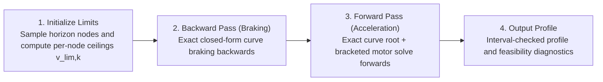

# 02 — Velocity Profiler and Limits

**Applies To:** `VelocityProfiler`, `DrivetrainLimits`, `VectorLimiter`

---

## 1. Scope: Speed Planning and Drive Commands

This spec turns the path and measured progress from [01 — Geometry and progress](01-path-geometry-and-kinematics.md) into a speed profile and bounded translational command.

- **Inputs:** Path geometry, measured progress and cross-track error, measured/applied velocity, drivetrain limits, zones, and heading budgets/gates from [03](03-heading-and-rotation.md).
- **Outputs:** Profile speeds, final translation command, feasibility status, and active constraints.
- **Owns:** Physical limits, profile sampling, braking/acceleration passes, lookahead, cross-track feedback, terminal convergence, and final command limiting.

---

## 2. Drivetrain Physical Limits Model

Define robot physical limits and drive-motor parameters once in immutable records:

```java
public record DriveMotorModel(
    double massKg,                   // m: Robot mass
    double wheelRadiusMeters,        // r_wheel: Loaded drive wheel radius
    double driveGearRatio,           // G_drive: Motor-to-wheel reduction
    double motorResistanceOhms,      // R_m: Winding resistance
    double torqueConstantNmPerAmp,   // k_T: Stator torque constant
    double staticFrictionVolts,      // k_S: Drivetrain static friction voltage
    double slipCurrentAmps,          // I_slip: Stator current at wheel slip
    double freeCurrentAmps,          // I_free: Unloaded free current
    double batteryResistanceOhms,    // R_bat: Internal battery + wiring resistance
    double inverterEfficiency,       // eta_inv: Controller/motor power transfer factor
    double gearboxEfficiency,        // eta_gear: Mechanical drivetrain efficiency
    double accelDerateFactor,        // eta_a: Conservative acceleration margin
    double nominalVoltageVolts       // V_nom: Nominal 12.0 V reference
) {}

public record DrivetrainLimits(
    double maxLinearVelocity,        // v_max (m/s): Derived loaded top speed on carpet
    double freeLinearAcceleration,   // a_0 (m/s^2): Derived stall/zero-speed acceleration
    double motorFreeSpeed,           // v_free (m/s): Derived motor theoretical free speed
    double maxBrakingDeceleration,   // a_brake (m/s^2): On-robot tuned safe braking
    double frictionLimit,            // a_fric (m/s^2): On-robot tuned tire traction (μ * g)
    double maxLateralAcceleration,   // a_lat (m/s^2): Derived cornering limit (0.85 * a_fric)
    double maxAngularVelocity,       // omega_max (rad/s): Derived maximum rotation rate
    double maxAngularAcceleration,   // alpha_max (rad/s^2): Derived maximum rotational acceleration
    double maxPathTurnRateRadPerSec, // delta_dot_eff (rad/s): Closed-loop steer/phase-lag rate cap
    double driveResponseLagSeconds,  // tau_lag (s): On-robot validated velocity tracking lag
    DriveMotorModel motorModel       // Stator, voltage-sag, and supply-power curve parameters
) {}
```

- **Derived Estimates:** Estimate speed/acceleration limits from CAD, gearing, motor data, and calibration; validate on each robot.

- **Empirical Parameters:** Traction $a_{fric}$, braking $a_{brake}$, and lag $\tau_{lag}$ are primary carpet measurements. Acceleration and braking need not be symmetric.

- **Tracking Policy:** Keep $\tau_{xt}$, $v_{xt,max}$, $kP_\theta$, sampling, and recovery thresholds separate from physical capabilities. Supply module locations through the execution context.

- **Supply-Current & Voltage-Aware Motor Torque-Speed Curve:** Using optional live `TickInput` values `swerveSupplyCurrentLimitAmps` ($I_{supply}$—strictly the **instantaneous** per-drive-motor DC supply ceiling enforced by hardware, accounting for any asynchronous bus latency, rather than a delayed continuous thermal floor) and `restingBatteryVoltageVolts` ($V_{oc}$, latched at near-zero draw or compensated via $V_{oc} = \mathrm{clamp}(V_{bat} + I_{tot} R_{bat}, 9.0, V_{nom})$ so loaded sag is never double-counted, defaulting to $V_{nom}$ if absent):

  ```math
  E(v) = k_S + (V_{nom} - k_S)\frac{v}{v_{free}}, \qquad
  I_{volt}(v) = \frac{\max\left(0,\; V_{oc} - E(v)\right)}{R_m + 4 R_{bat}/\eta_{inv}}
  ```

  ```math
  V_{bus,sup} = \max\left(7.0\text{ V},\; V_{oc} - 4 I_{supply} R_{bat}\right), \qquad
  I_{sup\_max}(v) = \frac{-E(v) + \sqrt{E(v)^2 + 4 R_m \eta_{inv} V_{bus,sup} I_{supply}}}{2 R_m}
  ```

  ```math
  I_{max}(v) = \min\left(I_{slip},\; I_{volt}(v),\; I_{sup\_max}(v)\right), \qquad
  a_{motor}(v) = \eta_a \frac{4 \eta_{gear} G_{drive} k_T \max\left(0,\; I_{max}(v) - I_{free}\right)}{m \cdot r_{wheel}}
  ```

  (Omit $I_{sup\_max}(v)$ when `swerveSupplyCurrentLimitAmps` is absent; without $I_{supply}$ throttling, this reduces to the linear back-EMF curve bounded by $I_{slip}$.)

> See **[TB3-SPEC-07: Parameter Derivation & Physics Sandbox Validation](07-empirical-calibration-routine.md)** for derivation estimates, input assumptions, and calibration.

---

### Segment ceilings

`MotionLimits.robotMaximum()` uses the physical model with its normal derates. A segment can supply lower positive ceilings for chassis speed (m/s), acceleration and braking (m/s²), angular speed (rad/s), and angular acceleration (rad/s²). The motor curve and traction still constrain speed gain. Apply authored acceleration in the forward pass and final command projection. The chassis speed ceiling and physical module speed ceiling are independent. Log resolved ceilings alongside profile, commanded, and measured motion.

## 3. Two-Pass Spatial Horizon Profiler

Sample the [horizon defined in 01 §4](01-path-geometry-and-kinematics.md#4-planning-horizon) at maximum spacing $\Delta s = 0.05$ m initially.

1. **Include both endpoints:** Uniform sampling needs $N = \lceil S_{horizon}/\Delta s\rceil + 1$ nodes, indexed $0$ through $N-1$.
2. **Insert exact boundaries:** Add current measured progress, piece boundaries, goals, heading anchors, and zone boundaries. Recount $N$ after insertion; use actual interval length $\Delta s_k=s_{k+1}-s_k$.
3. **Handle zero length:** Use terminal position/heading control directly; do not divide by path length.

```
Node:     0        1        2        k       k+1               N-1 (End)
Arc (s):  0.00     0.05     0.10 ... s_k     s_{k+1} ...       S_horizon
          |--------|--------|--------|--------|-----------------|
                   Δs = 0.05m
```

A future shorter horizon must account for every downstream constraint in its cutoff speed. The straight-line braking distance `v_max²/(2*a_brake)` alone is insufficient because cornering and rotation can reduce available braking.

### 3.1 Node-Level Limit Formulation

Obtain noise-free **per-node** translational budgets $(v_{max, eff, k}, a_{fric, eff, k})$ from [TB3-SPEC-03 §5](03-heading-and-rotation.md#5-swerve-wheel-speed-friction--spatial-budget-allocation) (which includes the closed-form path-coupled wheel limit $v_{coupled,max,k} = \frac{v_{max}}{1 + |\theta^{*\prime}|_k R_{max}}$ with join derivative $|\theta^{*\prime}|_k = \max(|\theta^{*\prime}(s_k^-)|, |\theta^{*\prime}(s_k^+)|)$ on `faceTravel`/`facePoint` segments). These budgets can reach zero; do not add positive floors that exceed available capacity.

At each spatial sample $k$ with join curvature $|\kappa_k| = \max(|\kappa(s_k^-)|, |\kappa(s_k^+)|)$, the local velocity limit $v_{lim, k}$ is bounded by:

1. **Effective Translational Velocity Limit:** $v_{max, eff, k}$
2. **Curvature, Centripetal & Closed-Loop Turn-Rate Limit:**
   For $a_{lat,eff,k} = \min(a_{lat}, a_{fric,eff,k})$ and closed-loop steer/phase-lag turn-rate limit $\dot{\delta}_{eff}$:

   ```math
   v_{corner,k}=\min\left(\sqrt{\frac{a_{lat,eff,k}}{|\kappa_k|}},\; \frac{\dot{\delta}_{eff}}{|\kappa_k|}\right)
   ```

   (On straight segments where $\kappa_k = 0$, $v_{corner,k}=\infty$.)
3. **Zone & Hard Heading Gate Constraints:** Apply zone speed ceilings. An unsatisfied hard gate inserts a zero-speed barrier at its anchor; the backward pass propagates braking upstream ([TB3-SPEC-03 §4](03-heading-and-rotation.md#4-translation-rotation-coupling-hard-vs-soft-gates)).
4. **Goal Exit Constraints:** `Goal.stop` has $v_{goal,N-1}=0$. `Goal.finishThrough(v_cruise)` sets $v_{goal,k} = v_{cruise}$ at $S_{total}$ and $v_{goal,N-1} = 0$ at the overrun ray end $S_{total} + d_{overrun}$. An interior `Goal.through` may declare a speed ceiling $v_{pass}$, never a required minimum; otherwise $v_{goal,k}=\infty$.

The composite speed ceiling is:

```math
v_{lim,k}=\min(v_{max,eff,k},v_{corner,k},v_{zone,k},v_{gate,k},v_{goal,k})
```

For fillet radius $r_k$ from [01 §2.3](01-path-geometry-and-kinematics.md#23-choosing-the-fillet-radius), if a requested pass-speed ceiling $v_{pass}$ exceeds the corner's combined lateral/turn-rate capability:

```math
v_{pass} > \min\left(\sqrt{a_{lat} r_k},\; \dot{\delta}_{eff} r_k\right)
```

then `VelocityProfiler` caps corner speed at $\min\left(\sqrt{a_{lat} r_k},\; \dot{\delta}_{eff} r_k\right)$, and the preview runner logs a warning.

### 3.2 Friction Circle Coupling (Tangential Acceleration Capacity)

At speed $v$, lateral acceleration $a_{lateral} = v^2 |\kappa|$ consumes effective translational traction ($a_{fric, eff}$).
Under the friction envelope ($a_{tangential}^2 + a_{lateral}^2 \le a_{fric, eff}^2$), the remaining tangential acceleration capacity is:

```math
a_{t}(v, \kappa, a_{fric,eff}) = \sqrt{\max\left(0, \; a_{fric, eff}^2 - (v^2 \kappa)^2\right)}
```

### 3.3 Dynamic Programming Sweeps

For each interval $[s_k, s_{k+1}]$ of length $\Delta s_k = s_{k+1} - s_k$, define conservative interval traction $\bar{a}_{fric,eff,k} = \min(a_{fric,eff,k}, a_{fric,eff,k+1})$ and interval peak curvature $\bar{\kappa}_k = \max_{s \in [s_k, s_{k+1}]} |\kappa(s)|$. Pre-clamp $v_{lim,k}$ and $v_{lim,k+1}$ to $\sqrt{\min(a_{lat}, \bar{a}_{fric,eff,k})/\bar{\kappa}_k}$ when $\bar{\kappa}_k > 0$ so every endpoint satisfies $\bar{\kappa}_k v^2 \le \bar{a}_{fric,eff,k}$.

#### Pass 1: Backward Pass (Enforcing Braking Limits down to $k_{curr}$)

The backward pass propagates braking from the terminal node to $k_{curr}$, the inserted node at current measured progress, storing backward-feasible speeds $v_{bwd,k}$.

1. **Initialize:** $v_{bwd,N-1}=v_{lim,N-1}$.
2. **Solve backward, $k=N-2$ down to $k_{curr}$:** Evaluate the exact closed-form friction-circle braking root in $u = v_{bwd,k}^2$ together with the straight braking bound:

   ```math
   u_{fric,bwd} = \frac{v_{bwd,k+1}^2 + 2\Delta s_k \sqrt{\max\left(0,\; (1 + 4\Delta s_k^2 \bar{\kappa}_k^2)\bar{a}_{fric,eff,k}^2 - \bar{\kappa}_k^2 v_{bwd,k+1}^4\right)}}{1 + 4\Delta s_k^2 \bar{\kappa}_k^2}
   ```

   ```math
   v_{bwd,k} = \min\left(v_{lim,k},\; \sqrt{\min\left(v_{bwd,k+1}^2 + 2 a_{brake}\Delta s_k,\; u_{fric,bwd}\right)}\right)
   ```

#### Pass 2: Forward Pass (Enforcing Motor Acceleration Limits from Current Node $k_{curr}$)

1. **Seed current progress:**

   ```math
   v_{k_{curr}}\leftarrow\min\left(v_{bwd,k_{curr}},\; v_{start}\right)
   ```

   If measured motion exceeds the backward envelope ($v_{start} > v_{bwd,k_{curr}}$), report `INFEASIBLE` and use bounded recovery (§3.4); clamping the profile does not make the measured state feasible.
2. **Solve forward, $k=k_{curr}$ through $N-2$:** Separate the curve friction-circle bound from the monotone motor-torque bound so corner acceleration never stalls where $\frac{\mathrm{d}a_t}{\mathrm{d}u} \to -\infty$, while never exceeding Pass 1's backward braking envelope $v_{bwd,k+1}$:
   - Compute the exact forward friction-circle quadratic root and combined cap:

     ```math
     u_{fric,fwd} = \frac{v_k^2 + 2\Delta s_k \sqrt{\max\left(0,\; (1 + 4\Delta s_k^2 \bar{\kappa}_k^2)\bar{a}_{fric,eff,k}^2 - \bar{\kappa}_k^2 v_k^4\right)}}{1 + 4\Delta s_k^2 \bar{\kappa}_k^2}, \qquad
     u_{cap} = \min\left(v_{bwd,k+1}^2,\; u_{fric,fwd}\right)
     ```

   - If $u_{cap} \le v_k^2$ (braking or downstream-ceiling limited), set $v_{k+1} = \sqrt{u_{cap}}$ directly.
   - Otherwise let $u_{hi} = \min\left(u_{cap},\; v_k^2 + 2\Delta s_k a_{motor}(v_k)\right)$ and $g(u) = u - v_k^2 - 2\Delta s_k a_{motor}(\sqrt{u})$:
     - If $g(u_{hi}) \le 0$ (motor torque non-binding over $[s_k, s_{k+1}]$), set $v_{k+1} = \sqrt{u_{hi}}$ directly.
     - Else ($g(v_k^2) \le 0 < g(u_{hi})$), run 4 bracketed bisection steps on $[v_k^2, u_{hi}]$ and set $v_{k+1} = \sqrt{u_{lo}}$.



### 3.4 Initial Velocity Selection and Chatter Elimination

1. **Nominal tracking:** During continuous TB3 tracking, set $\vec{v}_{prev}$ from TB3's own `lastCommand` (feeding back azimuth-cosine-scaled module target velocities every tick deadlocks rest startup whenever wheels sit $90^\circ$ from the launch tangent). Project $\vec{v}_{prev}$ onto the current path tangent:

   ```math
   v_{start}=\max(0,\vec v_{prev}\cdot\hat t(s))
   ```

   Total vector magnitude would incorrectly count sideways correction as forward speed.
2. **Activation / handoff:** Seed $\vec{v}_{prev}$ from `applied` velocity (falling back to measured velocity) on activation or drive-source handoff, and monitor measured divergence.
3. **Disturbance detection:** Compare measured velocity against TB3's `lastCommand`, so opposite or sideways motion is detected even at equal speed:

   ```math
   \|\vec v_{meas}-\vec v_{lastCmd}\|>v_{diverge,threshold}
   ```

   The tracking policy owns threshold/dwell and reseeding from measured velocity; preserve event identity during recovery.
4. **Infeasible motion:** Negative forward velocity needs bounded arrest. Motion above the braking envelope emits `INFEASIBLE`; brake/recover without declaring a stop or gate successfully reached.

---

## 4. Latency Compensation (Lookahead Advance)

`VelocityProfiler` uses separate speed and tangent lookaheads to compensate for CAN, motor-filter, and steering lag ($\tau_{lag} \approx 0.040\text{ s}$) and avoid startup deadlock at $v = 0$:

1. **Tapering Near Earliest Active Stop Barrier (No Endpoint Chatter):**
   Define available braking deceleration $a_{dec} = \min(a_{brake},\; a_{fric,eff,0})$ (if $a_{dec} \le 10^{-6}$, enter infeasible recovery rather than dividing by zero). Let $s_{barrier}$ be the earliest closed `HARD` gate anchor $\ge s$, or $S_{total}$ when terminal `PassType` is `STOP` (and $S_{total} + d_{overrun}$ for `Goal.finishThrough`). For `Goal.finishThrough` with no closed `HARD` gate ahead, keep $\tau_{effective} = \Delta t + \tau_{lag}$ untapered until entering the safety overrun braking distance $d_{brake} = \max\left(0.30\text{ m},\; \frac{v^2}{2 a_{dec}}\right)$ of $s_{barrier}$:

   ```math
   \tau_{effective} = (\Delta t + \tau_{lag}) \cdot \min\left(1.0, \; \frac{s_{barrier} - s}{d_{brake}}\right)
   ```

2. **Second-Order Speed Lookahead ($s_{eval, v}$):**

   ```math
   a_{avail}(s)=\min\left(a_{motor}(v(s)),\; a_t(v(s),\kappa(s),a_{fric,eff}(s))\right)
   ```

   ```math
   s_{eval, v} = s + v(s) \cdot \tau_{effective} + \frac{1}{2} a_{avail}(s) \cdot \tau_{effective}^2
   ```

   At rest with positive available acceleration, the second-order term prevents startup deadlock; final command limits still apply.
3. **Half-Lead Tangent Lookahead ($s_{eval, t}$):**
   Full speed lookahead can turn into corners early. Start with half-lead tangent evaluation and validate it in simulation/carpet tests:

   ```math
   s_{eval, t} = s + v(s) \cdot \left(\frac{1}{2} \Delta t + \frac{1}{2} \tau_{lag}\right)
   ```

   - **Profile speed $v_{profile}$:** Evaluate by **quadratic ($v^2$-linear) interpolation** across interval $[s_k, s_{k+1}]$ containing $s_{eval,v}$ (with $v_{profile} = v_k, a_{t,prof,k} = 0$ if $\Delta s_k \le 10^{-9}$) so constant-torque launches from rest are exact across any control rate (`50–250 Hz`):

     ```math
     v_{profile}(s_{eval,v}) = \sqrt{v_k^2 + \frac{s_{eval,v} - s_k}{\Delta s_k}\left(v_{k+1}^2 - v_k^2\right)}, \qquad
     a_{t,prof}(s_{eval,v}) = \frac{v_{k+1}^2 - v_k^2}{2\Delta s_k}
     ```

   - **Path unit tangent $\hat{t}_{eval}$:** Evaluated at $s_{eval, t}$.
   - **Path unit normal $\hat{n}(s)$:** Evaluated at measured projection $s$.
4. **Bounds:** Clamp both lookaheads to the horizon leg and any closed gate ($s_{barrier}$). Lookahead never advances event progress or samples beyond a required stop. With no braking capacity, enter infeasible recovery rather than divide by zero.

---

## 5. Cross-Track Control, Stop Convergence, 7-Set 2D Projection & Feedforwards

1. **Cross-Track Feedback Velocity ($v_{xt}$):**
   Use the signed error and normal from [01 §5.2](01-path-geometry-and-kinematics.md#52-local-projection-and-progress) for negative feedback:

   ```math
   v_{xt, limit} = \min(v_{xt, max}, \; v_{max, eff, 0}), \quad v_{xt} = \mathrm{clamp}\left(-\frac{e_{xt}}{\tau_{xt}}, \; -v_{xt, limit}, \; v_{xt, limit}\right)
   ```

2. **Combine Forward and Cross-Track Demand:**

   ```math
   \vec v_{des,path}=v_{profile}\hat t_{eval}+v_{xt}\hat n(s)
   ```

   The lookahead tangent and current normal need not be perpendicular. Apply speed/module limits to their actual sum.
3. **Terminal 2D Convergence at Stop Goals & Closed Hard Gates:**
   Cross-track feedback $v_{xt} \hat{n}(s)$ acts perpendicular to $\hat{t}$, leaving inline lag when $s$ reaches $s_{barrier}$. Disabled at `Goal.finishThrough` unless entering the overrun safety stop; near `Goal.stop` or a closed interior `HARD` gate at $\mathbf{p}_{stop} = \mathbf{r}(s_{barrier})$, compute $d_{stop} = \lVert \mathbf{p}_{stop} - \mathbf{p}_{robot} \rVert$ and blend deterministically:

   ```math
   \vec{e}_{stop} = \mathbf{p}_{stop} - \mathbf{p}_{robot}, \quad v_{term} = \min\left(v_{max, eff, 0}, \; \sqrt{2 \cdot a_{dec} \cdot d_{stop}}, \; \frac{d_{stop}}{0.85 \cdot \tau_{xt}}\right)
   ```

   ```math
   \vec{v}_{term}=\begin{cases}
     v_{term}\vec e_{stop}/d_{stop} & d_{stop}>0\\
     0 & d_{stop}=0
   \end{cases}, \qquad
   \beta_{term} = \begin{cases}
     1 & \text{if } s_{meas} \ge s_{barrier} \lor d_{stop} \le d_{inner} \text{ (or latched)} \\
     \mathrm{clamp}\left(\dfrac{d_{outer} - \max(s_{barrier} - s_{meas},\; d_{stop})}{d_{outer} - d_{inner}},\; 0,\; 1\right) & \text{otherwise}
   \end{cases}
   ```

   with defaults $d_{outer} = 0.25\text{ m}$, $d_{inner} = 0.08\text{ m}$, latching $\beta_{term} = 1$ once $d_{stop} \le d_{inner}$ (with $0.04\text{ m}$ dropout hysteresis), and $\vec{v}_{des} = (1 - \beta_{term})\vec{v}_{des,path} + \beta_{term}\vec{v}_{term}$. Completion requires measured pose/speed/heading and dwell, not zero profile speed ([04](04-runtime-integration-and-teleop-assist.md#4-stops-and-markers)).
4. **Exact 7-Constraint 2D Active-Set Projection:**
   Instead of sequential speed and slew clamping, solve $\vec{v}_{cmd} = \arg\min_{\vec{v} \in \mathcal{C}} \|\vec{v} - \vec{v}_{des}\|^2$ over the intersection $\mathcal{C} \subset \mathbb{R}^2$ of 7 closed convex sets:
   - **Work-energy origin speed/motor disk:** $\|\vec{v}\| \le \min\left(v_{max},\; \|\vec{v}_{prev}\| + a_{motor}(\|\vec{v}_{prev}\|)\Delta t\right)$ (continuous at $\vec{v}_{prev} = \mathbf{0}$, permits constant-speed lateral cornering, blocks unpowered speed gain in all directions).
   - **Braking half-space** (active when $\|\vec{v}_{prev}\| > 10^{-6}$, $\hat{e}_v = \vec{v}_{prev}/\|\vec{v}_{prev}\|$): $(\vec{v} - \vec{v}_{prev}) \cdot \hat{e}_v \ge -a_{brake}\Delta t$.
   - **Friction-slew disk:** $\|\vec{v} - \vec{v}_{prev}\| \le a_{fric, eff, 0} \cdot \Delta t$.
   - **Four exact field-frame module-speed disks ($i = 0\dots 3$):** $\|\vec{v} + \vec{v}_{rot,i}^{field}\| \le v_{max}$, where for module $(x_i, y_i)$ in the robot frame at heading $\theta = \theta_{meas}$:

     ```math
     \vec{v}_{rot,i}^{field} = \omega_{cmd}\,\vec{r}_i^{\perp,field} = \omega_{cmd}
     \begin{bmatrix}
       -x_i\sin\theta - y_i\cos\theta \\
       x_i\cos\theta - y_i\sin\theta
     \end{bmatrix}
     ```

   Evaluate $\vec{v}_{des}$, the $7$ single-boundary orthogonal projections, and the $\le 2\binom{7}{2} = 42$ pairwise boundary intersections ($\le 50$ closed-form candidates total, zero heap allocation), keeping the feasible candidate minimizing $\|\vec{v} - \vec{v}_{des}\|^2$. Skip any disk-disk pair that is concentric ($d = \|\mathbf{c}_1 - \mathbf{c}_2\| < 10^{-9}$, e.g. when $\omega_{cmd} = 0$), disjoint ($d > r_1 + r_2$), or strictly nested ($d < |r_1 - r_2|$), as well as parallel half-space/line intersections, so singular `0/0` divides cannot produce `NaN`.
5. **Shrinking Envelope Fallback:** If $\mathcal{C} = \emptyset$, first reduce $|\omega_{cmd} - \omega_{prev}|$ within $\alpha_{max}\Delta t$ when module-speed disks conflict; if still empty, select $\vec{v}_{cmd}$ inside the physical slew disk $\|\vec{v} - \vec{v}_{prev}\| \le a_{fric,eff,0}\Delta t$ minimizing maximum excess over the speed/module disks and emit `INFEASIBLE`. Disabled/emergency output inhibition takes precedence.
6. **Planned Acceleration & Wheel-Force Feedforwards:** Compute noise-free field-relative acceleration feedforwards strictly from the spatial profile and reference step—never finite-differencing feedback commands $\vec{v}_{cmd}$ or $\omega_{cmd}$:

   ```math
   \vec{a}_{ff}^{field} = \gamma_{clip}\,a_{t,prof}(s_{eval,v})\,\hat{t}_{eval} + \sigma_{turn}(s_{eval,t})\kappa(s_{eval,t})v_{lat,ff}^2\,\hat{n}(s_{eval,t}), \qquad \alpha_{ff} = \alpha_{ref}
   ```

   where $v_{lat,ff} = \min(v_{profile}, \|\vec{v}_{cmd}\|)$, $\gamma_{clip} = 1$ when $s_{meas} < s_{barrier}$, $\beta_{term} < 1$, and tangential clipping $(\vec{v}_{des} - \vec{v}_{cmd})\cdot\hat{t}_{eval} \le 10^{-3}\text{ m/s}$ (else $0$), and optional per-module field wheel-force feedforwards (bounded by $\|\vec{F}_i^{field}\| \le \frac{m}{4}a_{fric}$) use the **unnormalized** lever-arm vector $\vec{r}_i^{\perp,field}$ (in meters):

   ```math
   \vec{F}_i^{field} = \frac{m}{4}\vec{a}_{ff}^{field} + \frac{J_{zz}\alpha_{ff}}{\sum_{j=0}^{3} (x_j^2 + y_j^2)}\,\vec{r}_i^{\perp,field}
   ```

   Calibrate $\tau_{lag}$ empirically under the **exact downstream feedforward mode** (`ChassisSpeeds`-only vs. chassis-acceleration / wheel-force torque feedforward enabled) used on the robot so §4 lookahead never double-counts longitudinal acceleration.

---

## 6. Execution Budget & Telemetry

- **Bounded Buffers:** Size profile arrays for validated capacity, both endpoints, and inserted boundaries; reject overflow without dropping constraints. Reuse buffers where profiling warrants it.

- **Measured Performance:** Benchmark worst-case runtime and allocation on the target robot; record acceptance evidence in [06](06-verification-simulation-and-ci.md).

- **Limiting Factor Logging:** Expose `Trailblazer/LimitingFactor` in `TickResult` every loop for structured robot telemetry (AdvantageScope / WPILib DataLog):
  ```java
  public enum LimitingFactor {
      TOP_SPEED, CORNER_CENTRIPETAL, ZONE_SPEED_CAP, GOAL_DECELERATION,
      MOTOR_ACCELERATION, HEADING_HARD_GATE, VECTOR_SLEW_LIMIT, MODULE_SPEED, INFEASIBLE
  }
  ```

Log profile and final-command constraints separately; more than one limit may be active.
