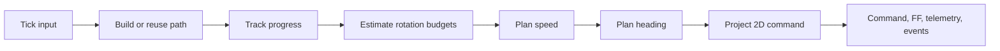
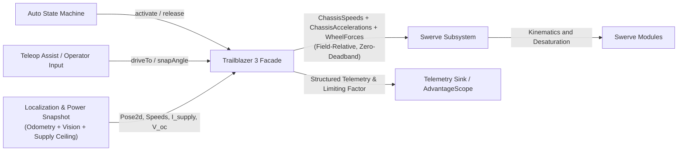

# Trailblazer 3 Spec Overview

Trailblazer 3 is a clean-sheet Java path-planning and motion-control library built for the **new 2027 robot**, with zero legacy Trailblazer 1 or 2026 robot dependencies. It replaces PID-to-endpoint control with rounded paths and explicit acceleration, braking, and turning limits, replans every loop from measured motion, and keeps all authoring in code.

---

**Implementation scope.** Follow the [Trailblazer 3 roadmap](08-implementation-roadmap-and-migration.md), including the headless Java scenario runner and CI reports. The [VS Code preview app and warm-JVM worker](deferred/vs-code-preview-app.md) are deferred. Begin that work only when explicitly requested.

## 1. Trailblazer 1 vs. Alternatives

| Metric                        | Trailblazer 1                            | Choreo                                        | PathPlanner                             | 254 Hermite Splines                   | Trailblazer 3                                                                       |
| :---------------------------- | :--------------------------------------- | :-------------------------------------------- | :-------------------------------------- | :------------------------------------ | :---------------------------------------------------------------------------------- |
| **Indexed by**                | Heuristic $t \in [0, 1]$ per point       | Clock time $t$                                | Clock time $t$                          | Arc length $s$ or time $t$            | **Path distance $s$ (Horizon)**                                                     |
| **Bump / Collision Recovery** | Jerky; target jumps when index advances  | Poor; setpoint runs ahead in time             | Moderate; PID winds up unless replanned | Moderate; needs high cross-track gain | **Re-solves from current state; explicit recovery policy**                          |
| **Cornering**                 | Straight line to point; snaps direction  | Full offline $C^2$ OCP + wheel forces         | Bézier centripetal clamp                | Curvature-bounded $\kappa(s)$         | **Circular fillets (margin-reserved) + 2-pass speed profile + 7-set 2D projection** |
| **Accel vs. Braking**         | Limits speed-up; no mid-path brake limit | Asymmetric (offline motor torque-speed)       | Symmetric scalar limits                 | Symmetric                             | **Asymmetric braking vs. live supply/stator-limited motor curve**                   |
| **Heading Control**           | Tied to waypoints; flips mid-arc         | Coupled offline                               | Independent profile                     | Coupled or decoupled                  | **Decoupled schedule $\theta^*(s)$ with error-frame feedforward + hard/soft gates** |
| **Dynamic / Vision Goals**    | Supported via `Supplier<Point>`          | Offline only                                  | Limited                                 | Requires re-splining                  | **Built-in online evaluation**                                                      |
| **Preview & Testing**         | None (must run on carpet)                | Desktop GUI                                   | Desktop GUI                             | Sim scripts                           | **Headless Java runner + CI simulation**                            |

---

## 2. Core Design Rules

### Everything in code

Define paths in Java so the code is the single source of truth. [Tooling spec](05-developer-tooling.md)

### Replan every loop

Use fresh measurements each loop to respond to how the robot actually moved, and reuse the path geometry when it still applies. [Runtime spec](04-runtime-integration-and-teleop-assist.md)

### Let autos specify goals and tolerances

Autos say where to go and how close is good enough, so the planner can use robot physics to choose corner radii and speeds.

### Start with physics and verify on carpet

Use CAD and motor estimates as a starting point, then test each robot on carpet to confirm its limits and controller defaults. [Calibration spec](07-empirical-calibration-routine.md)

### Enforce limits and recover when needed

Check the speed profile and final command against the robot’s combined driving and turning limits, and use explicit recovery when the measured motion is already outside what the model allows.

### Run the same planner everywhere

Pass time and robot state as inputs so desktop tests and CI can run the same planner as the target 2027 robot controller (e.g., SystemCore).

### Clarity

- Log robot telemetry and the active speed constraint each tick so developers can see what happened in logs.
- Publish CI check results and previews so reviewers can see how a change affects an auto. [Verification spec](06-verification-simulation-and-ci.md)

---

## 3. End-to-End Runtime Pipeline

The planner runs once per robot control loop. Each update is a **tick**. It takes a `TickInput` and returns a `TickResult`.

1. Build or reuse the path through the next terminal goal (`Goal.stop` or `Goal.cruiseThrough`). [Geometry spec](01-path-geometry-and-kinematics.md#4-planning-horizon)
2. Project the measured pose onto the path to get $s_{meas}$, $e_{xt}$, and corridor-gated $s_{high\_water}$. [Geometry spec](01-path-geometry-and-kinematics.md#52-local-projection-and-progress)
3. Estimate noise-free per-node rotation budgets $(v_{max,eff,k}, a_{fric,eff,k})$ along the spatial horizon. [Heading spec](03-heading-and-rotation.md#5-swerve-wheel-speed-friction--spatial-budget-allocation)
4. Plan speed along the path: run backward braking and forward acceleration passes, then evaluate lookahead ($s_{eval,v}, s_{eval,t}, v_{profile}$). [Velocity spec](02-velocity-profiler-and-limits.md#3-two-pass-spatial-horizon-profiler)
5. Step the bounded heading reference in the moving-target error frame using $v_{profile}$ and compute $(\omega_{cmd}, \alpha_{cmd})$. [Heading spec](03-heading-and-rotation.md#3-angular-motion-profiling--feedforward)
6. Project the combined translational + cross-track/terminal demand onto the 7-constraint admissible set and emit field-relative `ChassisSpeeds`, `ChassisAccelerations`, and optional wheel-force feedforwards. [Velocity spec](02-velocity-profiler-and-limits.md#5-cross-track-control-stop-convergence-7-set-2d-projection--feedforwards)

The runtime keeps state between ticks, handles tick inputs and outputs, and manages when plans start and stop. [Runtime spec](04-runtime-integration-and-teleop-assist.md)

---

## 4. Subsystem Architecture

Trailblazer 3 is decoupled from low-level drivetrain motor control and high-level match state machines.

### 4.1 Separation of Responsibilities

1. **Auto State Machine:** Runs overall autos and uses `passedMarker` and `atGoal` to transition states.
2. **Trailblazer:** Solves path geometry, velocity, and heading, emitting field-relative `ChassisSpeeds`, noise-free `ChassisAccelerations`, and optional module `WheelForces` feedforwards.
3. **Swerve Subsystem:** Executes TB3's closed-loop trajectory command (`ChassisSpeeds`, `ChassisAccelerations`, and optional `WheelForces`) with zero command deadband.
4. **Localization & Power Snapshot:** Fuses wheel odometry and vision into field-relative `Pose2d` and `ChassisSpeeds` normalized to `TimeSource`, paired with optional instantaneous drive supply-current ceiling and resting battery voltage.

### 4.2 Math and Runtime Separation

To make sure math vs. logic is easy to find, they're in separate places.

| Package / boundary | Responsibility                                                                                            |
| :----------------- | :-------------------------------------------------------------------------------------------------------- |
| `model`            | Immutable plans, resolved inputs/results, limits, and stable IDs                                          |
| `math`             | Pure geometry, projection, profiling, heading, and constraint calculators; explicit state and `dt`, no IO |
| `runtime`          | Activation, state transitions, target supplier evaluation, events, and cached output                      |
| Robot integration  | Localization snapshots, drive-source selection, controls, telemetry, and drivetrain output                |

### Extra Notes

- Keep season-specific field definitions and robot configuration outside shared part.
- Any tooling should use the same model/math/runtime without constructing hardware.
- Define TB3's own clean trajectory command and axis-ownership interface for the 2027 drivetrain rather than inheriting legacy 2026 `DriveSource` constraints (use a thin adapter only if running optional carpet tests on a prior testbed).
