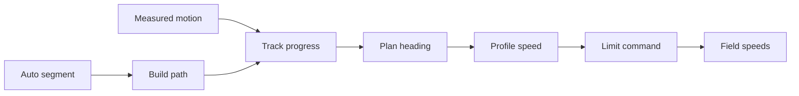

# Trailblazer 3

- [Write and test autos](../../../../../../../../docs/writing-autos-tb3.md).
- [Run the comp testbed](../../../../../../../../docs/trailblazer-3-testbed.md).
- `model`: goals, segments, limits, results, and tuning values.
- `math`: geometry, heading, speed profile, and command limits.
- `runtime/Trailblazer`: progress, markers, completion, and recovery.
- `config/Field2026`: field dimensions and keepouts used by robot and preview.
- `preview`: the desktop runner and VS Code worker.

## Behavior

- Paths use straight lines and circular corner blends.
- Speed planning accounts for acceleration, braking, curvature, and rotation.
- Heading can follow fixed angles, path travel, or a field point.
- Markers record passed waypoints. Stops require settling; moving finishes allow handoff.
- The runtime recovers onto the fixed segment geometry via unified cross-track and velocity control.
- Autos own mechanism and bump crossing state machines.

## Notes

- [Geometry](01-path-geometry-and-kinematics.md)
- [Speed and limits](02-velocity-profiler-and-limits.md)
- [Heading](03-heading-and-rotation.md)
- [Runtime](04-runtime-integration-and-teleop-assist.md)
- [Tooling](05-developer-tooling.md)
- [Verification](06-verification-simulation-and-ci.md)
- [Calibration](07-empirical-calibration-routine.md)
- [Integration status](08-implementation-roadmap-and-migration.md)
